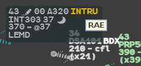
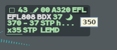
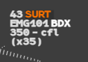
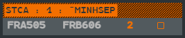

Besides the [safety nets](/5g-atm-doc/alerts/safety-nets/), g-atm watches each flight's
trajectory and data and reports what needs your attention in **line 0** of the label. The
colours follow the [alert levels](/5g-atm-doc/alerts/safety-nets/#alert-levels); the 4F
terms are in the [Glossary](/5g-atm-doc/reference/glossary/).

## @SFL (DSAM)

The selected level (SFL) the pilot has set differs from your CFL. On a RESP flight, line 0
shows `@` and the SFL, in orange (`@19`). The alert ends as soon as the SFL equals the CFL.

- After you enter a CFL, g-atm waits **10 seconds**, the time for the pilot to set it.
- When the SFL changes under an unchanged CFL, the alert comes at once.

The delay is a local setting: **Tools → External Applications → Local Settings → DSAM
Delay**, 10 s or 15 s. See [Local Settings](/5g-atm-doc/reference/local-settings/).

:::note[IVAO]
The selected level comes only from the simulator: on the network there is no @SFL alert.
:::

## CLAM

The CLAM (cleared level adherence monitoring) warns that a RESP flight deviates from its
CFL by more than **400 ft**: it levels off early, overshoots, does not start, or goes the
wrong way. **CLAM** shows in yellow.

It ends when the flight is back on its profile: within 200 ft of the CFL, or climbing or
descending towards it again. There is no CLAM when you entered the CFL while the flight had
not reached the previous one: the monitor arms only once the flight is level. After a CFL
entered on a level flight, the pilot has 60 seconds to start.

## INTRU

A flight is in your sector's area of responsibility, or about to enter it, while your sector
is not served for it: it is SURV, AUTRE, PREPA not coordinated, or a track without a plan.

| Look | When |
|---|---|
| **INTRU** yellow | The flight is in your volumes |
| **INTRU** blue | The flight will enter within 4 minutes (straight-line extrapolation) |

Hover it: the tooltip names the sector the flight is on frequency with. **Right click** the
blue INTRU to acknowledge it: it leaves the base label and stays in the selected label. The
yellow one cannot be acknowledged. The alert ends when the flight leaves your volumes or its
plan changes. The flight is kept on the picture whatever your filters.

A flight a neighbour holds while it wanders into your volumes keeps the alert. A flight you
transferred or released is not an intruder. A flight you [skipped](/5g-atm-doc/frequency/skip-shrq/)
is still reported.

## iNS alert

The NS field shows a sector you chose (a [prepared sector](/5g-atm-doc/frequency/transfer/#preparing-the-ns-prepa-ns),
or the target of a manual transfer) that is not the profile's next sector. Up to
**10 minutes** before the flight enters the planned sector, the **iNS** symbol appears after
the NS field, blue on a dark block. Its tooltip names the sector crossed: `Crossed : RAE`.

**Right click** acknowledges it; the acknowledgement holds as long as the prepared sector
stays. The same symbol also tells the previous sector about a
[SKIP](/5g-atm-doc/frequency/skip-shrq/). The 3.0 booklet calls it iNS; the V2.1 called it
NEXT.

## Clearance aids

### XFL/CFL discrepancy and CPDLC dialogue pending

When you transfer a flight whose CFL is not its XFL, or while a CPDLC dialogue is pending,
the **Transfer Confirmation** window asks you to confirm. See [Transfer
Confirmation](/5g-atm-doc/frequency/transfer/#transfer-confirmation).

### EFL/CFL discrepancy

The previous sector did not keep the agreed entry level. On an assumable flight whose CFL is
not its EFL, **EFL** shows at the end of line 0, in label colour; its tooltip gives the EFL
(`350`). It goes when you assume the flight. An EFL that g-atm only proposes (in brackets) is
not an agreed level and raises nothing.

## Transponder codes

An emergency code shows its mnemonic in line 0, orange on a dark block, and keeps the track
on the picture whatever your filters:

| Code | Mnemonic |
|---|---|
| 7500 | `HJCK` |
| 7600 | `RDOF` |
| 7601 | `RVMC` (radio failure, new in 3.0) |
| 7700 | `EMRG` |
| 7400 | `SURT` |
| 5677 | `ATTN` |

A flight on one of these codes gets no [CODE alert](/5g-atm-doc/correlation/alerts/#code).
For other special codes see [VFR, military, special
codes](/5g-atm-doc/particular/vfr-mil/).

:::caution[Not in g-atm]
Non-emergency codes (Ne-SSR) can show a short message in line 0 by local parameter. The
booklet gives no code for its examples (`SAR`, `RVTL`), and g-atm's table is empty: no
Ne-SSR message appears.
:::

## RVSM equipment

g-atm reads the RVSM equipment from the filed plan (`W` in item 10a, `STS/NONRVSM`). An APL
counts as equipped. A defect shows as:

| Mnemonic | Means |
|---|---|
| `noW` | Not equipped |
| `exW` | Exempted |
| `unW` | Unknown |

- Outside RVSM airspace, the defect shows only in the selected label (line 0, label colour)
  and in yellow in the **INFO** tab.
- As soon as the flight gets a CFL between FL290 and FL410, or is physically in that band,
  the defect turns to an alert: yellow on a dark block, in the base label too.

To change the equipment, **left click** the RVSM field of the INFO tab: the **RVSM** menu
offers **Equipped**, **NOT Equipped** and **Exempted**. Your choice stays on your position.

## STS

The mission of the STS/ field of the plan (MEDEVAC, SAR…) shows in line 0 of the selected
label only, in label colour. To see it in the base label, highlight it: see [Highlights,
warnings, Track Ring](/5g-atm-doc/markings/highlights/).

## IDENT

When the pilot presses IDENT, **IDENT** shows in line 0 in label colour, until the
transponder leaves the ident mode.

## Window framing

A window that hides a label carrying a critical, alert or warning mention gets an **orange
frame**, title bar included, so that the alert under it is not missed.

## System corruption

An orange **?** on a one-character block in line 0 says the flight's data cannot be
trusted. Its tooltip says which case:

- `Data related to this flight are corrupted`;
- `Assume Lost`. Take the flight again with Force Assume to clear it.

:::note[IVAO]
The network has nothing like it: only a simulation raises this alarm.
:::

## Outdated AFL

The age of the actual level (AFL) is the age of the last position received:

| Age | Display |
|---|---|
| Over 12 s | AFL in yellow |
| Over 15 s | `afl` instead of the level, and the symbol of an extrapolated track while the position is old |
| Over 30 s | The track is lost: see [FPASD and lost tracks](/5g-atm-doc/correlation/lost-tracks/) |

The correlation alerts (CODE, @FID, DUPE) are on [Correlation
alerts](/5g-atm-doc/correlation/alerts/).

---

*4-Flight booklet 3.0: §12.3–12.10 (p. 145–155).*
