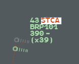
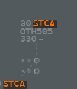
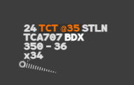
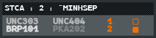

The safety nets warn you of a loss of separation (STCA, TCT) or of a flight entering an
active military area (APW). Like every alert, they show as a mnemonic in **line 0** of the
label. The 4F terms are in the [Glossary](/5g-atm-doc/reference/glossary/).

## Alert levels

Each line 0 mention has one of five levels, told apart by colour:

| Level | Look | For example |
|---|---|---|
| **Critical** | Red text on a block that flashes white and dark | STCA, TCT 1 |
| **Alert** | Orange on a dark block | STCA Info, TCT 2, emergency codes, @SFL, LOST |
| **Warning** | Yellow on a dark block | CLAM, INTRU, RVSM defect, STLN on the position that lost the flight. APW: yellow, no block |
| **Action** | Blue on a dark block | CODE, @FID, DUPE, INTRU ahead, SHRQ received, DELEG |
| **Info** | Label colour | IDENT, SKIP, EFL |

A window that hides a label in alert gets an orange frame: see [Window
framing](/5g-atm-doc/alerts/monitoring/#window-framing). The other alerts are on
[Monitoring and other alerts](/5g-atm-doc/alerts/monitoring/).

## STCA

The STCA (short term conflict alert) uses **radar data only**: positions, ground speeds and
rates, not your clearances and not the selected level. It extrapolates each flight in a
straight line and tests two vertical hypotheses; it alerts if either one predicts a loss of
separation.

| | HM3 | HM2 |
|---|---|---|
| Vertical model | Current rate plus 30 % | Stops at the next whole flight level (IFL) above a climbing flight or below a descending one |
| Look-ahead | 120 s | 70 s |
| Horizontal separation | 4.9 NM | 4.9 NM |
| Vertical separation, RVSM | 740 ft | 500 ft |
| Vertical separation above FL410 | 1800 ft | 1000 ft |

The alert stops when no loss is predicted any more, or when the flights diverge with more
than 4.4 NM between them. Flights slower than 70 kt are ignored.

When at least one of the two flights concerns you (RESP, PREPA coordinated, assumable, SURV,
or an uncorrelated track in your area), the STCA is **critical**:

- **STCA** in red in line 0, on a block flashing white and dark;
- the leader lines of both labels turn red;
- the [Alert List](#alert-list) pops up;
- both flights stay on the picture whatever your filters.

### STCA Info

When neither flight concerns you (AUTRE, PREPA not coordinated, uncorrelated outside your
area), the alert is **STCA Info**: STCA in orange, no flashing, no Alert List row. It shows
while at least one of the two flights is on your picture by itself, and stops when both
leave your filters. It forces no flight onto the picture, but a contextual filter keeps the
flights that carry it.

## TCT

The TCT predicts a loss of separation from **clearances**: actual
level, CFL, rate and heading. At least one of the two flights must be RESP. Separation is
5 NM and 1000 ft.

The level each flight is heading for is:

1. its CFL, if a position of your centre holds the flight and the CFL can be reached;
2. otherwise its selected level (SFL), known only in a simulation;
3. otherwise, while it climbs or descends, the next whole flight level.

A CFL counts as soon as you enter it: a level flight just given a new CFL is modelled at the
rate of its aircraft type. The TCT can therefore appear or go the moment you enter a CFL.

| Level | Look | When |
|---|---|---|
| **TCT 1** | Critical, flashing like the STCA; red leader lines; Alert List | Conflict in less than 2 minutes, or in 2 to 3 minutes when the vertical gap is under 1700 ft or the flights close faster than 10 NM per minute |
| **TCT 2** | Orange | Conflict in 2 to 4 minutes |

A flight can carry both: STCA first, then TCT, on the same line 0.

## Alert List

The Alert List shows the pairs of flights in critical STCA or TCT 1, one row per pair even
when the pair has both alerts. It pops up with the first pair and goes with the last; it has
no cross and no column headers. g-atm never saves it in a standard configuration.

Its title counts the pairs: `STCA : 2 : ˆMINHSEP`. Each row gives:

- the two callsigns in their state colours. **Left click** either one: its Callsign Menu;
- the minimum horizontal separation predicted, in whole nautical miles, in orange;
- a box you can tick for yourself. It has no other effect: the alert ends only when its
  conditions end.

## APW: Area Proximity Warning

The APW warns you that a flight is in, or about to enter, an active military area or TSA,
buffer included. **APW** shows in yellow in line 0, without a block; its tooltip names the
area or areas.

The APW watches a flight that is:

- civil IFR, correlated (full plan or APL), not holding;
- PREPA coordinated, assumable, assumed, shot, skipped or stolen.

It alerts when the flight is inside the area plus its buffer (2 NM, 500 ft), or when its
radar extrapolation (heading, ground speed and rate, stopped at the CFL) enters it within
3 minutes. A flight off its planned route is covered, since g-atm follows the flight, not
the route. The alert is recomputed at each radar update and stops by itself.

- **Right click** APW: it leaves the base label and stays in the selected label.
- **Right click** it again in the selected label: it comes back.

:::note[IVAO]
The areas are the active special areas of your centre in the IVAO API, the ones drawn on the
picture. g-atm reads them every 5 minutes, so an area activated in between alerts up to
5 minutes late. The API does not reliably tell military areas from TSAs: every area with a
polygon counts. Without an IVAO API key, and so in a simulation, there are no areas and no
APW.
:::

The buffer, the 3-minute notice and the inhibited flows (transits allowed by letter of
agreement, none by default) are fixed values, not in Local Settings.

---

*4-Flight booklet 3.0: §12.1–12.2 (p. 137–145).*
