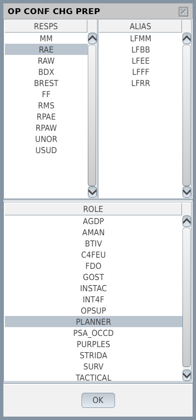

The **OP CONF CHG PREP** window is where you choose what your position works: a sector or
a group of sectors (a responsibility), and a role. Everything follows from that choice:
the flights you are responsible for, the standard configuration, the frequency and the
datalink station.

## The Mode and OE fields

Two fields in the middle of the Global Menu say how the position is set up.

| Mode field | OE field | Meaning |
|---|---|---|
| `FREE` | `------/------` | No responsibility, no role |
| `PREPA` | `<alias or resp>/<role>` | Prepared: a responsibility and a role are chosen, the session is not open |
| (empty) | `<alias or resp>/<role>` | Armed: chosen and the session is open |


The OE field is cut at 18 characters. **Hover** it: a tooltip lists the elementary
responsibilities of the position (for example `RAW RAE` for a grouping of both). The
**Status** menu repeats the same text, read-only.

## Choose a responsibility and a role

1. Left click the **OE field**. The **OP CONF CHG PREP** window opens under it.
2. In **RESPS**, left click a responsibility to work it alone, **or** in **ALIAS**, left
   click an alias to work the whole group. Selecting one clears the other.
3. In **ROLE**, left click your role.
4. Left click **OK**.



The lists are in alphanumeric order, with the entries of the centre whose sector file is in
service first. When you reopen the window, your current choice is selected.

**OK** stays greyed until you have chosen a Resp or an Alias **and** a role, and the choice
resolves to real sectors. Hover the greyed button: its tooltip says what is missing or what
is wrong. Names that the sector file does not know but that do not block (see
[`sectorfile`](#an-alias)) also show in that tooltip, with **OK** active.

### What OK does

- If the responsibility belongs to an alias written for another sector file, g-atm puts
  that sector file in service first, then applies your choice: one click is enough.
- The sectors are applied to the flight states, the label filtering and the lists.
- The frequency of the responsibility is announced to the network at once, without
  reconnecting.
- If datalink is set up and you are connected, the CPDLC station switches to the logon
  codes of the responsibility (see [Setting up datalink](/5g-atm-doc/cpdlc/setup/)).
- The standard configuration of the new position (`<resp>/<role>`) applies, at once or
  after the OE REV, depending on the change: see
  [Splitting, grouping, roles](/5g-atm-doc/cco/regrouping/).

## PREPA mode: prepare before the session

Choose a responsibility and a role **before** you open your network session: the Mode field
shows **PREPA** and the standard configuration of that position is loaded (filters, maps,
zoom and centre of the picture). Adjust your picture as you like.


When the session opens, the position is armed: the Mode field empties and the standard
configuration is recalled, overwriting what you changed in PREPA mode. A session that
reopens on a position already armed (after a network cut) recalls nothing.

When an armed position closes its session it goes back to PREPA mode, its choice kept. To
leave a position, close the session.

:::caution[Not in g-atm]
On the real 4F, a position in PREPA mode already shows the traffic of its future sectors, in
OTHER format, with only SEP and QDM available. In g-atm you receive traffic only once your
session is open, and the session arms the position: there is no PREPA traffic view. A FREE
position with an open session works on its connection callsign.

The real 4F offers the window only to a FREE position; the room supervisor does the rest.
g-atm has no supervisor: the window stays available on an armed position, and that is how
you split, group or change role.
:::

## op_config.json

The window lists what `op_config.json` describes: the responsibilities your centre can open,
how they group, and the roles. The file is in the application data folder
(`%APPDATA%\com.jules.g-atm\op_config.json`). It is not created for you: write it once for
your centre. See [Files and folders](/5g-atm-doc/reference/files/).

When you connect to a server that is not IVAO (a simulation), g-atm reads
`op_config_simu.json` instead, if it exists (see
[Joining a simulation](/5g-atm-doc/simulation/joining/)).

```json
{
  "roles": ["TACTICAL", "PLANNER"],
  "config": [
    {
      "alias": "LFMM",
      "sectorfile": "CRNA SE - Marseille",
      "resps": [
        {
          "sector": "RAW",
          "callsign": "LFMM_W_CTR",
          "frequency": "132.365",
          "cpdlc": { "logon": "LFM1", "fallback_logons": ["LFM2"] },
          "subsectors": ["W1", "W2"]
        },
        {
          "sector": "RAE",
          "callsign": "LFMM_E_CTR",
          "frequency": "125.100",
          "cpdlc": { "logon": "LFM3" },
          "subsectors": ["E1", "E2"]
        },
        {
          "sector": "MM",
          "callsign": "LFMM_CTR",
          "frequency": "128.200",
          "cpdlc": { "logon": "LFMM" },
          "subsectors": ["RAW", "RAE"]
        }
      ]
    }
  ]
}
```

The sector file name, sector names, frequencies and codes above are examples: use those of
your sector file and your centre.

### `roles`

The roles offered in the **ROLE** list (sorted alphabetically there). The role is part of
the position: it is the second half of the OE field and of the standard configuration key,
and changing it is a total change of mapping.

### An alias

| Field | Required | Meaning |
|---|---|---|
| `alias` | yes | Name of the centre or group, shown in the **ALIAS** list |
| `sectorfile` | optional | The sector file this alias is written for |
| `resps` | yes | The responsibilities of the alias |

**`sectorfile`** names the sector file by its file name (the path, the case and the `.isc`
extension do not matter, but the name must match exactly: `CRNA SE - Marseille` or
`CRNA SE - Marseille.isc`). It has two effects:

- choosing a responsibility of this alias puts that sector file in service if another one
  is loaded, and its entries come first in the lists while it is in service;
- unknown `subsectors` become **warnings** instead of errors: the sectors that do resolve
  light up.

Without the field, any unknown name blocks the choice.

### A resp

| Field | Required | Meaning |
|---|---|---|
| `sector` | yes | Name of the responsibility, shown in the **RESPS** list |
| `subsectors` | yes | What it is made of: names of other resps of the same alias, or of real sectors of the sector file |
| `callsign` | recommended | Position callsign, for example `LFMM_W_CTR`. Used for the LOAs and coordination, and to recognise the position of a colleague |
| `frequency` | recommended | Frequency announced to the network once the resp is validated |
| `cpdlc` | optional | Datalink station: `logon`, and `fallback_logons` tried in order if the code is taken |

CPDLC station codes are four letters with no underscore (`LFM1`, not `LFMM_W_CTR`).

### How subsectors resolve

For every name in `subsectors`, in order:

1. if it is **another resp** of the same alias, it is expanded, recursively;
2. otherwise, if it is a **real sector** of the sector file, it is kept;
3. otherwise it is an **error** (or a warning, with `sectorfile`).

In the example, `MM` lists `RAW` and `RAE`, which expand to their four real sectors.
Duplicates are dropped, your order is kept, and circular references are reported.

When you choose a whole **alias**, the callsign, frequency and CPDLC station are those of
the resp that covers the whole alias (`MM` in the example). If no single resp covers it,
they are left unset and you keep those of your connection.

### Messages

The messages of the OK tooltip are in French:

| Message | Meaning |
|---|---|
| `op_config.json introuvable (AppData)` | The file does not exist yet |
| `structure invalide (roles[] et config[] attendus)` | The top level must hold a `roles` array and a `config` array |
| `Choisir une Resp ou un Alias`, `Choisir un rôle` | A choice is missing |
| `Secteur «X» inconnu (…)` | `X` is neither a resp of the alias nor a sector of the sector file |
| `Référence circulaire dans op_config.json` | Two resps list each other |
| `Aucun secteur résolu pour …` | The resp expands to nothing |
| `Sectorfile «X» introuvable` | The `sectorfile` named is not among your sector files |

---

*4-Flight booklet 3.0: §14.1.b (p. 181–183), §14.4 (p. 186–187).*
