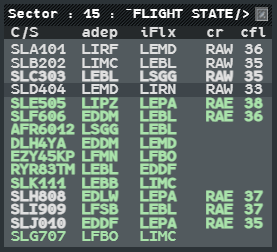

A configuration change (CCO) splits a group of sectors, groups sectors, or changes a role.
You prepare it by checking which sector each flight is on frequency with, then you change
the mapping of your position and acknowledge it when you are ready.

## Comm Resp

The **Comm Resp** (CR) is the sector the flight is on frequency with, as entered in the
system. On a position that holds several responsibilities, g-atm sets it, when the position
takes the flight, to the first of your responsibilities the flight crosses: the one it is in,
or the one it reaches first. After that it changes only when you change it.

Before a split, each flight should carry the Comm Resp of the volume it will be in after the
split. Change it with the **Chg Com Resp** menu: **left click** the `cr` field of the
extended label, or the `cr` cell of the Sector List. The menu is described in
[SKIP, SHRQ, Reclaim, LOST, Comm Resp](/5g-atm-doc/frequency/skip-shrq/).

A position with a single responsibility has nothing to choose: its flights carry its name.

## The Sector List

The Sector List helps you find the flights whose Comm Resp must change. Open it from
**Tools → Flight Lists → Sector Lists → Sector**.

| Column | Meaning |
|---|---|
| `C/S` | Callsign, in the colour of the flight state; bold while Not Seen |
| `adep` | Departure |
| `iFlx` | Inbound flux |
| `cr` | Comm Resp. **Left click**: the Chg Com Resp menu |
| `cfl` | Cleared level |

The column menu also offers `ades`, `efl`, `xfl`, `ns` and `atyp`.

The list opens sorted by flight state then CFL (`^FLIGHT STATE/ CFL`, cut in the title as
`^FLIGHT STATE/>`): the assumed flights first, by CFL from highest to lowest, then the other
flights by state, each by CFL from highest to lowest. **Shift + left click** a column header
for another sort (by `iFlx`, for example). It shows 30 flights before a scrollbar. The
common list gestures are in
[Sequencing arrivals](/5g-atm-doc/traffic/sequencing/#working-in-a-list).

## Change the mapping

On the real 4F the room supervisor changes the mapping. g-atm has no supervisor: you do it
yourself in the **OP CONF CHG PREP** window, on an armed position too (see
[OP CONF and PREPA mode](/5g-atm-doc/cco/op-conf/)). Choose the new responsibility (or alias)
and press **OK**.

g-atm then compares the old and the new mapping:

| Change | When | What happens |
|---|---|---|
| **Total** | From FREE to a responsibility, a change of role, or no sector in common | The standard configuration of the new position applies at once |
| **Partial** | Same role, some sectors kept (a split or a grouping) | The OE field goes into **REV** |

### The OE REV

After a partial change, the OE field turns **blue**, joined to the blue block of the voice
icon.

While the REV waits:

- the flight states, the next sectors and the responsibilities of the Chg Com Resp menu
  already follow the **new** mapping;
- the standard configuration (filters, maps, zoom, centre of the picture, lists) and the
  sector boundaries on the picture stay those of the **old** mapping.

Check your new sectors (hover the OE field for the list), then, when you are ready,
**left click or right click the OE field**. The position goes to the standard
configuration of its new mapping, sector boundaries included.

Do not forget to acknowledge the REV: until then, your picture settings and the sector
boundaries you see are the old ones. Going back to the mapping whose standard is applied
leaves nothing to acknowledge.

### What happens to the flights

- Each flight state is recomputed for the new mapping, and so are the next sector and the
  transition levels.
- A flight that becomes yours through the change appears **Not Seen**. Flights you had
  already seen stay Seen, and your markings stay on your position.
- Between g-atm positions of the same centre, a flight you hold whose Comm Resp is a
  responsibility you no longer hold is transferred to the g-atm position that now holds it,
  and that position takes it without a gesture. Only the radar controller (role
  `TACTICAL`) receives such flights. The other flights stay with you.

:::note[IVAO]
On the real system a flight belongs to whoever holds the responsibility of its Comm Resp.
On IVAO a flight belongs to the callsign that assumed it, so g-atm hands it over with a
network transfer, and only to a g-atm position. With a controller on another client,
transfer the flights yourself.
:::

What the other g-atm positions copy at a change (iCoor, warnings, Datablocks…) is in
[Sharing between positions](/5g-atm-doc/cco/sharing/).

## Grouping

Grouping is a configuration change like the others: choose the alias or the resp that
covers the group, press **OK**, acknowledge the OE REV. If the positions you take over run
g-atm, their duplicated objects (iCoor, warnings, Datablocks…) are copied to you and replace
yours; when two disagree, the last one written wins (the last warning colour, for example).

:::caution[Not in g-atm]
- **Moving a position** (copying a whole position to another one) needs a second working
  position: not done.
- **Returning to FREE by giving all your sectors**: close the session instead.
- **Military areas by responsibility**: the sector data have no such setting, so no area
  appears or disappears with the mapping.
:::

## Roles

The role is the second half of the OE field. It selects the standard configuration of the
position (`<resp>/<role>`), and changing it is a total change of mapping. At a split, only a
`TACTICAL` position receives the flights handed over by another g-atm position.

:::note[Next version]
**The PLANNER role.** In the next version, a position whose role is `PLANNER` follows the
radar controllers of its responsibility:

- the controllers followed are the position callsigns (`callsign` in `op_config.json`) of
  the resps your choice covers entirely, plus the g-atm positions holding the same
  responsibility. Choose an alias grouping two sectors and you follow both radar
  controllers;
- their flights show as **RESP** on your picture (colour, states, REV), but you do not take
  network control: the radar controllers keep the flights, and assume, transfer and clear
  them;
- PREPA and SURV are computed over the union of their volumes. A flight released or
  transferred by them stays SURV in your area of interest;
- it works from an observer connection (for example `BREST/PLANNER` on an `_OBS` callsign
  seeing the flights of the centre's `_CTR` as RESP), and the radar controllers do not need
  g-atm;
- their private transfer offers and their local coordination data are not mirrored.
:::

---

*4-Flight booklet 3.0: §14.1.a, §14.1.c, §14.2 (p. 179–185).*
