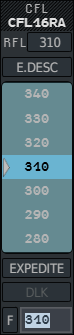
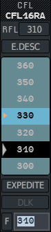
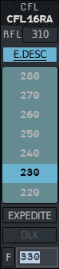
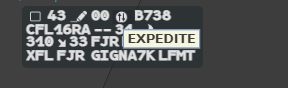

Every clearance you give is entered on the label, in a value menu: a level, a point, a
heading, a speed or a rate. This page explains how those menus behave, then the first of
them, the CFL (cleared flight level) menu.

## How clearance menus work

All the clearance menus of this chapter share the same logic.

| Gesture | Effect |
|---|---|
| **Left click** on a label field | Opens its menu, where you clicked |
| **Mouse wheel** over the list | Scrolls the values |
| **Left click** on a value | Validates it and closes the menu |
| Typing, then `Enter` | Validates the typed value |
| **Right click** inside the menu, or any click outside it | Leaves without validating anything |
| `Esc` in the entry field | Same |
| **Middle click** on a value | Prepares it instead of giving it (CFL and Waypoint menus) |

A few things hold for every menu:

- The menu opens with the useful row **under the pointer**: a second left click without
  moving validates it.
- The entry field at the bottom has the keyboard focus as soon as the menu opens. You can
  type straight away.
- In the lists, a **grey triangle** marks the flight's reference value (each menu says
  which), a **black row** is the value already in force, and an **orange triangle** marks
  a prepared value.
- The label keeps its format (selected or extended) while one of its menus is open, so you
  can still read it.
- Right click on a value **on the label** usually removes it (heading, speed, rate,
  Expedite). Each page says which.

When the pointer becomes a cross, the application is waiting for you to pick one or more
flights (to build an analysis group, for example). See [Group, SEP, QDM,
CPA](/5g-atm-doc/conflicts/group-sep-qdm/).

## The CFL menu

**Left click the CFL field** of the label. The menu opens over it.

The flight above is cleared at 310 (black row), its exit level is 310 (grey triangle), and
the field already holds 310, selected, ready to be overwritten.

| Element | What it does |
|---|---|
| Title and callsign | The callsign is in the label's colour |
| **RFL** button | The requested level of the flight plan. Click it to clear that level |
| **E.DESC** | Emergency descent, see below |
| Level list | FL010 to FL450, seven rows visible. The grey triangle is the flight's exit level (XFL), or its present level when it has none. The black row is its current CFL |
| **EXPEDITE** | Expedite, see below |
| **DLK** | Sends the level by datalink as well, see below |
| **F** and the field | Type a level in hundreds of feet (`350`) and press `Enter`. The field holds the current CFL, selected; it is empty when the flight has none |

The menu opens centred on the prepared level if there is one, otherwise on the grey
triangle.

:::note
Some rows may have a tinted background: they are levels outside your sector's volume.
See [Changing a level](/5g-atm-doc/profile/levels/). Holding the middle button down on a
level shows a simulated contextual filter: see [Contextual
filters](/5g-atm-doc/conflicts/contextual-filters/).
:::

The cleared level is sent on the network: every controller sees it.

## Preparing a level

You have decided what you will give, but not yet. Prepare it.

1. Open the CFL menu.
2. **Middle click** the level. The menu closes. Nothing is sent and nothing changes on the
   label.
3. Next time you open the menu, it opens **on that level**, marked with an **orange
   triangle**. A left click gives it.

To change the prepared level, middle click another one. To remove it, **Ctrl + middle
click** any level.

A prepared level is a note for your own position. Other controllers do not see it.

## Emergency descent (E.DESC)

1. Open the CFL menu and left click **E.DESC**. It turns blue, underlined.
2. Left click the level.

The label shows an orange arrow symbol on line 0, in the base and the selected format. The
flight's TaFL (the target level of its profile) is set to the cleared level at once.
While E.DESC is in force, the assigned rate takes priority over the assigned speed in the
trajectory computation (see [Speed, rate and AMID](/5g-atm-doc/clearances/speed-rate/)).

**To remove it**: open the menu (E.DESC is already pressed for this flight), click E.DESC
to release it, then click the cleared level. The symbol goes; the TaFL stays where E.DESC
put it, so set it again if needed: see [Changing a level](/5g-atm-doc/profile/levels/).

## Expedite

1. Open the CFL menu and left click **EXPEDITE**. It turns blue, underlined.
2. Left click the level.

A disc with two arrows appears on line 0 of the label. Hover it: the tooltip reads
`EXPEDITE`.

**To remove it**: **right click** the disc. Or open the menu (EXPEDITE is already pressed),
release the button and click the level.

E.DESC and EXPEDITE are independent: you can press both.

:::note
Giving a level with the button released removes its symbol. A level given from the
[AMID](/5g-atm-doc/clearances/speed-rate/#the-amid) removes both symbols.
:::

E.DESC and Expedite stay on your position: the IVAO network does not carry them.

## Sending the level by datalink (DLK)

If the flight is in a datalink session with you and you have assumed it, the **DLK**
button is active.

1. Left click **DLK** (it turns blue), or press the **CPDLC** key (`Alt`). You can do it
   before or while you type.
2. Left click the level, or type it and press `Enter`.

The level is cleared in the system exactly as a voice clearance, and the CPDLC message
goes to the aircraft. While DLK is armed, E.DESC and EXPEDITE are greyed: neither can be
sent by datalink.

Hover a greyed DLK button to see why it is greyed. What happens next, and how to read
the frame that appears around the CFL, is in [Sending
clearances](/5g-atm-doc/cpdlc/uplinks/).

---

*4-Flight booklet 3.0: §5.1 and §5.2 (p. 41–43).*
