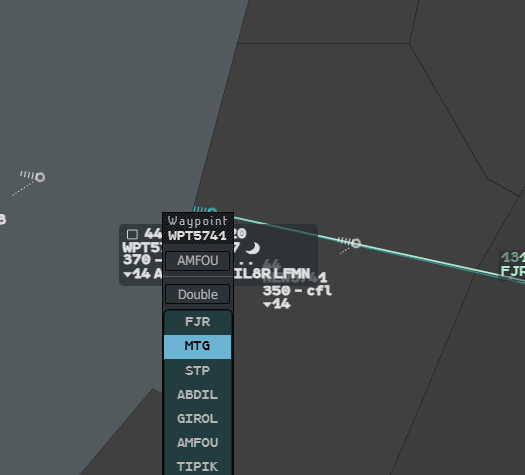
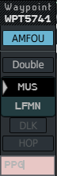
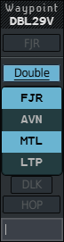
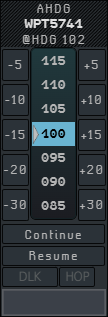

A direct goes in the **CNAV** field (the cleared point) through the **Waypoint** menu. A
heading goes in the heading field through the **AHDG** (assigned heading) menu. Both menus
work like the CFL menu: see [How clearance menus
work](/5g-atm-doc/clearances/levels/#how-clearance-menus-work).

## The Waypoint menu

**Left click the CNAV field** of the label. The menu opens with the **XNAV button under
the pointer**.

| Element | What it does |
|---|---|
| Title and callsign | |
| **XNAV** button | The exit point of the flight from your sector, from the letters of agreement. One click: direct to it. It reads `GEO` when the exit point is a geographic coordinate, and stays greyed `XNAV` when no exit point is known |
| **Double** | Double direct, see below |
| Point list | The points of the route still ahead of the flight, from its present position. Seven rows at most, the rest scrolls. The point already cleared is the black row with the grey triangle |
| **DLK** | Sends the direct by datalink as well |
| **HOP** | Always greyed: it has no use on IVAO |
| Entry field | Type a point name and press `Enter` |

### Direct to a point

Left click a point in the list (or the XNAV button). The menu closes and the flight is
cleared direct to it. The CNAV field shows the point; the list now starts at it.

**Hover** a point, or the XNAV button, before clicking: the flight's route (its Flight Leg)
appears with a **blue line** showing the direct you are about to give. Both disappear when
the pointer leaves the menu.

The direct is sent on the network: every controller sees the new CNAV.

### Typing a point

The field has the focus when the menu opens: just type.

- As soon as your letters start the name of a **route point**, that point is highlighted
  in blue in the list. `Enter` clears the direct to it.
- When your letters match **no route point**, the field turns **pink**. `Enter` then gives
  a route modification that rejoins the route, shown as a dashed line from the point to
  the rejoin point (see [Changing the route](/5g-atm-doc/profile/route/)). When no rejoin
  is possible, `Enter` gives a plain direct to that beacon, VOR or NDB; the flight resumes
  its route once past it. A geographic coordinate is refused.

### Double direct

1. Left click **Double**. It turns blue, underlined, and the XNAV button dims.
2. Left click the first point. It stays highlighted in blue.
3. Left click the second point. The menu closes.

The flight's path, on the Flight Leg and in the extrapolation, now goes from the first point
straight to the second. You can also type either point and press `Enter`.

The network carries only one point: other controllers see the direct to the first point.
Your position keeps the second, as long as the first point stays the cleared point. Any
new direct, heading or resumed navigation cancels it.

### Preparing a point

As in the CFL menu: **middle click** a point to prepare it, **Ctrl + middle click** to
remove the preparation. Nothing is sent. The menu then reopens on the prepared point,
marked with an orange triangle. The prepared point stays on your position only.

### Sending the direct by datalink

Arm **DLK** (left click, or the **CPDLC** key, `Alt`), then left click a point in the
list or the XNAV button. While DLK is armed, **Double** is greyed and a typed point does
nothing: neither a double direct nor a typed point can go by datalink. See [Sending
clearances](/5g-atm-doc/cpdlc/uplinks/).

## The AHDG menu

**Left click the heading field** (`h...`) of the selected label. The menu opens with the
heading closest to the aircraft's present heading **under the pointer**.

| Element | What it does |
|---|---|
| Title, callsign and `@HDG` | `@HDG 102` is the heading the aircraft reports |
| Heading list | In steps of 5°, in a loop (north is `360`). The grey triangle is the value closest to the aircraft's heading; the black row is the heading already assigned |
| `-5` … `-30`, `+5` … `+30` | Relative turns, left and right. They count from the assigned heading, or from the aircraft's heading when none is assigned |
| **Continue** | Assigns the heading the aircraft is flying now |
| **Resume** | Removes the heading: back to own navigation |
| **DLK** | Sends the heading by datalink as well |
| **HOP** | Always greyed |
| Entry field | An absolute heading (`250`) or a relative one (`+10`, `-20`), then `Enter` |

### On the label

- **Selected label**: the heading field shows the value, `h110`. The CNAV field keeps the
  next point of the route.
- **Base label**: a circled **H** symbol after the vertical trend says the flight is on a
  heading.

**To remove a heading**: **right click** the heading field, click **Resume** in the menu,
or give a direct to a point of the route.

The heading is sent on the network in the cleared-point field, so other controllers see it.

### Sending the heading by datalink

Arm **DLK** (left click or the **CPDLC** key, `Alt`), then choose the heading. A relative
heading is sent as the absolute heading it gives. For a flight with no Mode S heading (no
`@h` value in its label), the relative buttons are greyed while DLK is armed. **Resume** is never sent by
datalink. See [Sending clearances](/5g-atm-doc/cpdlc/uplinks/).

---

*4-Flight booklet 3.0: §5.3 and §5.4 (p. 43–44).*
