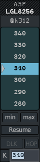
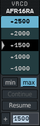
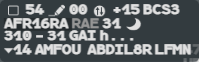
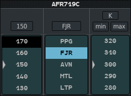

The **ASP** (assigned speed) menu and the **VRCD** (vertical rate) menu work like the CFL
menu: see [How clearance menus work](/5g-atm-doc/clearances/levels/#how-clearance-menus-work).
The **AMID** gathers level, point and speed in one window.

## The ASP menu

**Left click the ground speed field** of the label, its speed symbol, or the assigned
speed when there is one. The menu opens with the speed closest to the aircraft's own
speed **under the pointer**.

| Element | What it does |
|---|---|
| Title and callsign | |
| `@k312` / `@m.80` | The aircraft's indicated airspeed or Mach, from the Mode S line of the label. `@k...` while it is unknown |
| Speed list | 550 to 160 kt in steps of 10, or Mach .99 to .40 in steps of .01. The grey triangle is the value closest to the aircraft's speed; the black row is the assigned speed |
| **min** / **max** | Makes the speed a minimum or a maximum. Choose it **before** the speed. The two exclude each other; click again to release |
| **Resume** | Removes the assigned speed |
| **DLK** | Sends the speed by datalink as well |
| **HOP** | Always greyed |
| **K** / **M** and the field | Left click the unit to switch between knots and Mach: the list, the triangle and the field follow. Type `310` in knots, `80`, `.80` or `0.80` in Mach, then `Enter` |

The menu opens in Mach when the assigned speed is a Mach number. The field holds the
assigned speed, or the value of the grey triangle, selected.

### On the label

- **Selected label**: the assigned speed, in tens of knots (`31` for 310 kt) or in Mach
  (`.80`), after a circled **K** or **M** symbol. A maximum reads `<29`, a minimum `>30`.
- **Base label**: only the circled **K** or **M** symbol, to say the flight is on an
  assigned speed.

**To remove a speed**: **right click** the ground speed, the symbol or the assigned value,
or click **Resume** in the menu.

The speed is sent on the network. The minimum or maximum is not: it stays on your
position.

### Sending the speed by datalink

Arm **DLK** (left click, or the **CPDLC** key, `Alt`), then choose the speed, in knots or
in Mach. While DLK is armed, **min** and **max** are released and greyed: a minimum or
maximum speed cannot go by datalink. See [Sending clearances](/5g-atm-doc/cpdlc/uplinks/).

## The VRCD menu

**Left click the rate field** of the label (`00` on line 0 of the selected label, between
the pencil and the aircraft type), or the rate symbol once a rate is set.

| Element | What it does |
|---|---|
| Title and callsign | |
| Rate list | From +6000 to -6000 ft/min in steps of 500, with nothing between +1000 and -1000. It opens on the rate already set, otherwise on +1000: that row has the grey triangle, is black and is under the pointer |
| **min** / **max** | Makes the rate a minimum or a maximum. Choose it **before** the rate |
| **Continue** | Sets the rate the aircraft is flying now. Greyed in level flight |
| **Resume** | Removes the rate. Greyed when no rate is set |
| **+** / **-** and the field | Left click the sign to change it. Type the rate in whole hundreds of ft/min, up to 6000 (`1500`), then `Enter` |

### On the label

A set rate puts a **disc with two arrows** on line 0, in both formats. In the selected
label the value follows it: `+15` (1500 ft/min), `<+25` for a maximum, `>-10` for a
minimum.

**Left click** the disc or the value to reopen the menu. **Right click** to remove the
rate.

:::note
The Expedite symbol is the same disc. Expedite has an `EXPEDITE` tooltip and no value
after it. A flight that has both shows two discs, the rate first.
:::

On IVAO the rate stays on your position: the network does not carry it. It cannot be sent
by datalink either.

## Speed and rate together

A flight can have an assigned speed **and** an assigned rate. Setting one no longer
removes the other.

Both feed the trajectory computation that gives the flight's estimates (times over
points, sector entries):

- the rate replaces the aircraft's own rate until the CFL is reached: a plain rate is
  used as given, a minimum raises the aircraft's rate, a maximum caps it. Past the CFL the
  aircraft's own rate is used again;
- the speed is always kept in the trajectory, except after an emergency descent: once a
  level is given with **E.DESC**, the rate takes priority and the assigned speed is no
  longer used for the trajectory (it stays displayed). Any other level clearance gives
  priority back to the speed.

## The AMID

The AMID (Aircraft Multiple Input Device) lets you give a level, a direct and a speed in
a row, without reopening three menus.

1. Hover a label and press the **AMID** key (`Space`). The AMID of that flight opens, its
   top right corner at the pointer.
2. Left click a level, a point and/or a speed. **Each click is applied at once**: the
   lists and the label update, and the window stays open.
3. Press `Space` again, wherever the pointer is, or left click the radar picture, to close
   it. A right click inside it also closes it.

| Column | Top | List (five rows) |
|---|---|---|
| Level | The exit level: one click clears it | The CFL menu's levels, triangle and black row |
| Point | The exit point (XNAV): one click gives the direct | The route points ahead, the cleared point black |
| Speed | **K** / **M**, **min**, **max** | The ASP menu's speeds |

The AMID has no entry field, no DLK, no E.DESC, Expedite, Double or Resume. It is not
moved to stay on screen and does not close by itself: close it when you are done.

:::note
`Space` does nothing while you type in a field, or with `Ctrl` or `Alt` held: the default
push-to-talk shortcut, `Ctrl + Shift + Space`, never opens the AMID.
:::

---

*4-Flight booklet 3.0: §5.5, §5.6 and §5.7 (p. 45–47).*
