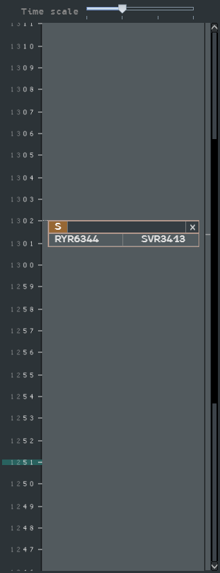
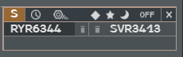
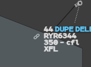

When you need a new group to analyse another conflict, you can store the first one in the
**Agenda**. Each stored group is a box called a **Datablock** (DB), placed on a time line
at the time of the conflict. Think of it as post-it notes on the fridge door.

## The Agenda window

Open it from **Tools** → **Agenda**. It also opens by itself when you create a Datablock.

- The **time line** runs from the past at the bottom to the future at the top, from
  20 minutes ago to 30 minutes ahead. The current time is on a teal band. Scroll it with
  the scroll bar or the **mouse wheel**; it opens with 5 minutes of past visible.
- **Time scale**, at the top, changes the scale in four steps.
- A Datablock hangs from its time: its top edge is on it, and a dotted line joins it to
  the hour column. A small mark in the band next to the scroll bar shows where it is in
  the whole time line.
- Datablocks move down with time. A Datablock more than **20 minutes** in the past
  disappears.

## A Datablock

At rest a Datablock shows only its level letter, its cross and its flights. Under the
pointer it opens:

| Element | What it does |
|---|---|
| **L** or **S** | Level of the Datablock: **L** local to you, **S** shared with your suite. **Left click** on **L** to share it |
| **Clock** | **Drag** it to extrapolate the group on the radar image and move the Datablock on the time line |
| **Recall** symbol | Brings the group back on the radar image |
| **Diamond, star, moon** | Puts that warning on every flight of the group (see [Highlights, warnings, Track Ring](/5g-atm-doc/markings/highlights/)) |
| **OFF** | Removes the warning |
| **Cross** | Deletes the Datablock |
| **Bin** next to a flight | Removes that flight from the Datablock |

A Datablock holds up to **8 flights**, like the group. Removing its last flight deletes it.

A new Datablock is local (**L**). Once shared (**S**) it cannot go back to local. The other
g-atm positions of your suite see shared Datablocks; see
[Sharing between positions](/5g-atm-doc/cco/sharing/).

Hovering a flight in a Datablock highlights it; hovering a Datablock highlights all its
flights on the radar image and in the lists. Flights of a Datablock are never hidden by
the filters.

## Creating a Datablock

First put the flights in a group (see [Group, SEP, QDM, CPA](/5g-atm-doc/conflicts/group-sep-qdm/)).
Then either:

- **Drag** the track symbol of one flight of the group to extrapolate, and release the
  button **while holding Ctrl**. The Datablock is placed at the time you reached; or
- **Left click** in the time line of the Agenda. The Datablock is placed at the time you
  clicked, past included.

If all flights of the group carry the same warning, the Datablock takes it.

To add flights to an existing Datablock, put them in the group, then **Ctrl + left click**
in the Datablock.

## Finding a group again from a label

A flight that belongs to one or more Datablocks shows a **link** symbol on its label.

| Gesture on the link symbol | Effect |
|---|---|
| **Left click** | Recalls the group of its Datablock. Click again to go to the next Datablock of that flight, in turn |
| **Right click** | Deletes the Datablock, only when the flight belongs to a single one |

---

*4-Flight booklet 3.0: §7.3 (p. 76–78).*
