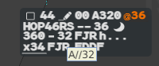
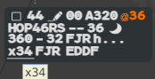

A contextual filter answers one question for as long as you hold the button: "which
flights interfere with this one?". Hold the **middle click** on a value of a label, and
the picture keeps only the flights that match it. Release, and the picture comes back.

It answers only the question you ask: it knows nothing about routes or geography.

## Using a filter

1. Point at the value you want to test on a label: CFL, XFL, iFlux, ADES or CR.
2. Press and **hold** the middle button.
3. Look at the picture: only the matching flights remain. A bubble under the pointer
   recalls the value tested, and the pointer becomes a funnel.
4. Release the button: everything is back as before.

During a CFL filter on HOP46RS (FL360, cleared FL320), the bubble reads `A//32`.

:::note
A short middle click (under 300 ms) is not a filter. On a label field it is a marking
(see [Highlights, warnings, Track Ring](/5g-atm-doc/markings/highlights/)). The picture is
filtered during that short press too: g-atm cannot know in advance how long you will hold.
:::

While a filter is held, the layered filters of the [Filter Area](/5g-atm-doc/position/filters/)
(level window, VFR, MIL) are suspended: a matching flight is shown even if it is outside
your level window.

## The filters

| Field held | Bubble | Keeps the flights… |
|---|---|---|
| **CFL** (or the EFL that replaces it on a PREPA flight) | `A//` and the level, `A//32` | whose level band overlaps the band of the flight you pressed |
| **XFL** | `x` and the level, `x34` | with the same exit level as displayed on their label |
| **iFlux** on the base label, **ADES** on the extended label | the value | with the same iFlux (the iFlux is the ADES when no flow is defined) |
| **CR** on the extended label | the value | with the same Comm Resp. Useful after a split |

### The level band

The CFL filter compares level bands, not single levels. The band of a flight runs from
its actual level (AFL, as the label shows it) to the level it is going to:

- the **EFL** for a flight in PREPA,
- the **CFL** otherwise,
- widened to the level selected by the pilot (SFL) when g-atm knows it and it differs.

:::note[IVAO]
IVAO does not transmit the selected level. Outside the simulator the band is AFL to
CFL (or EFL).
:::

The XFL filter compares what the labels display: the XFL you entered, or the one the
letters of agreement give. For a flight off the picture, which has no label, g-atm asks
for the value while you hold the button.

The bubble `x34` recalls the exit level tested, the one written on the label.

## Simulated filters

You can test a level before you give it.

- In the **CFL menu** (or the **EFL menu**), hold the middle click on a level: the
  filter uses the band from the flight's AFL to that level.
- In the **XFL menu**, hold the middle click on a level: the filter keeps the flights
  whose XFL is that level.

The bubble shows at once. A short middle click in the CFL or EFL menu keeps its usual
meaning: it prepares the level (see [Levels: the CFL menu](/5g-atm-doc/clearances/levels/)).

## Flights shown whatever the criterion

Some flights stay on the picture even if they do not match:

- flights in **STCA** or **TCT** alert;
- the filtering exceptions of the Filter Area: emergency codes, flights held by a tool or
  a marking, and the other cases listed in [Filter Area and filtering](/5g-atm-doc/position/filters/);
- an IFR flight on the picture with **no CFL and no EFL**: no level criterion can judge it.

A **VFR** or **MIL** flight that was not displayed before the filter never appears. One
that was displayed follows the criterion like the others. A VFR has no CFL, so it is not
kept by the last rule.

:::note[Next version]
Each secondary image will have its own contextual filter: a filter held on a secondary
image filters that image only.
:::

---

*4-Flight booklet 3.0: §7.1 (p. 63–66).*
