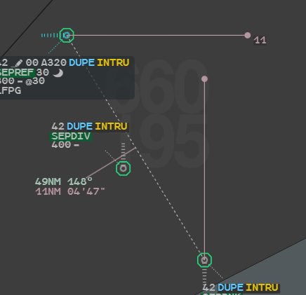
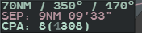
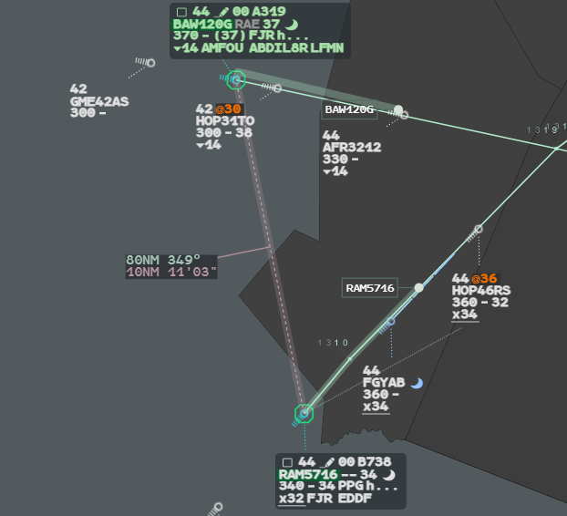
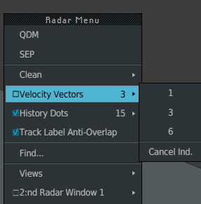

These tools help you analyse a possible conflict. Start by putting the flights concerned
in a **group**: the SEP, the QDM and the extrapolation then work on every flight of it.

## The group

The group is local to your position. It holds up to **8 flights**.

| To | Do |
|---|---|
| Add a flight | **Left click** on its track symbol (the head of the track) |
| Add a flight whose track is hidden under others | **Ctrl + left click** on its callsign |
| Remove one flight | **Left click** on its track symbol again |
| Remove the whole group | **Right click** on an empty part of the radar image |

A flight in the group has a green background behind its callsign and an octagon around
its track. Flights of the group are never hidden by the filters.

:::note
Only the plain left click works on the track symbol. Shift and Alt do nothing, and
**Ctrl + left click** on a track opens the Track Menu.
:::

## SEP, the minimum separation

The SEP is the minimum distance two flights will have if they keep a straight line at
their current radar speed.

### Fugitive SEP

With two flights or more in the group, **hover the track or the label** of one of them.
The SEP with another flight of the group appears, drawn as two "swords": one line from
each flight to its position at the minimum, with the value at the tip. It disappears
when the pointer leaves.

In a group of three flights or more, the flight you hover is the reference. Each notch
of the **mouse wheel** shows the SEP (and QDM) with the next flight of the group, in turn.
To get a pair without that flight, hover another one.

The two flights are linked by the dotted QDM line; the block reads `49NM 148°` then
`11NM 04'47"`, and the swords end with the SEP value, `11`.

### Placed SEP

1. Press the **SEP** key (`S`), or choose **SEP** in the Radar Menu, or in the Track Menu
   of a flight (the tool then starts from that flight). The pointer becomes a cross.
2. **Left click** the two flights.

The SEP stays until you **right click** on one of its swords, its line or its block.

**Lock SEP** (`L`) turns the fugitive SEP on screen into a placed one: it stays when the
pointer leaves.

### Reading the value

The value is in NM, truncated to the mile. The time after it is the time left until the
minimum.

| Value | Colour |
|---|---|
| Under 6 NM | Red |
| 6 to 9 NM | Yellow |
| 9 NM and more | Pink |
| Diverging flights, or a minimum over 20 NM | `---`, no value |

## QDM, distance and bearing

The QDM can join two points, two flights, or a point and a flight.

1. Press the **QDM** key (`Q`), or choose **QDM** in the Radar Menu or the Track Menu.
2. **Left click** the first object: a flight, or any place without a track for a
   geographic point. The line follows the pointer.
3. **Left click** the second object.

**Right click** while placing it to give up. To remove a QDM, **right click** on its line
or its block.

| Ends | First line | Second line |
|---|---|---|
| Two points | Distance and bearing | — |
| Two flights | Distance and bearing, `73NM 138°` | SEP and time to it, `4NM 07'21"` |
| A point and a flight | Distance and bearing | Time to reach the point and the level the flight would pass at its present rate, `18'/ZF300` |

The distance has one decimal under 10 NM. Its colour follows the SEP thresholds, with
green from 9 NM. A QDM placed between two flights shows the SEP swords only while you
hover its block.

## CPA, the closest point of approach

The CPA is the approximate minimum distance between two flights **following their
routes**, inside or outside your sector. It uses the same data as the extrapolation.

To see it, turn the **mouse wheel** once over the block of a QDM between two flights. The
block opens in its long form; the next notch closes it.

`CPA: 8(1308)` is 8 NM, reached at 13:08 UTC. `CPA: ---` means the routes are not
computed yet.

## Extrapolation

The extrapolation moves the flights of the group forward along their routes, so that you
see where they will be.

1. Put the flights in the group.
2. **Drag** the track symbol of one of them along its route.
3. Release: the flights return to their present position.

Every flight of the group moves to the same time, up to 30 minutes ahead. Each one shows
its [Flight Leg](/5g-atm-doc/labels/flight-leg/), a green band from the track to a round
marker, and its callsign framed to the left of the marker. A dotted line joins the track
you hold to the pointer. The pair shown when you started the drag stays on screen.

BAW120G and RAM5716 are moved to the same time: each green band ends on a round marker
with the callsign beside it, and the pair keeps its QDM block, `80NM 349°`.

If a flight's route is not loaded yet, the first press loads it: drag again.

The extrapolation uses the speed of the label clearance when there is one, otherwise the
speed deduced from the ground speed, and the upper winds g-atm already uses for the
Mode S line. Without wind data it uses the observed ground speed.

**Ctrl** held when you release stores the group in the [Agenda](/5g-atm-doc/conflicts/agenda/)
as a Datablock, at the time you reached.

## Speed vectors

A speed vector shows where a flight will be in 1, 3 or 6 minutes, with one tick per
minute at its radar speed.

| To | Do |
|---|---|
| Show or hide the vectors of all flights | **VV ON/OFF** key (`V`), or Radar Menu → **Velocity Vectors** |
| Choose the length | Keys **VV 1'** (`1`), **VV 3'** (`3`), **VV 6'** (`6`), or the submenu of **Velocity Vectors** |
| Show the vector of one flight only | **Ctrl + left click** on its GS field, or Track Menu → **Individual VV**. Same gesture to remove it |
| Remove all individual vectors | Radar Menu → **Velocity Vectors** → **Cancel Ind.** |

The value after **Velocity Vectors**, `3`, is the length in force.

Individual vectors stay when you turn the vectors off, and all take the last length
chosen.

:::note[Next version]
Each secondary image will have its own group, measures and extrapolation, and the SEP,
QDM, Lock SEP and VV keys will act on the image under the pointer.
:::

---

*4-Flight booklet 3.0: §7.2.a–f (p. 66–72).*
