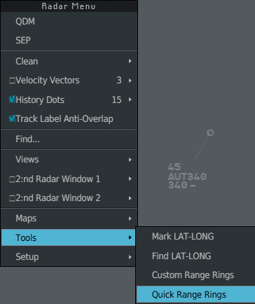
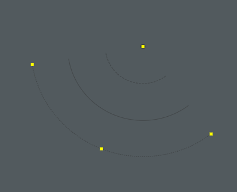
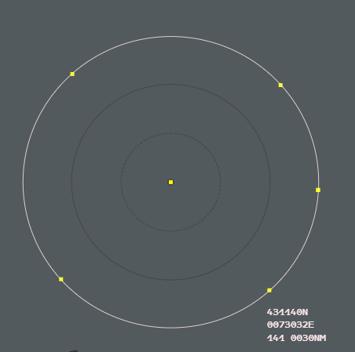

Range Rings are concentric circles you place anywhere on the radar image, as full circles
or as an arc. They help you judge distances at a glance. You can have several sets on
each image.

## Placing a set

Open the Radar Menu (**Ctrl + left click** on an empty part of the radar image), then
**Tools**.

The two Range Rings entries are at the bottom of the **Tools** submenu.

### Quick placement

1. Choose **Quick Range Rings**, or press the **Quick RR** key (`T`).
2. **Left click** where you want the centre.

You get full circles at once: 25 circles at the default interval (125 NM of radius at
5 NM).

### Custom placement

1. Choose **Custom Range Rings**.
2. **Left click** the centre.
3. Move the mouse: the outer circle follows the pointer and inner circles are added.
   **Left click** to fix the size.
4. Move the mouse: the pointer marks the end of the arc. **Left click** to fix it.

To get full circles, click the second time where you clicked the first time (an arc of
less than 3° counts as full circles).

**Right click** or `Escape` during the placement gives up: nothing is created.

:::note
**Mark LAT-LONG** and **Find LAT-LONG** are in the menu, as on the real system, but the
booklet does not describe them: in g-atm they close the menu and do nothing.
:::

## Selecting and changing a set

**Left click** on one of the circles to select the set. Yellow handles appear. A click
elsewhere, or `Escape`, deselects it.

An arc has four handles: one at the centre, one at each end, one in the middle of the
outer arc.

| Handle | **Drag** it to |
|---|---|
| The square at the centre | Move the set |
| The four handles in a square (full circles), or the handle in the middle of an arc | Change the size |
| The two angle handles, at the ends of the arc | Change where the arc starts and ends |

On full circles the two angle handles are on top of each other, at the bearing of the
click that fixed the size (due east after a quick placement).

| To | Do |
|---|---|
| Delete the selected set | `Delete` key |
| Change its interval | **Ctrl + left click** at its centre to open the Radar Menu, then **Range Rings** → **Interval** → **5 Nm** or **10 Nm** |

### The information box

While you place a set, drag a handle, hover a circle or a handle of the selected set, or
click on a circle, the outer circle turns light and three lines hang under the pointer:

- the latitude of the pointer, `431140N`;
- its longitude, `0073032E`;
- the bearing and the distance from the centre, `141 0030NM`. On a circle, the distance
  is that circle's radius.

## Hiding and removing all sets

| To | Do |
|---|---|
| Hide all sets, or bring them back | **RR On/Off** key (`R`). Hidden sets can be neither seen nor picked |
| Remove all sets | The **CLEAN** key (`End`), or the Radar Menu, see [CLEAN and standard configuration](/5g-atm-doc/position/clean-standard/) |

Placing a new set brings hidden sets back.

## Local settings

The default interval between circles is a local setting: **Tools** → **External
Applications** → **Local Settings** → **Range Rings: 5 NM** or **Range Rings: 10 NM**.
A quick placement uses it for its 25 circles. See
[Local Settings](/5g-atm-doc/reference/local-settings/).

:::caution[Not in g-atm]
The 4F keyboard of V2.1 had a third key, "RR Création". The 3.0 booklet shows only
**RR ON/OFF** and **Quick RR**, and so does g-atm: custom placement is in the Radar Menu.
:::

## On a secondary image

Range Rings work the same way on a [secondary image](/5g-atm-doc/position/secondary-images/).
A set belongs to the image where you put its centre: it is drawn and picked only there.
**RR On/Off** and **CLEAN** act on every image.

Radii are true nautical miles. Far from the latitude of the image's origin, the image
stretches east–west, so the circles are drawn as slight ellipses.

---

*4-Flight booklet 3.0: §7.2.g (p. 73–75).*
