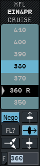
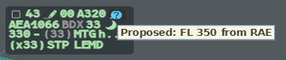
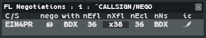
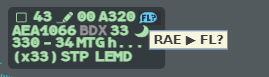

**NEGO** lets you negotiate a level electronically: the exit level (XFL) with the next
sector, or the entry level (EFL) with the previous sector. **FL?** asks the next sector to
give you a level.

:::note[IVAO]
Both work only between g-atm positions: the other controller must run g-atm. The XFL
agreed by a NEGO is also sent on the network by the position that holds the flight.
:::

## Proposing a level

1. Open the XFL menu of the flight (**left click** the XFL field), or its EFL menu.
2. **Left click** **Nego**: the button turns blue.
3. If needed, press the transition button you want (see [Changing a level](/5g-atm-doc/profile/levels/)).
4. **Left click** the level, or type it in the **F** field and press `Enter`.

Nothing is set: the proposal leaves, to the next sector from the XFL menu, to the sector
holding the flight from the EFL menu. **Nego** is greyed when there is no one to
negotiate with. The transition you chose goes with the proposal and applies if it is
accepted.

**Nego** is blue: clicking `380` now proposes FL380 instead of setting it.

## While the NEGO runs

| Side | On the label |
|---|---|
| You, who propose | Your XFL (or EFL) is greyed at its value before the NEGO; a symbol in the label colour appears on line 0 |
| The other sector | A blue symbol on line 0; its EFL (or XFL) is greyed at its value before the NEGO |

**Hover** the symbol to read the proposal: `Proposed: FL 380 to BDX` on your side,
`Proposed: FL 350 from RAE` on the other.

Other g-atm positions that have the flight in PREPA Coordinated or RESP, and take no part
in the NEGO, see a green padlock on line 0.

## Answering, cancelling

| Who | Gesture on the symbol | Effect |
|---|---|---|
| The receiver | **Left click** | Accepts. Each side writes its level: the proposer its XFL, the receiver its EFL (the reverse for an EFL NEGO). The proposer sees its new level in REV |
| The receiver | **Right click** | Refuses. The proposer sees a yellow cross |
| The proposer | **Right click** | Cancels the NEGO |
| Either side | **Right click** on a refused or broken NEGO | Removes the symbol |

A NEGO **breaks** when someone enters a new level on the transition it is about: an XFL
entry breaks the NEGOs on the exit, an EFL entry those on the entry. Both sides then see a
yellow `!`.

When a flight has several NEGOs, the symbol answers the oldest one received first; the
tooltip says which. The next one appears when the first is answered.

## The FL Negotiations list

The **FL Negotiations** list gathers the NEGOs of your sector. It opens by itself with the
first NEGO and closes with the last. If you close it by hand, it stays closed until the
next NEGO. You can open it from **Tools** → **Flight Lists** → **FL Negotiations**.

| Column | Content |
|---|---|
| **C/S** | Callsign |
| **nego** | The NEGO symbol: blue for a NEGO received, label colour for yours, yellow when refused or broken |
| **with** | The sector you negotiate with |
| **nEfl**, **nXfl** | The entry and exit levels if the NEGO is accepted |
| **nEcl** | The ECL in force |
| **nNs** | The next sector if the NEGO is accepted |
| **ic** | The iCoor field of the flight, clickable as on the label |

In the list you can answer any NEGO directly: **left click** its symbol to accept,
**right click** to refuse, cancel or remove it. Refused and broken NEGOs leave the list
after **30 seconds**; their symbol stays on the label until you right click it.

## FL?, asking for a level

Use **FL?** with layered sectors, when you need a level above or below what the exit
contract planned.

1. Open the XFL menu and **left click** **FL?**, or open the Callsign Menu and **left
   click** **FL?** (just after **Point...**).
2. The request goes straight to the next sector. Both are greyed or absent when no next
   sector is online.

A symbol appears on line 0 on both sides: label colour for you, action blue for the next
sector. Its tooltip reads `FL? ▶ BDX` on your side and `RAE ▶ FL?` on the other.

The next sector answers with an EFL change (or by telephone): a left click on the symbol
accepts nothing. To close or cancel a FL?, **right click** the symbol.

:::caution
FL? is a special POINT. Do not answer a FL? with a POINT: the answer could be read as a
contract on another transition than the next sector's.
:::

---

*4-Flight booklet 3.0: §9.2–9.3 (p. 104–106).*
