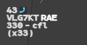
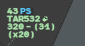
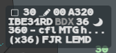

Two marks on line 0 tell you that a coordination still has to be made by telephone: the
**Verbal Indicator** with the next sector, **PS** with the previous one. **Force ACT** makes
the next sector served for a flight before its time.

## Next sector to coordinate

On the real system these marks appear when the automatic coordination with the adjacent
unit has failed (ACT, LAM, REV messages).

:::note[IVAO]
IVAO has no such messages, so nothing can fail. g-atm reads the letters of agreement
instead: a line whose level is `000` means that no level is agreed and the coordination is
to be made by telephone.
:::

### Verbal Indicator: the next sector

A handset symbol appears on line 0 when your letter of agreement towards the next sector
gives `000` for this flight.

**Right click** the symbol to acknowledge it.

### PS: the previous sector

`PS` appears on line 0 when the position that holds the flight has a letter of agreement
towards you that gives `000`. It shows on a flight in PREPA Coordinated or assumable,
held by another position: the two positions see the same coordination to make, each from
its side.

**Right click** `PS` to acknowledge it. On the real system this "unblocks the system";
in g-atm nothing is blocked, the right click only removes the mark.

Both acknowledgements are local to your position.

### Letter of agreement levels that are not levels

Four values in the level column of a letter of agreement are markers, never shown as an
exit level. The label then shows the ELO in brackets, `(x35)`: a level proposed by the
profile, not an agreed one (see [Changing a level](/5g-atm-doc/profile/levels/)).

| Value | Means | Verbal Indicator |
|---|---|---|
| `000` | No level agreed: coordinate by telephone | Yes |
| `660` | No exit level at all | No |
| `888` | The flow is forbidden by the sector | No |
| `999` | The level depends on the configuration in force | No |

## Force ACT

The **NS** field (next sector) is **white** when the next sector is served for the flight,
**grey** otherwise.

:::note[IVAO]
On the real system the next sector is served when the automatic coordination has sent it
the flight. In g-atm it is served when the flight will enter it within **15 minutes**:
the time at which that sector, if it runs g-atm, sees the flight become PREPA
Coordinated. A planned sector that nobody holds is never served.
:::

To serve the next sector now:

1. **Left click** the callsign to open the Callsign Menu.
2. **Left click** **Force ACT**. The entry is there while an online next sector is not
   served yet, on an assumed flight as on a PREPA flight.

The NS field turns white. g-atm tells the other g-atm positions of the centre: for the
next sector, the flight becomes PREPA Coordinated at once.

If you shoot a flight while its NS is still grey, g-atm makes the Force ACT for you and
asks you to confirm the transfer: see [Assume and shoot](/5g-atm-doc/frequency/assume-shoot/).

---

*4-Flight booklet 3.0: §9.4–9.5 (p. 107).*
