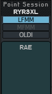
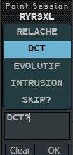
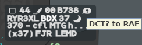
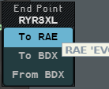

A **POINT** shows a flight to another sector, with a short message or none. The other
controller sees a symbol on the label and reads your message in its tooltip.

The electronic coordination tools (POINT, NEGO, FL?) are open to both controllers of a
suite, but they are rather the planning controller's job. They do not replace a word to
your colleague, and the telephone stays the safest way for complex cases.

:::note[IVAO]
There is no OLDI and no Coflight on IVAO: coordination messages travel as private text
messages between controllers. A simple POINT uses a convention other IVAO clients also
use. Several POINTs on one flight, NEGO answers and FL? are understood only by another
g-atm position.
:::

## Sending a POINT

1. **Left click** the callsign to open the Callsign Menu, then **Point...**.
2. The **Point Session** menu opens. Choose the sector:
   - the first button (your centre, `LFMM` for instance) lists the online positions of
     your centre; **OLDI** lists those of the other centres. The button between them
     (`MFMM`) stays greyed: IVAO has no military twin centre;
   - **left click** the sector in the list, or type its name in the field at the bottom
     and press `Enter`. The flight's next sector carries the marker.
3. Choose the message: **left click** a ready text (**RELACHE**, **DCT**, **EVOLUTIF**,
   **INTRUSION**, **SKIP?**) to put it in the message area, edit it or type your own.
   **Clear** empties the area.
4. **OK**, or `Enter`.

The first view lists the online sectors of `LFMM` (here `RAE`); the second shows the
ready texts, with `DCT?` typed in the message area.

A POINT to a sector of another centre leaves at once, without text: you cannot add one.
It may not be shown on the other side.

## What you see

| Side | Symbol on line 0 | Tooltip when you hover it |
|---|---|---|
| Sender | An arrow in the label colour, on the **selected** label only | The message and the receiver: `DCT? to RAE` |
| Receiver | A blue arrow, on the base label too | The message and the sender |

- A POINT whose message is `FL?` is a level request: see [NEGO and FL?](/5g-atm-doc/coordination/nego/).
- A POINT on an AUTRE flight, sent or received, puts it in SURV: it is no longer filtered
  out, and you get its flight plan data (see [States and colours](/5g-atm-doc/flights/states/)).

## Answering a POINT

1. **Left click** the blue symbol. The **Answer Point** menu lists the sectors that sent
   you a POINT on this flight.
2. **Left click** the sector. This closes the POINT you received and opens Point Session
   on its message view, with that sector already chosen.
3. Type your answer, then **OK**.

:::caution
Answering deletes the POINT you received and its message. Remember the question, and
repeat its content in your answer so that nobody can misread it.
:::

## Ending a POINT

**Right click** the symbol. The POINT is closed on both sides, whether you sent it or
received it.

## Several POINTs on one flight

On one flight you can send POINTs to up to **4** sectors, receive POINTs from several, and
send and receive at the same time. The symbol becomes a double bubble: blue when all the
POINTs are received, in the label colour otherwise. Its tooltip has one line per POINT.

To end them, one at a time:

1. **Right click** the symbol, or choose **End Point** in the Callsign Menu. The **End
   Point** menu lists the sessions: `To RAE`, `From BDX`. Hover a row to read its message.
2. **Left click** the session to close. The menu closes.

The flight has two POINTs sent and one received; the tooltip of the hovered row gives
its message.

## A POINT on a track without flight plan

When a POINT arrives on a track that has no flight plan, g-atm creates an APL for it. If
the POINT is removed before a flight plan is found, the APL is decorrelated and the track
may be filtered out again. That APL then blocks a new APL with the same ADEP/ADES pair
from the track: to correlate the flight again, create an APL with a different pair (see
[Finding and editing plans](/5g-atm-doc/correlation/flight-plans/)).

---

*4-Flight booklet 3.0: §9.1 (p. 101–103).*
