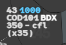
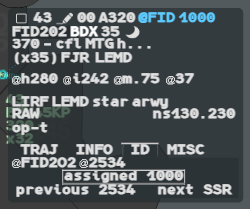
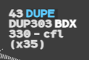

A flight on the picture is a **track** correlated with a **flight plan**. Three alerts in
line 0 tell you that this correlation is wrong or in doubt: **CODE**, **@FID** and **DUPE**.

:::note[IVAO]
On the network a track is a connected pilot, and his plan is the one he filed under the same
callsign (or a plan g-atm holds: an APL, a plan you created). The real system correlates on
the transponder code, or on the Mode S callsign under code 1000; g-atm follows the same keys
to raise its alerts.
:::

All three are **action blue**, on a dark block in the base label and without a block in the
selected label. They come after the aircraft type, @FID before the code. They show from
the PREPA coordinated state on.

| Mnemonic | Means |
|---|---|
| A 4-digit code | **CODE**: the pilot squawks another code than the one he should. The code shown is the one to give him |
| **@FID** | The Mode S callsign does not match the plan's callsign |
| **DUPE** | Another track or plan is a better candidate for this correlation |

## CODE

The flight squawks a code (TSSR) different from the code it should have (ASSR). Line 0 then
shows the **code to give** the pilot.

The ASSR is the code assigned to the flight on the network. Failing that, an IFR plan should
squawk `1000`; a VFR plan or a track without a plan has no ASSR, so no CODE alert.

The alert stays as long as the codes differ, on every sector the flight crosses. A flight
squawking an emergency or special code (7500, 7600, 7601, 7700, 7400, 5677) gets no CODE
alert: see [Monitoring and other alerts](/5g-atm-doc/alerts/monitoring/#transponder-codes).

## @FID

The track is correlated with a full plan under code `1000`, and its Mode S callsign (the
Flight ID) is not the plan's callsign. **@FID** shows in line 0, before the code.

The **ID** tab of the selected label shows the Mode S callsign with its `@`, the assigned
code in a frame, and the previous code.

If the callsign cannot be put right, give the flight a discrete code instead of `1000`:

1. Left click the callsign.
2. **Correlation ▸ Downgrade ModeS Correl.**

g-atm takes the first discrete code from `0601` to `0677` that no known flight uses, and
assigns it on the network. The correlation then rests on the new code, not on the Mode S
callsign.

:::note[IVAO]
On the network the Mode S callsign is the connection callsign, so it always matches the plan
and @FID never shows. You meet it only in a [simulation](/5g-atm-doc/simulation/joining/).
:::

## DUPE

**DUPE** says the correlation of a track and a plan is in doubt because a better candidate
exists:

- another track answers the plan's key (its discrete code, or its callsign under `1000`);
- or the flight's track answers the key of another plan.

DUPE cannot be acknowledged: it goes when the doubt goes. It shows only on a flight that
concerns your position, that is not AUTRE nor PREPA not coordinated. Both flights of the
doubt are kept on the picture whatever your filters.

Codes that many flights squawk at once (`0000`, `1200`, `2000`, `7000`, emergency codes)
point at nobody and raise no DUPE.

:::caution[Not in g-atm]
The booklet shows DUPE on every flight for the CDS and Supervision positions. Those
positions do not exist on the network.
:::

---

*4-Flight booklet 3.0: §11.1.a (p. 123–125); §12.6 (p. 154).*
