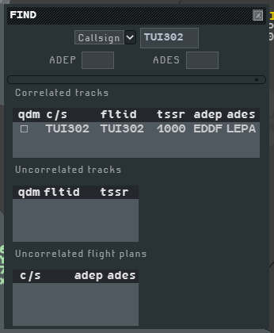
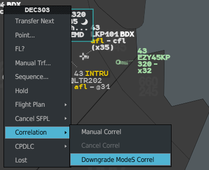
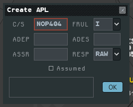
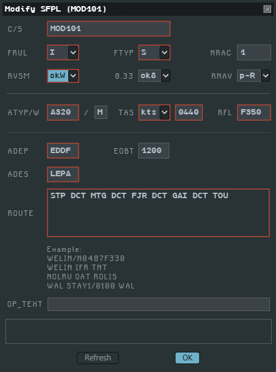

This page covers what you do about a flight plan: find it, tie it to a track, activate it,
create a short plan (APL) for a track that has none, edit it, create one from scratch, or
delete it.

## FIND

FIND retrieves a flight from its callsign, its SSR code, or its airfields.

1. Press the **Find** key (`F`), or open the Radar Menu (**Ctrl + left click** on the radar
   picture) and choose **Find...**.
2. In the small window, pick **Callsign** or **SSR code** in the list.
3. Type the whole value, or a part with `*` as a wildcard (`AFR*`), then **Enter**.

The window unfolds on its results. Unfolded (or after a click on the bar under the field), it
also has **ADEP** and **ADES** fields, the departure and destination airfields:

- **Enter** in any of the three fields runs the search;
- an airfield restricts the search, `*` allowed; an empty field restricts nothing;
- the airfields alone are enough. A track without a plan has no airfield, so an airfield
  search never finds it.

The results come in three tables:

| Table | Columns |
|---|---|
| **Correlated tracks** | `qdm`, `c/s`, `fltid` (Mode S callsign), `tssr` (code squawked), `adep`, `ades` |
| **Uncorrelated tracks** | `qdm`, `fltid`, `tssr` |
| **Uncorrelated flight plans** | `c/s`, `adep`, `ades` |

A callsign search also matches the Mode S callsign; a code search matches a plan's assigned
code and a track's squawked code. With no result, or more than ten, a tooltip next to the
field says **No match** or **Too many matches**, and the tables stay empty.

In the results:

- **left click** a callsign: the flight's Callsign Menu;
- **left click** the `fltid` of an uncorrelated track: its Track Menu, with **Create APL...**
  under the pointer;
- tick **qdm**: a QDM line from the centre of the picture to the track, to spot it. Untick to
  remove it.

FIND stays open until you close it with its cross.

## Correlating a plan and a track by hand

Manual correlation ties an uncorrelated plan to an uncorrelated track.

**From the track:**

1. **Ctrl + left click** its track symbol: the Track Menu opens.
2. **Correlation ▸ Manual Correl.** The pointer becomes a white **×**.
3. **Left click** the plan's callsign: in a list, in FIND, or on a [FPASD](/5g-atm-doc/correlation/lost-tracks/#the-fpasd).

**From the plan** (a plan without a track):

1. Left click its callsign, then **Correlation ▸ Manual Correl**.
2. **Left click** the track, or its label.

A click in an empty spot cancels.

The Correlation submenu offers only what fits the flight; the other entries are greyed:

| Entry | Offered on |
|---|---|
| **Manual Correl** | A plan without a track (Callsign Menu), or an uncorrelated track (Track Menu) |
| **Cancel Correl** | A correlated flight |
| **Downgrade ModeS Correl** | A plan under code 1000 with no track, or in @FID alert. See [Correlation alerts](/5g-atm-doc/correlation/alerts/#fid) |

**Cancel Correl** splits a correlated flight: the plan stays as a FPASD, the track goes on
alone as `@callsign`, and the flight enters the [Lost
List](/5g-atm-doc/correlation/lost-tracks/#the-lost-list). It stays apart until you
correlate it again by hand.

:::note[IVAO]
On the network a track **is** its pilot's connection callsign. Correlating a plan with a track
of another callsign files the plan's content under the track's callsign and deletes the
original plan. A track that already carries a plan in g-atm, even decorrelated, refuses:
`<callsign> correlation rejected`.
:::

## Activating a plan

**Activate** is the first entry of the Callsign Menu of a plan that is not active yet:

- a plan you created without **as active** ([Create SFPL](#create-sfpl)): once active, it
  shows as a FPASD from its departure airfield;
- a departing flight still on the ground at a small airfield: see
  [Departures](/5g-atm-doc/traffic/departures/).

## APL: abbreviated flight plan

An APL lets you work a track that has no flight plan. It holds a callsign, flight rules,
departure and destination.

### Creating an APL

- **Track Menu** (**Ctrl + left click** on the track symbol) → **Create APL...**.
- **Fake double click** on the track's `@callsign`: the first click opens the Track Menu with
  Create APL... under the pointer, the second opens the **Create APL** window with its **OK**
  button under the pointer.
- **Fake triple click**: a third click, on OK, creates the APL with its callsign only, not
  assumed.

| Field | Content |
|---|---|
| **C/S** | The track's callsign. Read only: on the network it is the pilot's |
| **FRUL** | Flight rules, `I` or `V` |
| **ADEP**, **ADES** | Departure and destination, 4 letters |
| **ASSR** | Code to assign; g-atm assigns it on the network |
| **RESP** | Comm Resp of the flight, among your responsibilities; the first is the default |
| **Assumed** | Tick it to assume the flight at once |

A field you start must be complete (4 letters or digits), or the window answers `Invalid
field`.

With the callsign, ADEP and ADES filled in, g-atm asks the network server again for the
pilot's filed plan. If one arrives, the APL becomes a full plan. (The real system queries
IFPS; the network's flight plan store plays that part.)

g-atm also creates an APL by itself when another g-atm position sends a
[POINT](/5g-atm-doc/coordination/point/) for a track without a plan. If that POINT is
withdrawn before a plan is found, the APL decorrelates.

### Working an APL

- It appears **Not Seen** (bold) and is listed in the NotSeen/Rev list. See [Seen, Not Seen
  and REV](/5g-atm-doc/flights/seen-rev/).
- It is a filter exception: g-atm keeps it on the picture whatever your
  [filters](/5g-atm-doc/position/filters/).
- Its label is minimal: no clearance fields, no route. The selected label has no tabs and
  ends with `@callsign @code`.
- You transfer it with **Manual Trf...**, take it with **Force Assume** (STLN shows on both
  positions when it is stolen), and give it back with **Deassume**.
- APLs are shared with the g-atm positions of your centre.

### The Sector Uncorrelated APL List

An APL whose track is lost or decorrelated enters the **Sector Uncorrelated APL List**. The
list pops up by itself; you can also open it from **Tools → Flight Lists → Sector
Uncorrelated APL**. Its columns are `C/S`, `etn`, `ACOPN` and `efl`; on IVAO only the
callsign is filled, since a POINT carries no estimate.

An APL stays in that list until it correlates again or is deleted, by you or by the system
after **6 hours**, even if its pilot has left. A decorrelated APL you held is also in the
Lost List.

To correlate the track of a decorrelated APL again with a new APL, give the new one another
ADEP/ADES pair; the same pair is refused with `APL already exists`.

## Modify SFPL

**Callsign Menu → Flight Plan ▸ Modify...** opens **Modify SFPL (callsign)**.

| Fields | Notes |
|---|---|
| **C/S** | Read only |
| **FRUL**, **FTYP**, **NRAC** | Flight rules, flight type, number of aircraft |
| **RVSM**, **8.33**, **RNAV** | Equipment: `okW`/`noW`, `ok8`/`no8`, `p-R`/`noR`/`unR` |
| **ATYP/W** | Aircraft type; the wake category next to it follows the type |
| **TAS**, **RFL** | Speed unit and value, requested level |
| **ADEP**, **EOBT**, **ADES** | Departure, off-block time, destination |
| **ROUTE** | Read only here: change the route with [Route Mod](/5g-atm-doc/profile/route/) |
| **OP_TEXT** | Operational text |

Fields with a red border are mandatory; **OK** stays greyed until they are all valid.
**Refresh** reads the plan again. **OK** sends the amendment to the network; the fields the
network does not carry are kept in your g-atm.

On an APL, Modify also converts it:

- callsign, ADEP and ADES are enough to validate, and start the plan search again;
- fill every mandatory field, route included (editable for an APL), and the APL becomes a
  full plan.

## Create SFPL

**Global Menu → Tools → Create SFPL...** opens the same window, titled **Create SFPL**, to
create a full plan with no track.

1. Fill every field with a red border. **Create** stays greyed until they are filled in the
   right format. Give the TAS in knots.
2. Tick **as active** to activate the plan now, or leave it to activate it later.
3. **Create.**

An active plan shows at once as a FPASD at its departure airfield. A plan created without
**as active** stays hidden: find it with [FIND](#find), then **Activate** it from its
Callsign Menu.

The plan exists only in your g-atm: there is no pilot behind it on the network.

## Deleting a plan

**Callsign Menu → Cancel SFPL ▸ Delete.** The plan (full plan or APL) leaves g-atm at once and
the flight decorrelates: its track stays alone. If you held the flight, it is released.

:::note[IVAO]
The plan is removed from your g-atm, not from the network, where it belongs to the pilot. The
same plan sent again by the server does not come back; an amended plan does.
:::

---

*4-Flight booklet 3.0: §11.2 (p. 127–136).*
