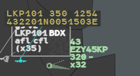
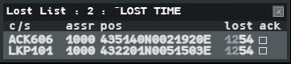
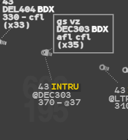
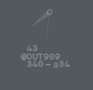

When the radar loses a track, or when you cancel a correlation, g-atm keeps what it knew:
a **marker** where the track was last seen, a row in the **Lost List**, and the **FPASD**,
the plan's theoretical position.

## When a track is lost

A track is lost after **30 seconds** without a position, or at once when the pilot
disconnects. Before that its level ages: see [Outdated
AFL](/5g-atm-doc/alerts/monitoring/#outdated-afl).

When the track comes back (positions arrive again, or the pilot reconnects under the same
callsign), the flight correlates again by itself, and the marker, the Lost List row and the
FPASD go away.

## LKP and LT markers

A marker takes the place of a lost track that was on your picture:

| Marker | Colour | Shows | When |
|---|---|---|---|
| **LKP** (Last Known Position) | Orange | The callsign | The track was correlated (full plan or APL) |
| **LT** (LOST Track) | Grey | The track's code | The track had no plan |

Point at a marker, or at its frame: it turns cyan and shows the callsign, the level, the
time and the coordinates of the last position.

To remove markers:

- **Right click** the marker. A hidden LKP can come back; an LT is gone.
- **CLEAN** (the **CLEAN** key, `End`, or Radar Menu → Clean) removes the LKPs and LTs older
  than 15 seconds. See [CLEAN and standard
  configuration](/5g-atm-doc/position/clean-standard/).
- **ack** in the Lost List removes the LKP.
- An LKP goes by itself when the flight correlates again.

To bring a hidden LKP back, left click the **pos** field of its Lost List row.

The standard configuration recall (**Conf. STD**, `F6`) no longer touches the markers.

## The Lost List

The Lost List tells you that a flight lost its correlation: a full plan, or an APL you held.
A cancelled correlation also puts the flight in it. Only flights that concerned your
position (not AUTRE) and were on your picture are listed.

It pops up by itself when a flight enters it. You can also open it from **Tools → Flight
Lists → Lost List**. Its title counts the flights: `Lost List : 2 : ˆLOST TIME`, sorted by
the time of loss.

| Column | Content |
|---|---|
| `c/s` | Callsign. Left click: the Callsign Menu |
| `assr` | Assigned code |
| `pos` | Position at the loss, latitude then longitude. Left click: shows the LKP again |
| `lost` | Time of the last radar update, UTC |
| `ack` | Left click: acknowledges the row (the box fills) and removes the marker |

- An acknowledged flight **stays** in the list. It leaves only when it correlates again,
  manually or automatically.
- The cross of the window closes the list only once **every** row is acknowledged.
- An acknowledgement does not reopen the list; only a new flight does.

## The FPASD

The FPASD shows where a flight should be according to its plan while no track is correlated
with it: after a track loss, after a Cancel Correl, or for a plan you created with [Create
SFPL](/5g-atm-doc/correlation/flight-plans/#create-sfpl).

- Only for a **full plan**: an APL has no FPASD.
- Only for a flight that concerned your position.
- Its position is the flight's profile, replayed from the moment the track was lost.

It looks like this:

- symbol and frame half transparent, the label in a thick frame;
- `gs vz` in line 0 and `afl` instead of the level: there is no radar data;
- no comet and no speed vector.

The label keeps the flight's state colour and its fields work as on any label (CFL, XFL…).
The FPASD has no track symbol: no Track Menu, no SEP or QDM on it. It goes away when the
flight correlates again, or when the profile reaches its end.

Here the correlation was cancelled: the plan of DEC303 stays as a FPASD (framed), its track
goes on alone as `@DEC303`.

:::caution[Not in g-atm]
The real system also shows a FPASD for a flight not detected yet (departures from nearby
fields, flights over the sea). On the network every connected pilot is detected, so g-atm
shows a FPASD only after a loss, a Cancel Correl, or for a plan created in g-atm.
:::

## Uncorrelated tracks

A pilot connected without a flight plan, or a track whose correlation you cancelled, is an
**uncorrelated track**. Its label has three lines and writes the Mode S callsign with an
`@`: `@OUT909`. Its selected level, when known (`@34`), is always shown, even when equal to
the actual level. It is SURV inside your area of interest, AUTRE beyond.

It has no Callsign Menu: a left click on its callsign opens the Track Menu with **Create
APL...** under the pointer. See [APL](/5g-atm-doc/correlation/flight-plans/#apl-abbreviated-flight-plan).

---

*4-Flight booklet 3.0: §11.1.b (p. 125–127).*
