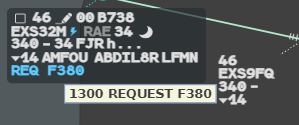
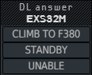
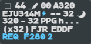
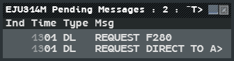

A pilot can ask by datalink for a **level** or a **direct**. The request waits on the
label until you answer it with two clicks.

## Which requests you receive

| The pilot sends | You see |
|---|---|
| `REQUEST FL380` | `REQ F380` |
| `REQUEST CLIMB TO FL380` | `REQ CLB TO F380` |
| `REQUEST DESCENT TO FL280` | `REQ DES TO F280` |
| `REQUEST DIRECT TO KESAX` | `REQ DCT KESAX` |

A reason such as `DUE TO WEATHER` is not shown.

g-atm answers some requests by itself, and you never see them:

- a request of another kind (a speed, for example) gets `SERVICE UNAVAILABLE`;
- a request from a flight that no sector of your centre has assumed yet gets `CPDLC
  TRANSFER NOT COMPLETED - REPEAT REQUEST`. "Your centre" means the positions whose
  callsign starts like yours (`LFMM_W_CTR`, `LFMM_E_CTR`…).

A request is shown only on the position that has the flight **assumed**.

## The request on the label

- The **lightning bolt** turns **blue**, in every format.
- The **selected label** gets an extra last line, in blue: the request. The base label
  shows only the blue bolt.

Hover the request line: the tooltip gives the time and the message, for example `1300
REQUEST F380`.

## Answering

**Left click the request line.** The **DL answer** menu opens, its title under the
pointer.

| Button | Effect |
|---|---|
| The clearance: `CLIMB TO F380`, `DESCEND TO F300`, `DIRECT TO KOTEM` | Accepts. The clearance is given in the system, sent to the aircraft, and the field is framed white: from here it is an ordinary [datalink clearance](/5g-atm-doc/cpdlc/uplinks/#reading-the-frame) |
| **STANDBY** | Tells the pilot to wait. The request stays blue, and the STANDBY button is greyed next time, with the tooltip `STANDBY already sent` |
| **UNABLE** | Refuses. The request line disappears and the label is as it was before the request |

When the request does not give the direction, the clearance button takes it from the
flight's present level.

A requested direct to a point that is **not on the route** can only be refused: the
clearance and STANDBY buttons are greyed. If you want to give it, use the frequency.

:::caution
If a dialogue of the same kind is already open with that flight (a level clearance still
waiting for its answer, say), accepting still sets the clearance in the system, but
nothing is sent to the aircraft and the request stays. Close the first dialogue, or answer
by voice.
:::

## Controller late

If you leave a request unanswered for **250 seconds** (counted again after a STANDBY), it
expires:

- the request line turns **orange**; the bolt stays blue;
- the aircraft receives `ATC TIMEOUT - REPEAT REQUEST`;
- a left click on the line no longer opens anything. **Right click** it to acknowledge it.

The pilot may send the request again.

## Several requests: the counter

When a flight has more than one request waiting, the label shows the oldest one, followed
by a blue **counter**.

**Left click the counter** to open the **Pending Messages** window of that flight.

## The Pending Messages window

| Column | Content |
|---|---|
| Ind | Empty |
| Time | The time the message arrived or left, UTC |
| Type | `DL` for a pilot request, `UL` for one of your messages still waiting for an answer |
| Msg | The text, cut after 19 characters with `>` |

- **Left click a DL row**: the DL answer menu opens on the radar picture, on the flight's
  request line. Answer as above.
- The left button of the title bar shrinks the window to its title bar; click it again to
  restore it. The right one closes it.
- The window closes by itself when the flight has nothing pending any more.

The same window lists the messages you sent from the CPDLC Editor that are still waiting
for an answer: see [Other messages](/5g-atm-doc/cpdlc/other-messages/).

Once answered, a request and your answer go to the flight's **CPDLC History**. A request
you never answered is not kept there.

---

*4-Flight booklet 3.0: §6.2.b and §6.2.c (p. 52–53).*
