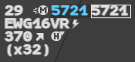
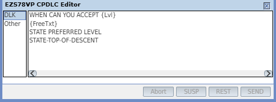
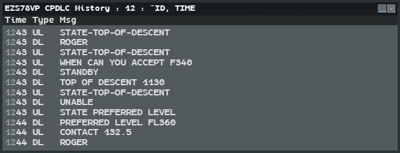

Beyond the clearance menus, datalink offers a squawk change, a stuck-microphone check,
prepared and free-text messages, and a history of what was exchanged with each flight.

## Change Squawk by datalink

When a flight must change its transponder code, the code to give shows in blue on line 0
of its label (see [Correlation alerts](/5g-atm-doc/correlation/alerts/)).

1. Hold the **CPDLC** key (`Alt`).
2. Left click the blue code.

The aircraft receives `SQUAWK 5721`, and the code is framed on the label while the
dialogue lasts. A left click without the key sends nothing.

The flight must be assumed by you and logged on to your station. The frame follows the
usual colours and acknowledgements: see [Sending
clearances](/5g-atm-doc/cpdlc/uplinks/#reading-the-frame).

## Check Stuck Microphone

When a carrier blocks the frequency, ask every datalink flight to check its microphone:
**Tools → CPDLC → Check Stuck Micro**.

The message `CHECK STUCK MICROPHONE` goes to every flight logged on to your station that
is assumable (a transfer to you is pending), assumed or shot. No answer is expected. A box
reports the result:

| Box | Meaning |
|---|---|
| `CPDLC Check Stuck Micro sent` | At least one flight received it |
| `No action. CPDLC Check Stuck Micro not sent due to no eligible aircraft` | No flight could receive it, or the station is offline |

Click **OK** to close the box.

## The CPDLC Editor

The editor sends prepared messages and free text to one flight.

**Left click the callsign** to open the Callsign Menu, then **CPDLC → Editor Window...**.
The entry is active for a flight logged on to your station that you have assumed.

| Group | Messages | Answer expected |
|---|---|---|
| DLK | `WHEN CAN YOU ACCEPT {Lvl}` | A report |
| | `{FreeTxt}` | ROGER |
| | `STATE PREFERRED LEVEL`, `STATE-TOP-OF-DESCENT` | A report |
| Other | `REPORT PRESENT LEVEL` | A report |
| | `{FreeTxt}` | WILCO / UNABLE |
| | `{FreeTxt}` | AFFIRM / NEGATIVE |
| | `{Design} ALTIMETER {Altim}`, `NO SPEED RESTRICTION` | ROGER |
| | `FLY HEADING {Degree}` | WILCO / UNABLE |

### Composing and sending

1. Left click a group, then a message. It appears in the lower space of the window.
2. Fields to complete (`{Lvl}`, `{FreeTxt}`…) show as rounded boxes. Left click one: a
   small entry window opens (a level menu for `{Lvl}`). Type and press `Enter`.
3. Add more messages if you want: they all leave as **one** message.
4. Left click **SEND**.

| Button | What it does | Active when |
|---|---|---|
| **Abort** | Clears the lower space | Something is composed |
| **SUSP** | Puts the composition aside without losing it | Something is composed |
| **REST** | Brings back what SUSP put aside | Something was put aside |
| **SEND** | Sends | Every field is filled |

Free text accepts letters, digits, spaces and `. , - / : ( ) +`. With any other
character (`?` or `!`, for example), **SEND** turns **yellow** and stays inactive.

### The message on the label

A message waiting for its answer shows on a line **above** the label (line "-1"), in the
label's colour: its first element, the full message in the tooltip. To its right:

| Mark | Meaning |
|---|---|
| **S**, yellow on dark | The pilot answered STANDBY |
| **U**, orange on red | The pilot refused. Tooltip: time and answer |
| **F**, orange on red | Failed: no answer in time, not sent, or a system failure. Tooltip: the reason, `HHMM TRANSMISSION FAILED` for example |
| A number | More than one element is waiting. Left click it to open the [Pending Messages window](/5g-atm-doc/cpdlc/downlinks/#the-pending-messages-window) |

- Any answer other than STANDBY or a refusal closes the message, and the line goes
  (report messages excepted, see below).
- **U** and **F** are acknowledged like a failed clearance: right click the message (a
  `TIMEOUT` opens its menu: **CANCEL**).
- When the aircraft answers `AIR SYSTEM TIMEOUT`, the bolt turns orange and the label gets
  a last line `AIR SYSTEM TIMEOUT` on a dark band.

**Report messages.** `REPORT PRESENT LEVEL`, `STATE PREFERRED LEVEL`,
`STATE-TOP-OF-DESCENT` and `WHEN CAN YOU ACCEPT` expect the pilot to report something.
When the report arrives, the message stays on line "-1" (`RPT PRESENT LEVEL` for the
first), the bolt turns **blue**, and the report shows on the last line of the selected
label, for example `PRESENT LEVEL F340`. Right click the message to acknowledge it.

## The CPDLC History

**Left click the callsign**, then **CPDLC → History...**. The entry is greyed until the
flight has at least one closed exchange.

Each row gives the time, `UL` (sent to the aircraft) or `DL` (received from it), and the
text. The window keeps the **closed** exchanges: a clearance or message and its answer, a
pilot request and your answer, `CHECK STUCK MICROPHONE`, an `AIR SYSTEM TIMEOUT` received.
It does not keep a message that never got an answer, a request you never answered, an
exchange closed on your side by a timeout, or an error answer.

The history lives in the station: it starts empty each time the station comes online.

---

*4-Flight booklet 3.0: §6.2.a (p. 52), §6.5 and §6.6 (p. 55–61).*
