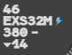

CPDLC (controller-pilot datalink communications) lets you exchange clearances and requests
with a pilot in writing. In g-atm you use it from the same label menus as voice
clearances, with the **DLK** button or the **CPDLC** key (`Alt`).

## What carries it

On IVAO, datalink runs on the **Hoppie ACARS network**, the service pilot add-ons use for
CPDLC. g-atm holds a **station** on that network: pilots log on to it with the station code
published in your ATIS, and every message goes through it.

In a simulation session hosted by a g-atm world server, the station is the **server's own
station**, not Hoppie: nothing is sent to Hoppie and your Hoppie code never leaves your
machine. See [Joining a simulation](/5g-atm-doc/simulation/joining/).

To bring the station online, see [Setting up datalink](/5g-atm-doc/cpdlc/setup/).

:::note[Different from the real 4-Flight]
On the real system, datalink goes through CoFlight and the whole centre shares one
connection. On IVAO each g-atm position holds its own station: a dialogue stays with the
station that opened it.
:::

## What you can do with it

| | Where |
|---|---|
| Send a level, heading, direct or speed | [Sending clearances](/5g-atm-doc/cpdlc/uplinks/) |
| Answer a pilot's level or direct request | [Pilot requests](/5g-atm-doc/cpdlc/downlinks/) |
| Transfer a flight, change its Comm Resp | [Transfer and Comm Resp](/5g-atm-doc/cpdlc/transfer/) |
| Change a squawk, check a stuck microphone, send other messages, read the history | [Other messages](/5g-atm-doc/cpdlc/other-messages/) |

What cannot go by datalink: an emergency descent (E.DESC), Expedite, a minimum or maximum
speed, a double direct, a point typed in the Waypoint menu, a vertical rate.

## How a datalink flight looks

A flight logged on to your station shows a **lightning bolt** right after its callsign,
in every label format.

The bolt's colour tells you whether datalink needs you:

| Bolt | Meaning |
|---|---|
| Label colour (white on an assumed flight) | Logged on, nothing pending |
| **Blue** | A pilot request is waiting, or the aircraft has answered a message that asked for a report. Look at the selected label |
| **Orange** | A system failure: the aircraft sent `AIR SYSTEM TIMEOUT` or an error. Right click the bolt to acknowledge it |

A refusal (`UNABLE`), a pilot who does not answer in time, or a corrupted exchange leave
the bolt in the label colour: the frame around the field tells you instead. See [Sending
clearances](/5g-atm-doc/cpdlc/uplinks/#reading-the-frame).

The bolt also stays on a flight you have just transferred by datalink, and on a flight
that still has a dialogue for you to acknowledge.

## Who holds the rights

Only the position that has the flight **assumed** (see [States and
colours](/5g-atm-doc/flights/states/)) can use datalink with it:

- the DLK buttons and the CPDLC key work only on a flight you have assumed and that is
  logged on to your station;
- pilot requests and pending messages are shown only to the position that has the flight
  assumed.

A shot flight (transferred, waiting for the next sector) is no longer yours for datalink.

Each flight has **one dialogue per kind of clearance** at a time: while a level clearance
waits for its answer, the DLK of the CFL menu is greyed for that flight. Dialogues of
different kinds (a level and a direct, say) run in parallel.

## Timing

The Hoppie network has no push: g-atm asks it for new messages every 45 to 75 seconds, at
random intervals, as the service requires. After you send something that expects an
answer, it asks every 20 seconds for two minutes. An answer or a request can therefore
take up to a minute to appear. Against a simulation server, the station polls every few
seconds.

Datalink never replaces the frequency. When a dialogue fails, the label tells you, and the
answer is to use the radio.

---

*4-Flight booklet 3.0: §6.1 (p. 49).*
