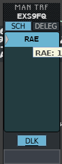
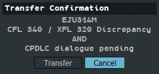
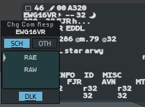
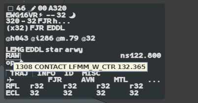

A flight logged on to your station can be sent to the next frequency by datalink instead
of by voice. The same applies to a change of Comm Resp inside your own position.

## Transferring by datalink

A datalink transfer does two things at once: it **shoots** the flight in the system, as a
voice transfer does, and it sends the aircraft `CONTACT ‹position› ‹frequency›` followed
by `HANDOVER ‹unit›`, which moves its datalink session to the next centre.

The flight must be assumed by you, logged on to your station, and have no transfer
dialogue already open.

### With the CPDLC key

1. Hold the **CPDLC** key (`Alt`).
2. Left click the **NS** (next sector) field of the label. The **Manual Transfer** menu
   (`MAN TRF`) opens with the planned next sector under the pointer, and DLK lit.
3. Still holding `Alt`, left click again without moving the mouse.

This is the usual two-click transfer from the NS field (the 4-Flight fake double click),
with the key held. In this menu the key only counts while it is held: release it before
the second click and the transfer goes by voice.

### With the DLK button

1. Left click the NS field. The Manual Transfer menu opens.
2. Left click **DLK**. It turns blue and stays armed.
3. Left click the sector, in the SCH or DELEG tab.

The menu itself (tabs, entry field, preparing a sector) is described in [Manual transfer,
NS, DELEG](/5g-atm-doc/frequency/transfer/).

:::note
Holding the key no longer draws a dashed frame around the NS field. A frame appears only
once the message has left: it is the proof that it was sent.
:::

## Reading the transfer

Once sent, the flight takes the look of a shot flight, and its **NS field is framed** in
every label format. Hover it: the tooltip recalls the order, for example `1309 CONTACT
LFMM_E_CTR 127.905`.

| Frame | State | What to do |
|---|---|---|
| **White** | Sent, waiting for the pilot | Wait |
| **Yellow** | The pilot answered `STANDBY` | Wait |
| none | The pilot answered `WILCO` | Nothing. The flight keeps its lightning bolt; your station ends its session |
| **Orange** | Refused (`UNABLE`), or the message could not be sent | Right click the NS field, then reclaim the flight |
| **Orange** | No answer in time (`TIMEOUT`) | Right click the NS field, **CANCEL**, then reclaim the flight |
| **Orange**, orange bolt | `AIR SYSTEM TIMEOUT` or an error from the aircraft | Right click the NS field or the bolt, then reclaim the flight |
| **Red** | CORRUPTION: the answer came from another flight | Right click the NS field, then check both flights |

The colours and tooltips are those of every datalink dialogue: see [Sending
clearances](/5g-atm-doc/cpdlc/uplinks/#reading-the-frame).

:::caution
When a datalink transfer fails, the flight is still **shot** in the system, but the pilot
is still on your frequency. Reclaim it (see [SKIP, SHRQ, Reclaim, LOST, Comm
Resp](/5g-atm-doc/frequency/skip-shrq/)) and transfer it by voice.
:::

## The Transfer Confirmation window

When a flight has a datalink dialogue in progress (a clearance waiting for its answer, or
a pilot request waiting for yours), **any** transfer of it first asks for confirmation:
the two clicks on the NS field, **Transfer Next**, the Manual Transfer menu, by voice or by
datalink.

The window lists every reason (here also a CFL that differs from the exit level). It
opens with the pointer on **Cancel**.

- **Transfer**: the transfer goes ahead.
- **Cancel**: nothing is sent.

:::caution[Not in g-atm]
On the real system, an open dialogue follows the flight to the receiving position. On
IVAO each position holds its own datalink station: the dialogue stays with yours, and you
still receive its answer. The receiving controller does not see it.
:::

## Change Comm Resp by datalink

The **Comm Resp** (CR) is the sector the flight is talking to, as recorded in the system.
On a grouped position you can move a flight from one of your elementary sectors to
another, and tell the pilot by datalink.

1. Open the **extended label** (see [Label formats and
   tabs](/5g-atm-doc/labels/formats/)) of a flight you have assumed and left click its
   **CR** field. The **Chg Com Resp** menu opens with the current Comm Resp under the pointer.
2. Arm DLK: left click **DLK**, or press the **CPDLC** key (`Alt`) once. Holding `Alt`
   while you open the menu arms it too.
3. Left click the new Comm Resp.

| Tab | Rows |
|---|---|
| **SCH** | The elementary sectors of your position that the flight crosses, in order, including the current Comm Resp |
| **OTH** | The other elementary sectors of your position, in alphabetical order |

A single, ungrouped position has one row: its own. Hover a row to see its frequency.

Without DLK, the click only updates the CR field. With DLK, the aircraft also receives
`CONTACT ‹position› ‹frequency›`, with no handover: the flight stays logged on to your
station. While the dialogue lasts, the CR field is **framed**, and shown on an extra line
of the base label too. Its tooltip recalls the order.

The frame follows the same colours, and is acknowledged the same way, as any other
datalink dialogue. The Comm Resp you set stays on your position: the IVAO network does
not carry it. See also [SKIP, SHRQ, Reclaim, LOST, Comm
Resp](/5g-atm-doc/frequency/skip-shrq/).

---

*4-Flight booklet 3.0: §6.3 and §6.4 (p. 53–55).*
