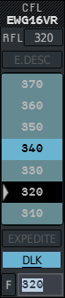
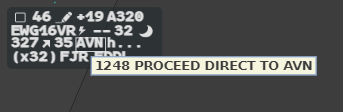
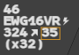
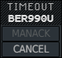

A datalink clearance is given from the usual label menu, with **DLK** armed. The system
takes it exactly like a voice clearance; the label then follows the dialogue with the
pilot until the answer comes.

## Sending a clearance

Four menus have a **DLK** button: CFL, Waypoint, AHDG and ASP.

1. Open the menu from the label, as usual.
2. Arm DLK: left click **DLK** (it turns blue, underlined), or press the **CPDLC** key
   (`Alt`). Each press toggles DLK, even while you type in the field. Hold `Alt` as you
   click the label field and the menu opens with DLK already armed.
3. Choose the value.

DLK is greyed when the flight cannot take it. Hover it for the reason: the flight has no
datalink session with you, you have not assumed it, or a dialogue of the same kind is
already open with it.

| Menu | What goes to the aircraft | Not possible by datalink |
|---|---|---|
| CFL | `CLIMB TO FL340`, `DESCEND TO FL280`, or `MAINTAIN FL340` when the level is the flight's own | E.DESC, EXPEDITE (greyed while DLK is armed) |
| Waypoint | `PROCEED DIRECT TO MMD` | Double direct, typed point |
| AHDG | `FLY HEADING 090`. A relative turn is sent as the absolute heading it gives | Resume |
| ASP | `MAINTAIN 280KT`, `MAINTAIN M.78` | min, max |

The system clearance is applied first, as if you had spoken it; then the message leaves.
Transfers and Comm Resp changes are on [Transfer and Comm
Resp](/5g-atm-doc/cpdlc/transfer/), the squawk on [Other
messages](/5g-atm-doc/cpdlc/other-messages/).

## Reading the frame

Once the message has left, the field that carries the clearance is **framed** on the
label, and shows the value you sent.

| Clearance | Field framed |
|---|---|
| Level | CFL |
| Direct | CNAV |
| Heading | The heading field, shown in the base label too while the dialogue lasts |
| Speed | The assigned speed, shown in the base label too while the dialogue lasts |

Hover the framed field: the tooltip recalls the time and the order, for example
`1248 PROCEED DIRECT TO AVN`.

The colour of the frame is the state of the dialogue:

| Frame | State | Tooltip | What to do |
|---|---|---|---|
| **White** | Sent, waiting for the pilot | The order | Wait |
| **Yellow** | The pilot answered `STANDBY` | The order | Wait. The time limit starts again |
| none | The pilot answered `WILCO` | — | Nothing: the dialogue is closed |
| **Orange** | `UNABLE`: the pilot refused | `HHMM UNABLE, DUE TO …` | Right click the field |
| **Orange** | `TIMEOUT`: no answer in time (PILOT LATE) | `HHMM TIMEOUT` | Right click, then **CANCEL** |
| **Orange** | The message could not be sent | `HHMM TRANSMISSION FAILED` | Right click the field |
| **Orange**, orange bolt | The aircraft answered `AIR SYSTEM TIMEOUT` | `HHMM AIR SYSTEM TIMEOUT` | Right click the field or the bolt |
| **Orange**, orange bolt | The aircraft answered with an error, such as `NOT CURRENT DATA AUTHORITY` | The text received | Right click the field or the bolt |
| **Red** | CORRUPTION: the answer came from another flight | `HHMM ‹other flight› ‹its answer›` | Find the other flight, then right click the field |

A frame stays as long as the dialogue is open: the label tells you, at a glance, which
clearance is in which state. Different kinds of dialogues run side by side, each on its
own field, their frames next to each other.

## Time limits

| Limit | Value | Result |
|---|---|---|
| Pilot answer | 119 s, started again by a `STANDBY` | `TIMEOUT` (PILOT LATE) |
| Technical acknowledgement from the aircraft | 40 s | `TIMEOUT` (PILOT LATE) |

The 40-second limit only applies to aircraft that send technical acknowledgements. The
Hoppie pilot clients in use today do not, so in practice only the 119-second limit
applies.

## Acknowledging a failed dialogue

An orange or red frame does not go away on its own: it waits for you.

- **Most cases**: **right click** the framed field. The frame disappears at once.
- **TIMEOUT**: right click the field. A small menu opens with `TIMEOUT` as its title, the
  callsign, **MANACK** (always greyed) and **CANCEL**. Left click **CANCEL**.
- **Orange bolt** (`AIR SYSTEM TIMEOUT` or error): you can right click the bolt instead of
  the field.

:::caution
Acknowledging restores nothing. The system took the clearance when you sent it, but the
aircraft did not accept it. Go back to the frequency, and set the label back to what the
aircraft is really doing.
:::

---

*4-Flight booklet 3.0: §6.2.a and §6.2.c (p. 49–53).*
