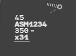
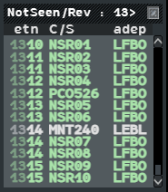
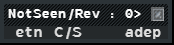

Two reading aids tell you what has changed since you last looked. A flight you have not
yet seen is drawn in bold (**Not Seen**). A field whose value has changed is drawn in bold
until you acknowledge it (**REV**). The **NotSeen/Rev List** collects both, wherever the
flights are.

## Not Seen and Seen

These flights start Not Seen, with their **whole label in bold**:

- PREPA coordinated, assumable and assumed flights (see
  [States and colours](/5g-atm-doc/flights/states/));
- a flight another position has taken from you by force (stolen, `STLN`): it is SURV, but
  it stays followed;
- an APL (a flight plan created by hand, see
  [Finding and editing plans](/5g-atm-doc/correlation/flight-plans/)).

A flight you have shot (transferred) or skipped is not concerned: it leaves the bold with
the transfer.

To mark a flight **Seen** (the bold goes away), use any of these gestures:

1. **Right click** on its callsign.
2. **Right click** on its iFlux field (line 3).
3. **Left click** or **right click** on its iCoop box (line 0 of the selected label).
   Any click de-bolds the flight, whether it ticks or unticks the box.
4. **Right click** on its row in the NotSeen/Rev List.

Seen is local to your position: nothing is sent, and the other positions keep their own
bold.

:::tip
With **Flight Leg Auto** on (Set Up menu), hovering the label of a Not Seen flight shows
its route. See [Flight Leg](/5g-atm-doc/labels/flight-leg/).
:::

## REV highlight

When a value changes on a flight you have already seen, its **callsign and the changed
field turn bold**. That is a REV (revision).

The fields watched are:

| Field | Where |
|---|---|
| **XFL**, exit level | Line 3 |
| **EFL**, entry level | Line 2, while the flight is PREPA coordinated |
| **NS**, next sector | Line 1 |
| **iFlux** | Line 3 |
| **STAR** | Line 3, when it is reallocated after a runway change |
| **HFL**, holding level | Line 3, when set by another position |

The change can come from anywhere: another position, the system (a profile recomputed, a
letter of agreement), or a consequence of your own action (a direct that changes the next
sector). Two exceptions:

- a value you have just entered yourself gives you no REV: the author of a change is not
  told about it;
- a value that appears for the first time is not a change.

A shot flight gets no REV. A field in REV is shown on the base label even if it was hidden
(by [occultation](/5g-atm-doc/labels/fields/#occultation), or because it belongs to the
selected format). A REV also unticks the flight's iCoop.

ASM1234 after another position changed its exit level: the callsign and `x31` are bold.

### Acknowledging a REV

One gesture clears **all the REVs of the flight**:

- **right click** on the callsign, on the field in REV, or on the iFlux;
- **left click** or **right click** on the iCoop box;
- **right click** on the flight's row in the NotSeen/Rev List.

## The NotSeen/Rev List (NSRL)

The NSRL lists every flight that is Not Seen or carries a REV, **whatever your zoom and
filters**: a flight off the edge of the picture is exactly the one you would miss.

Open it from **Tools → Flight Lists → NotSeen/Rev**. It never opens by itself. Close it with
its cross.

The title gives the number of flights listed. Rows look like the labels: bold for Not
Seen, the state colours, and the Local and Suite highlights on the column of the marked
field.

| Column | Content |
|---|---|
| `etn` | Time of entry into your volumes. Hours dimmed, minutes bright |
| `C/S` | Callsign. The only column you cannot remove |
| `adep` | Departure aerodrome |

**Right click** on the headers opens the column menu: you can add `ades`, `iFlx`, `ns`,
`efl`, `xfl`, `atyp` and `assr`.

**Sorting.** Not Seen flights first, then REVs, each group by entry time. **Shift + left
click** on a header sorts by that column; repeat to come back to the default order. A plain
click on a header does nothing.

**Size.** Twelve rows, then a scroll bar. Empty, the window shrinks to its title and
headers.

### Working from the list

| Gesture | Effect |
|---|---|
| Hover a row | The flight's label switches to the selected format |
| **Left click** a row | Opens the Callsign Menu |
| **Right click** a row | Marks the flight Seen and acknowledges its REVs |
| **Left click** the `ades` or `iFlx` cell | Shows or removes the flight's [Flight Leg](/5g-atm-doc/labels/flight-leg/) |

A flight leaves the list when you acknowledge it, or when its state no longer qualifies:
shot, SURV, AUTRE or PREPA not coordinated. A stolen flight stays.

---

*4-Flight booklet 3.0: §2.3 (p. 15–18).*
