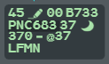
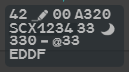
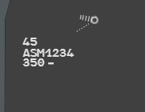

Every flight on the picture is in one state, and the state sets its colour. Read the
colour first: it tells you whether a flight is yours, coming to you, or only worth
watching.

## Four colours

| Family | Colour | Meaning |
|---|---|---|
| **PREPA** | Green | The flight will be controlled by your sector |
| **RESP** | White | Your sector controls the flight now |
| **SURV** | Light grey | Not yours, or no longer yours, but inside your area of interest |
| **AUTRE** | Grey, half transparent | Of no interest to you a priori |

The colour applies to the whole flight at once: label, leader line, track symbol,
history dots and speed vector.

## The states

| State | When | What you see |
|---|---|---|
| **PREPA not coordinated** | The flight will enter your volumes, but it is still more than 15 minutes from entry and outside your area of interest | Green. No iCoop, no next sector, no exit level. Line 2 shows the actual level and the pilot's selected level, line 3 the destination |
| **PREPA coordinated** | The flight is 15 minutes or less from entry, or already inside your area of interest | Green. Line 2 carries the entry contract: the entry level (EFL) and the entry point (ENAV) |
| **Assumable** | The upstream position has transferred the flight to you and you have not assumed it yet | Green label with a **white callsign**. The track symbol and history dots are already white |
| **Assumed** | You control the flight, or another g-atm position of your suite does | White |
| **Shot** | You have transferred the flight and the next sector has not assumed it yet | White label with a **grey callsign**: the flight is still yours |
| **SURV** | Inside your area of interest without being destined to you (held by another sector under or beside your airspace), or a flight that was yours (transferred, stolen, released) and is still in the area | Light grey. Once the next sector has assumed a flight you transferred, its actual level turns **white** |
| **AUTRE** | Outside your area of interest and not destined to you | Half-transparent grey |

A PREPA not coordinated flight: green, no iCoop box, line 2 with the selected level
`@37`, line 3 with the destination only.

A SURV flight: the same composition in light grey.

### Good to know

- **PREPA is about where the flight goes, not who holds it.** An inbound still
  controlled by the upstream sector is the normal PREPA case: that is when you prepare
  it.
- **A flight that was yours never turns green again.** It stays SURV while it is in your
  area of interest, then becomes AUTRE. The exception is a flight whose route brings it
  back into your sector (see [re-entry](/5g-atm-doc/labels/fields/#re-entry)).
- A POINT on an AUTRE flight makes it SURV (see [POINT](/5g-atm-doc/coordination/point/)).
- A flight plan without a track (FPASD) has its own symbol and label: see
  [FPASD and lost tracks](/5g-atm-doc/correlation/lost-tracks/).
- The state also decides what the filters may hide: see
  [Filter Area and filtering](/5g-atm-doc/position/filters/).

:::note[Differences with the real 4F, because of IVAO]
- In 4-Flight a flight becomes coordinated when the coordination message arrives
  (CoFlight or OLDI). IVAO carries no such message, so g-atm uses a fixed delay: 15
  minutes before entry.
- Any transfer (`$HO`) sent to your position makes the flight assumable, whichever
  centre it comes from. Without a transfer, an inbound stays PREPA coordinated until you
  assume it.
:::

## The area of interest

The area of interest (AoI) surrounds your area of responsibility:

- your volumes, widened by **20 NM** sideways;
- the same floors and ceilings, extended by **1,000 ft** for a flight that is not RVSM
  approved, so that it turns SURV, and is shown, as it approaches the sector.

Every track inside the AoI is PREPA, RESP or SURV, never AUTRE.

g-atm compares each flight's profile with your volumes in three dimensions: the floor
and ceiling of each slice count, not only the outline. A flight crossing your sector two
hundred levels above it is not PREPA. The comparison looks **60 minutes** ahead and is
repeated every **20 seconds**. Your volumes are those of the sectors your position holds
(see [OP CONF and PREPA mode](/5g-atm-doc/cco/op-conf/)).

Until the first comparison has answered, g-atm uses the outline of your sectors and a
15-minute projection of each flight's heading: a flight heading into your sectors (or
inside them and controlled by nobody) is PREPA not coordinated, a flight that was yours
stays SURV while it is in or heading into them, the others are AUTRE.

## How a track is drawn

The track symbol (ring, top right), the history dots behind it, and the dotted leader
line down to the label.

| Element | What it is |
|---|---|
| **Track symbol** | A small ring at the radar position. It turns cyan under the pointer |
| **History dots** | One bar per position received, across the route. The newest is the widest, the oldest shrinks to a dot: the tail shows where the flight comes from, the spacing shows its ground speed. On by default, 15 of them |
| **Leader line** | A dotted line from the track to the label. It aims at the centre of the label and stops at its edge. When you hover the label, it continues faintly under the dark background |
| **Speed vector** | Off by default. A line ahead of the track, in one-minute segments separated by a small gap |

To change them:

- **History dots**: Radar Menu → **History Dots**, 5, 10 or 15, or off.
- **Speed vectors for all flights**: Radar Menu → **Velocity Vectors** (1, 3 or 6
  minutes), or the VV keys: **VV ON/OFF** (`V`), **VV 1'** (`1`), **VV 3'** (`3`),
  **VV 6'** (`6`).
- **Speed vector for one flight**: **Ctrl + left click** on its ground speed field, or
  Track Menu → **Individual VV**.
- A flight with a [warning](/5g-atm-doc/markings/highlights/#warnings) always shows its
  speed vector.

The Radar Menu opens with **Ctrl + left click** on the radar picture, the Track Menu with
**Ctrl + left click** on a track symbol: see
[Radar Menu and Track Menu](/5g-atm-doc/position/radar-menu/).

---

*4-Flight booklet 3.0: §2.1–2.2 (p. 11–15).*
