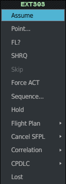
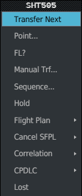
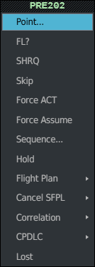
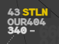

The frequency state says which position has a flight on frequency. You take a flight with
**Assume**, hand it to the next sector with a **shoot**, take a flight nobody gave you with
**Force Assume**, and give a flight back with **Deassume**. All of them start from the
Callsign Menu. The 4F terms used here (RESP, PREPA, SURV, AUTRE, NS, CFL, XFL…) are in the
[Glossary](/5g-atm-doc/reference/glossary/).

## The Callsign Menu

**Left click** the callsign of a label. The Callsign Menu opens with its **first entry under
the pointer**, and its header writes the callsign in the flight's state colour.

That placement is what makes the 4F **fake double click** work: a left click opens the menu,
and a second left click without moving the mouse picks the first entry. Take your time
between the two clicks; it is two clicks, not a system double click. The first entry is:

- **Transfer Next** on a flight you hold (you shoot it);
- **Assume** on a flight offered to you;
- **Activate** on a plan that is not active yet;
- **Point...** on any other flight, so a fake double click never takes a flight by force.

Two entries go above those when they are offered: **Modify ETO...** and **Reset Estimates**
(table below).

The entries depend on the flight's state, but their order never changes:

| Entry | Offered when | See |
|---|---|---|
| **Modify ETO...** | Active plan that the radar has never correlated | [Departures](/5g-atm-doc/traffic/departures/) |
| **Reset Estimates** | Your flight passed its last route point more than 10 minutes ago | [Changing the route](/5g-atm-doc/profile/route/) |
| **Transfer Next** | You hold the flight. Greyed without a next sector, or when nobody holds the next volume | Below |
| **Activate** | The plan is not active yet | [Finding and editing plans](/5g-atm-doc/correlation/flight-plans/) |
| **Assume** | The flight is shot to you, or it is PREPA coordinated and no position of your centre holds it | Below |
| **Refuse** | A transfer offer to you is waiting | Below |
| **Point...**, **End Point** | Always; End Point while a POINT is running | [POINT](/5g-atm-doc/coordination/point/) |
| **Reclaim** | You shot the flight and the next sector has not assumed it yet | [Reclaim](/5g-atm-doc/frequency/skip-shrq/) |
| **FL?** | A next sector online can receive the request | [NEGO and FL?](/5g-atm-doc/coordination/nego/) |
| **SHRQ** | The flight is PREPA | [SHRQ](/5g-atm-doc/frequency/skip-shrq/) |
| **Skip** / **Un-Skip** | PREPA coordinated / after a Skip | [SKIP](/5g-atm-doc/frequency/skip-shrq/) |
| **Force ACT** | The next sector is online but not served yet | [Next sector and Force ACT](/5g-atm-doc/coordination/next-sector/) |
| **Deassume** | See below | Below |
| **Force Assume** | The flight is not yours, not shot by you, and Assume is not offered | Below |
| **Manual Trf...** | You hold the flight | [Manual transfer](/5g-atm-doc/frequency/transfer/) |
| **Sequence...** | Always | [Sequencing arrivals](/5g-atm-doc/traffic/sequencing/) |
| **Hold** | Not on an APL, nor on a plan never correlated | [Holding](/5g-atm-doc/traffic/holds/) |
| **Force STAY entry** | You hold the flight and its plan has a STAY it has not entered | [Switch, patrol, STAY](/5g-atm-doc/particular/switch-patrol-stay/) |
| **Flight Plan ▸** | Always: Route Mod..., Modify..., Dyp Info... | [Route](/5g-atm-doc/profile/route/), [Modify](/5g-atm-doc/correlation/flight-plans/), [DyP Info](/5g-atm-doc/labels/dyp-info/) |
| **Cancel SFPL ▸** | Always: Delete | [Finding and editing plans](/5g-atm-doc/correlation/flight-plans/) |
| **Correlation ▸** | Always: Manual Correl, Cancel Correl, Downgrade ModeS Correl | [Finding and editing plans](/5g-atm-doc/correlation/flight-plans/) |
| **CPDLC ▸** | Always: History..., Editor Window... | [CPDLC](/5g-atm-doc/cpdlc/overview/) |
| **Lost** / **Cancel Lost** | Always, last entry | [LOST](/5g-atm-doc/frequency/skip-shrq/) |

Greyed entries are shown but do nothing.

## Assuming a flight

A flight you should take on frequency is either **assumable** (shot to you by the previous
sector) or **PREPA coordinated** when it comes from another centre. See [States and
colours](/5g-atm-doc/flights/states/).

1. Left click its callsign.
2. Left click **Assume**.

Or use the fake double click on the callsign. The label turns to the RESP colour: the flight
is yours.

Assume is the first row, so a fake double click takes the flight. Skip is greyed: no
position of your centre holds this flight.

On IVAO a transfer offer waits for an answer. **Refuse**, under Assume, sends the flight back
to the position that offered it. The real 4F has no such entry.

## Shooting a flight

A shoot transfers the flight to the next sector. The nominal case needs two things: you hold
the flight, and the next sector planned on its profile is **served**. The NS field (next
sector) is then **white**: white means "a click here shoots". Grey means the sector is
planned but not served yet.

:::note[IVAO]
On the real system the next sector is served when the automatic coordination reaches it.
g-atm counts it as served when the flight enters it within 15 minutes, the horizon at which
that sector sees the flight PREPA coordinated, or at once after a **Force ACT**. A volume
nobody holds is never served.
:::

Three ways to shoot:

- **Fake double click on the NS field.** The first click opens the MAN TRF menu with the
  planned next sector under the pointer; the second click shoots.
- **Fake double click on the callsign.** Transfer Next is the first entry.
- **Callsign Menu → Transfer Next.**

The flight is then **shot**: it stays yours until the next sector assumes it, and
**Reclaim** lets you take it back meanwhile. If g-atm knows the frequency of the receiving
position, it also posts `<callsign>, Contact <position> on <frequency>, good day.` on your
frequency's text channel.

A **Transfer Confirmation** window may ask you to confirm first (CFL not equal to XFL,
CPDLC dialogue pending). See [Transfer
Confirmation](/5g-atm-doc/frequency/transfer/#transfer-confirmation).

### Shooting to a grey NS

If you shoot while the NS field is still grey (too early, or a wrong click), g-atm:

1. does a **Force ACT** at once: the sector is now served and the field turns white;
2. opens the Transfer Confirmation window with **Sector has just been coordinated** as its
   first line.

**Transfer** sends the flight. **Cancel** transfers nothing, but the sector stays served.
Both the NS field and the callsign lead there, so Transfer Next is not greyed on a grey NS.
It stays greyed when the profile has no next sector, or when nobody holds that volume: use
[Manual Trf...](/5g-atm-doc/frequency/transfer/) or Deassume.

## Force Assume and stolen flights (STLN)

**Force Assume** takes a flight that was not shot to you. It is offered where Assume is not:
on a PREPA coordinated flight held by another position of your centre, and on SURV, AUTRE and
PREPA not coordinated flights. It sits lower in the menu, so the fake double click cannot
take a flight by force.

The first row is Point...; Force Assume is further down.

When the position that held the flight (or was receiving it) belongs to **your centre**, the
flight is **stolen**. Two positions are in the same centre when their callsigns share the
prefix before the first `_`. **STLN** then appears in line 0 on both positions:

| Position | STLN |
|---|---|
| You, who took the flight | Label colour |
| The position that lost it | Warning yellow, on a dark block |

Hover it: the tooltip names the sector that lost the flight, then the one that took it
(`RAE STOLEN BY RAW`). **Right click** STLN to acknowledge it on your position: it then shows
only in the selected label, in label colour.

STLN clears when the position that lost the flight takes it back with Force Assume, or when
the one that took it gives it back with Deassume. Taking a flight from another centre raises
no STLN.

## Deassume

**Deassume** gives a flight back at system level: after it, no position holds the flight.
It is offered on a flight you hold when:

- you took it with Force Assume; or
- no next sector can receive it: the profile has none, or nobody is online for that volume.

Otherwise you hand the flight over with Transfer Next or Manual Trf..., and Deassume is not
in the menu.

g-atm drops the clearances it kept for the flight (CFL and the others) and posts
`<callsign>, Switch to UNICOM 122.800, good day.` on your frequency's text channel.

:::note[IVAO]
The booklet keeps Deassume for a flight taken by Force Assume. g-atm also offers it when no
next sector can take the flight, because on the network you need a way to let a flight
leave controlled airspace.
:::

---

*4-Flight booklet 3.0: §10.1–10.2 (p. 109–112).*
