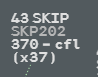
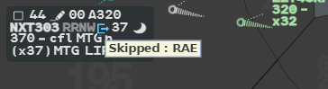
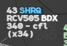
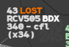

These Callsign Menu functions change who works a flight, or say something about its radio
contact. Most of them exist only between g-atm positions: other clients on the network
ignore them. The 4F terms are in the [Glossary](/5g-atm-doc/reference/glossary/).

## SKIP: delegating a flight to the previous sector

Use SKIP when you do not need to work a flight that is coming to you: the previous sector
keeps it and transfers it directly to the sector after you.

1. The flight must be **PREPA coordinated** and held by a position of **your centre**.
2. Left click its callsign, then **Skip**. The entry is greyed when no position of your
   centre holds the flight.

On your position, **SKIP** appears in line 0 in label colour, and the label looks like a
flight you have handed over: callsign grey, the rest white, nothing bold.

On the previous sector, the one holding the flight:

- the **iNS** indicator appears after the NS field, action blue on a dark block;
- the NS field moves on to the sector after the skipped one, and the XFL may change with it;
- hovering iNS shows `Skipped : RAE`. When the [iNS
  alert](/5g-atm-doc/alerts/monitoring/#ins-alert) is raised too, a first line names the
  sector crossed: `Crossed : …`;
- a **right click** on iNS acknowledges it: it turns to label colour and shows only in the
  selected label. Another sector skipping later does not turn it blue again.

To undo, choose **Un-Skip** in your Callsign Menu, as long as the flight has not been
transferred past you. g-atm also undoes the skip by itself when the profile no longer
crosses your volumes, or when the XFL or EFL moves by more than 999 ft.

The sector that received the delegation cannot give an XFL outside the levels of the
skipped sector: g-atm refuses it with `<callsign> XFL <level> out of skipped sector limits`.
If a sector other than the delegate assumes the flight, your SKIP mention goes away.

:::caution[Not in g-atm]
SKIP works only inside your centre. Skipping the first sector of the centre, which would
delegate the flight to the previous centre, is not offered.
:::

## SHRQ: asking for a flight

SHRQ (shoot request) asks the sector that has a flight on frequency to shoot it to you.

1. The flight must be **PREPA** (not assumable).
2. Left click its callsign, then **SHRQ**. The entry is dimmed while a SHRQ is already shown
   on the flight.

The request goes to the position that has the flight on frequency, and to the positions the
profile crosses between it and you. **SHRQ** appears in line 0:

| Position | SHRQ |
|---|---|
| You, who asked | Label colour |
| The positions that receive it | Action blue, on a dark block |

Hover it: the first line names the sector that asked and its frequency, the second the
sector that has the flight (`From UF 134.960` / `To UH`). A **right click** acknowledges it
on your position only; it then shows only in the selected label.

SHRQ goes away:

- on a position that received it, when that position shoots the flight;
- everywhere, when a position assumes the flight;
- when the position that asked goes offline.

:::note[IVAO]
On the network a flight may be held by nobody. SHRQ then sends the pilot a private message,
`Good day, please contact <your position> on <frequency>`, and the mention stays until you
have assumed the flight and the pilot reports your frequency. A SHRQ to a sector reaches
only g-atm positions.
:::

## Reclaim: taking back a flight shot by mistake

You shot a flight and the next sector has not assumed it yet: **Callsign Menu → Reclaim**.
You hold the flight again and the transfer offer is withdrawn.

On IVAO every transfer waits for the next sector to assume it, so the flight stays shot, and
Reclaim offered, until then.

:::caution[Not in g-atm]
The booklet's cases of a next sector reached by OLDI (with or without COF/MAS messages) do
not exist: the network has no OLDI.
:::

## LOST: a flight lost on frequency

Mark a flight you have lost radio contact with.

1. Left click its callsign.
2. **Lost**, the last entry.

**LOST** appears in line 0, orange on a dark block, on every g-atm position of your centre.
**Cancel Lost**, in the same place, removes it. Nothing is sent to the pilot or to the
network.

## Changing the Comm Resp

The **CR** field of the selected label says which responsibility has the flight on frequency.
It matters when your position holds several responsibilities.

1. Point at a flight you hold so that its selected label opens, and **left click** the CR
   field. The `cr` column of the Sector List does the same.
2. The **Chg Com Resp** menu opens, with two tabs:

| Tab | Lists |
|---|---|
| **SCH** | The responsibilities the flight crosses, in crossing order, the current Comm Resp included |
| **OTH** | The other responsibilities of your position, in alphanumeric order |

3. **Left click** the responsibility. The menu closes and the CR field changes.

With the **DLK** button the change also goes to the pilot by CPDLC: see [Transfer and Comm
Resp](/5g-atm-doc/cpdlc/transfer/). The Comm Resp is not sent to the network. It is shared
with the g-atm positions of your centre, so that a flight follows its responsibility when
the configuration changes: see [Splitting, grouping, roles](/5g-atm-doc/cco/regrouping/).

---

*4-Flight booklet 3.0: §10.5–10.9 (p. 116–122).*
