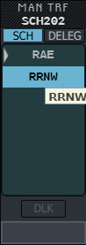
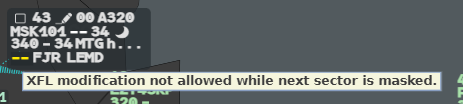
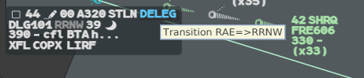
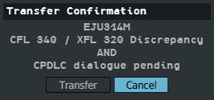

The **MAN TRF** menu shoots a flight to any online position, or prepares the sector you mean
to give it to. The NS field (next sector) can be masked or prepared without touching the
flight's profile. For XFL, ELO and the other 4F terms, see the
[Glossary](/5g-atm-doc/reference/glossary/).

g-atm writes every position with one short name, everywhere: the name of the responsibility
it holds in your [OP CONF](/5g-atm-doc/cco/op-conf/) (`RAW`, `RAE`, `BDX`…). A position that is
not in your OP CONF gets the last two letters of its prefix and its middle part:
`LIRR_NW_CTR` is `RRNW`.

## The MAN TRF menu

Open it with:

- a **left click on the NS field**, on any flight: the planned next sector is under the
  pointer;
- **Callsign Menu → Manual Trf...**, on a flight you hold.

The header writes `MAN TRF` and the callsign. Two tabs sort the online positions:

| Tab | Lists |
|---|---|
| **SCH** | The positions the profile crosses after you, in crossing order. The planned next sector comes first, marked by a grey triangle |
| **DELEG** | Every other online position, in alphabetical order |

Hover a row to see `sector: frequency` in a tooltip.

| Gesture | Effect |
|---|---|
| **Left click** a row | Shoots the flight to that position. Only on a flight you hold; on any other flight it does nothing |
| **Middle click** a row | Prepares that sector (Prepa NS, below) |
| Type the first letters in the field, **Enter** | Picks the first matching row |
| **Enter** alone | Picks the lit row: the planned next sector, unless you moved |
| **↑** / **↓** | Moves the lit row |
| **Escape**, or a click outside | Closes the menu |

A manual transfer **is** a shoot: you cannot change the next sector without shooting the
flight. When you shoot to a position the profile does not plan, that position stays in the NS
field until the transfer is done or taken back (Reclaim, refusal, Deassume).

To transfer by datalink instead, press the **DLK** button of the menu, or hold the **CPDLC**
key (`Alt`) while you click the NS field. See [Transfer and Comm
Resp](/5g-atm-doc/cpdlc/transfer/).

## Masking the NS field

Masking hides the next sector on your picture, for instance while you are not sure where
the flight goes. The profile does not change.

1. **Ctrl + right click** on the NS field: `--` replaces the NS **and** the XFL.
2. **Ctrl + right click** again to unmask.

While the NS is masked:

- the XFL opens no menu and no contextual filter. Point at its dashes: they turn yellow and
  a tooltip says `XFL modification not allowed while next sector is masked.`;
- the NS field has no tooltip and takes no highlight nor acknowledgement. A left click still
  opens the MAN TRF menu on the planned sector, so you can still shoot;
- the mask stays through a REV of the next sector. Only you remove it.

## Preparing the NS: Prepa NS

Prepare the sector you intend to transfer the flight to when it is not the one the profile
plans.

1. Open the MAN TRF menu (left click on the NS field).
2. **Middle click** the sector.

The NS field then shows that sector in brackets, `[BDX]`, in the base and the selected label.
In the MAN TRF menu an orange arrow marks it. The tooltip of the field gives the computed
next sector, then the prepared one and its frequency:
`Coflight NS: RAE / [BDX] : 130.230`. The [DyP Info](/5g-atm-doc/labels/dyp-info/) shows
the prepared sector and its frequency.

- Preparing transfers nothing: you still shoot from the MAN TRF menu.
- If the computed next sector changes while another sector is prepared, the prepared sector
  turns action blue and bold. **Right click** it to acknowledge.
- Middle click the same sector again to remove the preparation.
- Masking and Prepa NS combine: the prepared sector stays in brackets and the XFL is masked.

A prepared sector that is not the profile's next sector raises the [iNS
alert](/5g-atm-doc/alerts/monitoring/#ins-alert) as the flight comes close to the planned
sector.

Masking and Prepa NS are shared with the other g-atm position of your suite. See [Sharing
between positions](/5g-atm-doc/cco/sharing/).

## The DELEG indicator

**DELEG** in line 0 tells you that you hold (or can assume) a flight whose profile does not
actually go through your sector. It happens after:

- a Force Assume on a flight that does not cross your volumes;
- a manual transfer you received for a flight outside your volumes;
- a profile change after you assumed the flight.

The flight then takes the exit conditions of the sector it is in: its NS field and its
agreed exit level are read from that sector. The tooltip names both:
`Transition RAE=>RRNW`.

DELEG is action blue on a dark block, after the other mentions of line 0. **Right click** it
to acknowledge: it turns to label colour and stays in the base label.

g-atm remembers the flights it has seen in your volumes since the session started: a flight
that crossed your sector and left it is not DELEG.

## Transfer Confirmation

Before a transfer leaves, g-atm asks you to confirm it when there is a reason to:

| Line in the window | When |
|---|---|
| `Sector has just been coordinated` | You shot to a grey NS: g-atm has just done the Force ACT |
| `CFL 190 / XFL 300 Discrepancy` | The CFL is not the XFL. Without an XFL, the CFL is compared with the ELO shown |
| `CPDLC dialogue pending` | An uplink is waiting for its answer, or a pilot request is waiting for yours |

The window **Transfer Confirmation** writes the callsign, then the reasons, joined by `AND`
when there are several. It opens with **Cancel** under the pointer.

- **Transfer** sends the transfer.
- **Cancel** sends nothing.

Nothing leaves while the window is open, a CPDLC transfer included. Every way of
transferring goes through it: the NS field, the callsign, Transfer Next and the MAN TRF menu.

---

*4-Flight booklet 3.0: §10.1.c, §10.3–10.4 (p. 110–116); §12.4 (p. 149–151).*
