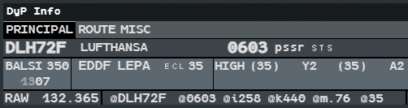
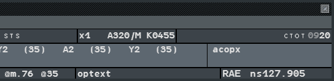
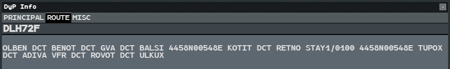
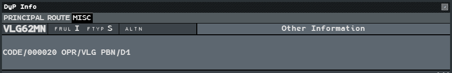

The DyP Info shows a flight in a format close to a paper strip. It repeats data from the
extended label, and adds data that is not about your sector directly: the sectors the
flight will cross and the exit level of each, the centre entry and exit points, the filed
route and field 18 of the flight plan.

It is a window of its own: place it anywhere, on any screen, by dragging its title bar.

## Dynamic and static

The two forms show the same data.

| | Dynamic | Static |
|---|---|---|
| **Open** | **Tools → DyP Info** | Callsign Menu → **Flight Plan** → **Dyp Info...** |
| **Shows** | The flight whose label (or list row) you hover. The last flight hovered stays displayed | The flight it was opened on, always |
| **Number** | One | Up to five. A sixth does not open: close one first |
| **Placed** | Where you left it | At the pointer |

Close either with its cross. The dynamic DyP is part of your standard configuration if it
was open when you saved it: **Set Up → Standard Configuration Recall**, or the
**Conf. STD** key (`F6`), brings it back (see
[CLEAN and standard configuration](/5g-atm-doc/position/clean-standard/)).

Use the dynamic DyP as a reading pane while you work; open static ones to keep a few
flights side by side while you sort out a situation.

## PRINCIPAL tab

The PRINCIPAL tab of DLH72F, in two halves. Its three rows:

| Row | Fields, left to right |
|---|---|
| **1** | Callsign and telephony designator (`LUFTHANSA`); assigned code (`0603`) and previous assigned code (`pssr`); `STS` indicators; number of aircraft, type and wake category, filed speed (`x1 A320/M K0455`); missing equipment, in yellow; `CTOT` |
| **2** | Centre entry point, its level and estimate (`BALSI 350`, `1307`); ADEP and ADES; `ECL`; the sectors crossed with their exit level (`HIGH (35)`, `Y2 (35)`…); centre exit point (`acopx` when unknown) |
| **3** | Comm Resp and its frequency (`RAW 132.365`); Mode S data (`@DLH72F @0603 @i258 @k440 @m.76 @35`: Mode S callsign, code, indicated airspeed, ground speed, Mach, selected level); op text; next sector and its frequency (`RAE ns127.905`) |

- **Sectors crossed.** Every elementary sector of the flight's profile, yours or not, read
  on the volumes. The exit level agreed for your sector is written as is, on your last
  sector; elsewhere the level the profile plans at the exit, in brackets.
- **Missing equipment** is shown in yellow on a dark cell: `no8`, `noR`, `noW`.
- **Next sector.** When you have prepared a next sector, the DyP shows the prepared
  sector and its frequency; otherwise the computed next sector (see
  [Manual transfer, NS, DELEG](/5g-atm-doc/frequency/transfer/)).
- **Number of aircraft.** **Left click** on it to change it (see
  [Switch, patrol, STAY](/5g-atm-doc/particular/switch-patrol-stay/)).
- A field with no data shows its mnemonic in lower case, such as `pssr`, `cr` or `optext`.
- Times are UTC; the hours are dimmed, the minutes bright.

:::note[Differences with the real 4F, because of IVAO]
- IVAO has no departure slot: the `CTOT` field shows the departure time of the filed
  flight plan.
- Comm Resp and next sector are positions (`RAW`, `RAE`), not elementary sectors: on IVAO
  one position holds all its sectors under one callsign.
- When no next sector is online, its frequency is UNICOM.
:::

## ROUTE tab

The route of the filed flight plan, wrapped at the spaces. The footer gives the page
(`1/1`).

## MISC tab

Flight rules (`FRUL`), flight type (`FTYP`), alternate (`ALTN`), and under
**Other Information** the content of field 18 of the filed flight plan.

---

*4-Flight booklet 3.0: §3.4 (p. 29–32).*
