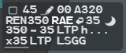
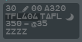

This page is the reference for the fields of the label. Most fields are clickable, and
the gestures follow one logic:

- **left click** opens the menu of the field;
- **middle click** marks the field for the suite, **Ctrl + middle click** marks it for you
  alone (see [Highlights](/5g-atm-doc/markings/highlights/));
- **middle click held** on CFL, XFL, iFlux or Comm Resp runs a contextual filter for as
  long as you hold (see [Contextual filters](/5g-atm-doc/conflicts/contextual-filters/));
- **right click** removes, cancels or acknowledges.

A clickable field darkens under the pointer. The actual level is written on three digits
(`350`); the other levels on two, in thousands of feet (`35` = FL350).

## Line 0

| Field | Shows | Gestures |
|---|---|---|
| **iCoop** | The suite cooperation box, selected format only | **Left** or **right click**: ticks or unticks it, and marks the flight Seen. See [iCoop](/5g-atm-doc/markings/notes/#icoop) |
| **Ground speed** | Tens of knots, `45` = 450 kt. A Ⓜ or ⓚ follows when a speed is assigned | **Left click**: speed menu. **Ctrl + left click**: individual speed vector. **Right click**: removes the assigned speed. See [Speed, rate and AMID](/5g-atm-doc/clearances/speed-rate/) |
| **Assigned speed** | The speed cleared, selected format | **Left click**: speed menu. **Right click**: removes it |
| **iCoor** | A pencil, or an envelope when a note is posted | **Left click**: iCoor Menu. **Right click** on the envelope: deletes the note. See [iCoor](/5g-atm-doc/markings/notes/#icoor) |
| **Vertical speed** | Hundreds of ft/min: `+19`, `-20`; `00` below 200 ft/min | **Left click**: rate menu (selected format) |
| **Sequence number** | The arrival sequence number | **Right click**: clears it. See [Sequencing arrivals](/5g-atm-doc/traffic/sequencing/) |
| **Aircraft type** | ICAO type, `A320`, selected format | — |
| **Mission** | `SAR`, `HEAD`, `FFR`, `MEDEVAC` from field 18 | — |

After these come the mentions and alerts, listed [below](#mentions-on-line-0).

## Line 1

| Field | Shows | Gestures |
|---|---|---|
| **Callsign** | The flight identification; `+` after it for a patrol | **Left click**: Callsign Menu, opened with its first entry under the pointer, so a second click without moving (the 4F fake double click) transfers the flight. **Ctrl + left click**: adds it to or removes it from the [analysis group](/5g-atm-doc/conflicts/group-sep-qdm/). **Right click**: Seen, and acknowledges all REVs |
| **Datalink bolt** | The flight is connected to your CPDLC station. Orange when a dialogue fails, blue on a pilot request | **Right click**: acknowledgement menu. See [CPDLC](/5g-atm-doc/cpdlc/overview/) |
| **NS**, next sector | The short name of the next position (`RAE`). On the base label only near the exit (10 minutes), or when forced. White when a transfer is possible. A prepared sector shows in brackets | **Left click**: Manual Transfer menu, the planned sector under the pointer: a fake double click shoots. **Ctrl + right click**: masks or unmasks the field. **Right click**: acknowledges a REV or a prepared sector. Hover: its frequency. See [Assume and shoot](/5g-atm-doc/frequency/assume-shoot/) and [Manual transfer, NS, DELEG](/5g-atm-doc/frequency/transfer/) |
| **Re-entry** | The flight will come back into your sector | See [Re-entry](#re-entry) |
| **iNS** | Sectors crossed or skipped | Hover: their list. See [SKIP, SHRQ, Reclaim, LOST, Comm Resp](/5g-atm-doc/frequency/skip-shrq/) |
| **TaFL** | Target flight level: the highest cruise level computed ahead of the flight. `TAFL` when none is known | **Left click**: Profile menu, to change the cruise level. Hover: the xRFL. See [Changing a level](/5g-atm-doc/profile/levels/) |
| **Op text tag** | The flight carries an operational text | Hover: the text |
| **Warning** | A moon in the label colour; coloured when a warning is set | **Left click**: next warning (blue, orange, yellow, none). See [Warnings](/5g-atm-doc/markings/highlights/#warnings) |

## Line 2

| Field | Shows | Gestures |
|---|---|---|
| **AFL**, actual level | The flight level, three digits. Yellow after 12 s without update, `afl` after 15 s | — |
| **Trend** | Climbing, descending, or `-` level | — |
| **CFL**, cleared level | Two digits, `cfl` when none | **Left click**: CFL menu, opened on the exit level so that a fake double click clears it. **Middle click held**: CFL filter. See [Levels: the CFL menu](/5g-atm-doc/clearances/levels/) |
| **EFL**, entry level | PREPA coordinated only, in place of the CFL | **Left click**: EFL menu. **Right click**: acknowledges its REV. See [Changing a level](/5g-atm-doc/profile/levels/) |
| **CNAV** | The next point the flight will overfly, or the direct you cleared. Selected format | **Left click**: CNAV menu. See [Route and heading](/5g-atm-doc/clearances/route-heading/) |
| **ENAV** (Edata) | PREPA coordinated only: the entry point, in place of the CNAV | **Left click**: eCOOR menu. See [Xcoor and Ecoor](/5g-atm-doc/markings/notes/#xcoor-and-ecoor) |
| **Heading** | `h...`, or `h270` with a heading symbol in place of the point when a heading is cleared | **Left click**: heading menu. **Right click**: removes the heading |
| **@SFL** | On a PREPA not coordinated, SURV or AUTRE flight: the level the pilot has selected | — |

## Line 3

| Field | Shows | Gestures |
|---|---|---|
| **XFL**, exit level | `x31`, `▲25`, `▼14` (see [Exit direction](#exit-direction)). Underlined when entered by hand; in brackets, `(x33)`, when only proposed; grey during a negotiation; `XFL` when none | **Left click**: XFL menu (see [Changing a level](/5g-atm-doc/profile/levels/)). **Middle click held**: XFL filter. **Right click**: acknowledges its REV |
| **HFL** | The holding level | See [Holding](/5g-atm-doc/traffic/holds/) |
| **Xdata** | The exit point (xPREF or XNAV), or an Xcoor note | **Left click**: xCOOR menu. See [Xcoor and Ecoor](/5g-atm-doc/markings/notes/#xcoor-and-ecoor) |
| **STAR** | With the Athis Rule local setting only | **Left click**: STAR menu. Hover: its first five points. See [Runway and STAR](/5g-atm-doc/traffic/runway-star/) |
| **iFlux** | The exit flow, or the destination | **Left click**: shows or removes the [Flight Leg](/5g-atm-doc/labels/flight-leg/). **Right click**: Seen and REV acknowledgement. **Middle click held**: destination filter. Hover: the STAR name |

## Extended format fields

| Field | Gestures |
|---|---|
| `@h`, `@i`, `@m`, `@sfl` | Marking only. See [Aircraft data](/5g-atm-doc/labels/formats/#aircraft-data-heading-ias-mach-selected-level) |
| **ADES** | **Left click**: shows or removes the Flight Leg. **Middle click held**: destination filter |
| **STAR**, **ARWY** | **Left click**: STAR menu, RUNWAY menu. Hover the STAR: its first five points |
| **CR**, Comm Resp | **Left click**: Comm Resp menu (see [SKIP, SHRQ, Reclaim, LOST, Comm Resp](/5g-atm-doc/frequency/skip-shrq/)). **Middle click held**: Comm Resp filter |
| **ns** frequency, **op-t**, clearance line | Marking only |

The tab fields are described in [Label formats and tabs](/5g-atm-doc/labels/formats/#extended-format).

## Mentions on line 0

Mentions follow the fixed fields of line 0. Each belongs to a chapter of its own:

| Mention | Meaning | Chapter |
|---|---|---|
| `STCA`, `TCT`, `APW` | Safety nets | [Safety nets](/5g-atm-doc/alerts/safety-nets/) |
| `EMRG`, `HJCK`, `RDOF`, `RVMC`, `SURT`, `ATTN` | Emergency codes | [Monitoring and other alerts](/5g-atm-doc/alerts/monitoring/) |
| `CLAM`, `@35` (DSAM), `INTRU`, `EFL`, `?`, `noW` / `exW` / `unW` | Monitoring alerts | [Monitoring and other alerts](/5g-atm-doc/alerts/monitoring/) |
| `STLN` | Flight taken by force by another position | [Assume and shoot](/5g-atm-doc/frequency/assume-shoot/) |
| `DELEG` | Delegation indicator | [Manual transfer, NS, DELEG](/5g-atm-doc/frequency/transfer/) |
| `SKIP`, `SHRQ`, `LOST` | Frequency states | [SKIP, SHRQ, Reclaim, LOST, Comm Resp](/5g-atm-doc/frequency/skip-shrq/) |
| Telephone symbol, `PS` | Next or previous sector to coordinate | [Next sector and Force ACT](/5g-atm-doc/coordination/next-sector/) |
| POINT, NEGO and FL? symbols | Coordinations in progress | [POINT](/5g-atm-doc/coordination/point/), [NEGO and FL?](/5g-atm-doc/coordination/nego/) |
| `DUPE`, `@FID`, a code to give | Correlation problems | [Correlation alerts](/5g-atm-doc/correlation/alerts/) |
| SEQi, stack letter, EAT, `HCT` | Holding | [Holding](/5g-atm-doc/traffic/holds/) |
| `STAR` in blue | The STAR is no longer valid | [Runway and STAR](/5g-atm-doc/traffic/runway-star/) |
| `STAY` | The flight is in a STAY area | [Switch, patrol, STAY](/5g-atm-doc/particular/switch-patrol-stay/) |
| A message such as `SAR` | A special transponder code | [VFR, military, special codes](/5g-atm-doc/particular/vfr-mil/) |
| `IDENT` | The pilot pressed IDENT | — |

A CPDLC message waiting for an answer sits on its own line above line 0: see
[Sending clearances](/5g-atm-doc/cpdlc/uplinks/).

## Exit direction

The sign in front of the exit level says where the flight leaves your volumes:

| Sign | Exit |
|---|---|
| `x` | Through the walls, sideways |
| `▼` | Through the floor |
| `▲` | Through the ceiling |

g-atm compares the exit level with the vertical band of your volumes stacked at the exit
point. A level beyond the band means an exit through the floor or the ceiling, level
flight included. A level inside the band means the walls, unless the flight is climbing or
descending toward a limit it is next to. A flight moving away from its exit level keeps
the `x`.

## ENAV, XNAV and xPREF

| Point | What it is |
|---|---|
| **ENAV** | The first route point after the entry limit of your sector. Shown on line 2 of a PREPA coordinated flight. When you assume the flight, the ENAV becomes the CNAV |
| **XNAV** | The first route point after the exit limit |
| **xPREF** | The preferred exit point of the flow, from the letter of agreement. When it exists, it takes the place of the XNAV |

The exit point field (Xdata) shows the xPREF, otherwise the XNAV; `COPX` when neither is
known. Both points are recomputed when a direct or a route change modifies the profile.

## iFlux

The iFlux is the exit trajectory of the flight at centre level: the name of the exit
point, followed by `*` when the exit is vertically constrained, or the destination when
the aerodrome is enough. It is computed on the whole filed route, so it is the same in
every sector of the centre and does not change as points are passed.

:::note
iFlux rules are defined per centre. g-atm 2.0.0 ships the rules of Reims (LFEE). In the
other centres the iFlux is the destination.
:::

## Re-entry

When the profile shows the flight leaving your sector and coming back later, a re-entry
symbol appears on line 1, between the next sector and the TaFL, in the base and selected
formats. It disappears during the second passage.

## Label keys

Three keys change what the base labels show, for all flights:

| Key | PC key | Effect |
|---|---|---|
| **iFlux** | `F7` | Shows or hides the iFlux on base labels |
| **Type avion** | `Insert` | Shows or hides the aircraft type on base labels, at the end of line 0 |
| **Label STD** | `Pause` | Back to the initial setting |

Each key inverts the display: it shows the field where the base label does not have it,
and hides it where it does (the destination of a PREPA not coordinated flight). The
**Conf. STD** key (`F6`) also brings back the initial setting.

:::caution
A controller taking over your position may find fields hidden by these keys. Press
**Label STD** before you leave.
:::

## Occultation

The base label hides a value that repeats another one. The selected format shows
everything.

| Field | Hidden on the base label when |
|---|---|
| **CFL** | The flight is at that level (within 200 ft) |
| **EFL** | The flight is at that level (within 200 ft) |
| **XFL** | It equals the CFL or the EFL |
| **@SFL** | It equals the actual level (within 200 ft) |

A hidden field comes back when it is in REV or marked. An assumed flight with no exit level
at all, neither set nor proposed, keeps the `XFL` mnemonic on its base label: it still
needs one.

The opposite case, a value that is missing: the field shows its mnemonic, `TAFL` here.

### ▲ and ▼ of a hidden exit level

When the XFL is hidden because it equals the CFL, and the flight leaves through the floor
or the ceiling, the `▼` or `▲` stays alone on line 3. It reminds you to transfer the flight
to the sector below or above. An exit through the walls shows nothing.

This indicator is a local setting, on by default: **Tools → External Applications → Local
Settings → XFL Exit Indicators** (see [Local Settings](/5g-atm-doc/reference/local-settings/)).

---

*4-Flight booklet 3.0: §3.1.c–i, §3.2 (p. 20–28).*
