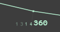
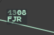
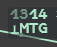

The Flight Leg draws the route of a flight on the radar picture: its points, the estimated
time over each, the changes of filed level, and its switch and STAY points if it has any.
Use it to see where a flight is going before you clear it or coordinate it.

## Showing a Flight Leg

### Permanently

Any of these shows the Flight Leg until you remove it:

- **left click** on the **iFlux** field (line 3 of the selected label);
- **left click** on the **ADES** field of the extended label;
- **left click** on the `ades` or `iFlx` cell of the flight's row in a flight list;
- Track Menu (**Ctrl + left click** on the track symbol) → **Flight Leg**.

### Automatically: Flight Leg Auto

With **Set Up → Flight Leg Auto** ticked, hovering the label of a **Not Seen** flight, or
its row in a list, shows its Flight Leg for as long as the pointer stays there. Once the
flight is Seen, hovering no longer shows it (see
[Seen, Not Seen and REV](/5g-atm-doc/flights/seen-rev/)).

Flight Leg Auto is on by default and is saved with your standard configuration.

The Flight Leg also appears on its own, for the time of the action, while you hover the
points of the CNAV menu and while you extrapolate an analysis group.

## Reading a Flight Leg

At rest, each point carries its estimate only (UTC, `1314`), hours dimmed and minutes
bright. `360` is the filed level that starts at that point.

| Element | Meaning |
|---|---|
| **Line** | Starts at the track symbol and goes straight to the first point. When the flight is more than 2 NM off its route, a dashed line joins it to the route first |
| **Point** | A small mark at each route point, with its estimated time beside it, on the outer side of the turn |
| **Filed level** | Written next to the estimate, at the point where the filed level (RFL) changes |
| **Switch and STAY symbols** | In blue, above the estimate of the point concerned (see [Switch, patrol, STAY](/5g-atm-doc/particular/switch-patrol-stay/)) |
| **Reversed T** | Before the name of a point the route now passes abeam: after a direct, the skipped points keep an estimate taken abeam |
| **Orange disc** | The end of the Flight Leg |

### When you hover

Hover the flight's label, or the Flight Leg itself (within 5 px of the line): the label
switches to the selected format and each point shows its estimate and its name in a dark
box.

After a direct, MTG is passed abeam: its name starts with the reversed T.

### Phase colours

**Tools → External Applications → Flight Leg Phase Colors** draws the climbs in green and
the descents in blue; the cruise keeps the Flight Leg colour. It is a g-atm addition, off
by default, and saved with your settings.

## Removing a Flight Leg

- **Right click** on the Flight Leg.
- The same **left click** that showed it (iFlux, ADES, list cell, Track Menu entry).
- **CLEAN** key (`End`), or Radar Menu → **Clean** → **RR-Flight Leg / Lost Tracks**:
  removes every Flight Leg at once (see
  [CLEAN and standard configuration](/5g-atm-doc/position/clean-standard/)).

:::note
A right click next to the Flight Leg, not on it, keeps its usual meaning.
:::

---

*4-Flight booklet 3.0: §3.3 (p. 28–29).*
