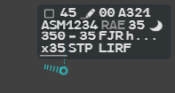
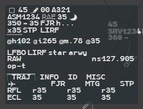
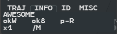
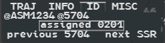

A label has three formats. The base format is the one you work with; hovering and the
mouse wheel open the others when you need more.

| Format | How you get it | What it shows |
|---|---|---|
| **Base** | Always | Three or four lines, no background: only what you need to control |
| **Selected** | **Hover** the label | Four lines on a dark translucent background: every field of the flight |
| **Extended** | **Mouse wheel** over the selected label | The selected lines, more data underneath, and four tabs |

Move the pointer off the label and it returns to the base format. While a menu opened from
one of its fields is open, the label stays as it is. A selected label comes in front of its
neighbours. Hovering the flight's row in a list, or its Flight Leg, also selects the label.

To move a label, **drag** it with the left button.

## Base format

For a flight you control:

| Line | Content |
|---|---|
| **0** | Ground speed, in tens of knots (`45` = 450 kt), then any mention or alert |
| **1** | Callsign. The next sector joins it when the exit is less than 10 minutes away; then the re-entry symbol and the warning symbol, if any |
| **2** | Actual level (AFL), vertical trend, cleared level (CFL), hidden once reached |
| **3** | Exit level (XFL), only when it says something |

A line with nothing to show is not drawn. The rules that hide redundant values are under
[Occultation](/5g-atm-doc/labels/fields/#occultation).

The other states change lines 2 and 3:

- **PREPA coordinated**: line 2 shows the entry level (EFL) in place of the CFL.
- **PREPA not coordinated, SURV, AUTRE**: line 2 shows the actual level, the trend and the
  pilot's selected level (`@SFL`). A PREPA not coordinated flight has its destination on
  line 3; SURV and AUTRE flights have no line 3.

Two kinds of field are forced onto the base label: a field in
[REV](/5g-atm-doc/flights/seen-rev/#rev-highlight), and a field you have
[marked](/5g-atm-doc/markings/highlights/).

## Selected format

The selected label of an assumed flight, line by line:

| Line | Fields | In the picture |
|---|---|---|
| **0** | iCoop box, ground speed, iCoor, vertical speed, aircraft type, then mentions | `☐ 45 ✎ 00 A321` |
| **1** | Callsign, next sector, TaFL, warning symbol | `ASM1234 RAE 35 ☾` |
| **2** | AFL, trend, CFL, CNAV (next point), heading | `350 - 35 FJR h...` |
| **3** | XFL, exit point (Xdata), iFlux | `x35 STP LIRF` |

By state:

- **PREPA coordinated**: line 2 holds the entry contract, AFL, trend, **EFL** and **ENAV**
  (the entry point). When the flight becomes assumable, line 2 returns to clearances.
- **PREPA not coordinated, SURV, AUTRE**: no iCoop, no next sector, line 2 reduced to AFL,
  trend and `@SFL`, line 3 reduced to the destination.
- With the **Athis Rule** local setting on, the STAR sits on line 3 between the exit point
  and the iFlux (see [Local Settings](/5g-atm-doc/reference/local-settings/)).

Every field is described, with its gestures, in [Label fields](/5g-atm-doc/labels/fields/).

### Mnemonics

A field that has no value shows its name instead, so that you can still click it:
`cfl`, `efl`, `star`, `arwy`, `cr`, `op-t`, `@sfl`, `h...` (heading), `TAFL`, `XFL`.

## Extended format

Roll the **mouse wheel** over the selected label. The first notch opens the extended
format on the **TRAJ** tab.

Under the four selected lines:

| Line | Content |
|---|---|
| **Mode S** | `@h` heading, `@i` indicated airspeed, `@m` Mach, `@` selected level (see below) |
| **Aerodromes** | ADEP, ADES, STAR, arrival runway |
| **Frequencies** | Comm Resp (`cr`): the position that has the flight on frequency. On the right, `ns` and the frequency of the next sector; UNICOM (122.800) when no next sector is online |
| **Op text** | The operational text, `op-t` when empty |
| **Clearance line** | On a flight you do not control: the clearances the sector holding it has given (CFL and CNAV; heading and speed too on a PREPA not coordinated, SURV or AUTRE flight) |
| **Proposed exit** | On a PREPA not coordinated flight: the exit level the letter of agreement gives, or an estimate in brackets |
| **Tabs** | TRAJ, INFO, ID, MISC |

### Moving between tabs

- Wheel **down**: next tab, TRAJ → INFO → ID → MISC.
- Wheel **up**: previous tab. At either end the wheel stays on the last tab: the label
  never closes under the wheel.
- **Left click** on a tab opens it directly.

### TRAJ

The route points ahead of the flight, four per row, with two levels for each:

- **RFL**: the filed level in force at that point, prefixed `r`;
- **ECL**: the cruise level the flight will actually hold there.

`...` means more points follow. **Left click** on a point opens the Profile menu, to change
the ECL up to that point (see [Changing a level](/5g-atm-doc/profile/levels/)).

### INFO

| Field | Content |
|---|---|
| Radio callsign | The telephony designator, `AWESOME` here |
| RVSM | `okW`, `noW`, `exW` or `unW`. **Left click** to set the equipment by hand (see [Monitoring and other alerts](/5g-atm-doc/alerts/monitoring/)) |
| 8.33 | `ok8` or `no8`, from field 10a of the flight plan |
| RNAV | `p-R` or `noR`, from the PBN codes of field 18 |
| Number and wake | `x1 /M`. **Left click** on the number to change it (see [Switch, patrol, STAY](/5g-atm-doc/particular/switch-patrol-stay/)) |
| Fourth line | The `STS/` indicators of field 18. MEDEVAC, SAR, FFR and HEAD also appear on line 0 |

### ID

- `@ASM1234 @5704`: the Mode S callsign and the transmitted code (tSSR).
- `assigned 0201`: the code assigned to the flight (aSSR).
- `previous`: the code assigned before the current one (pSSR); `next`: the future code
  (nSSR). `SSR` stands for an unknown code: `next` always shows it.

### MISC

The tab opens and is empty: the booklet does not describe it (it is for technical
support).

## Aircraft data: heading, IAS, Mach, selected level

The Mode S line shows data that comes from the aircraft. g-atm never shows an invented
value: when a value is not known, the field shows its mnemonic (`@h...`, `@sfl`).

| Field | In a g-atm simulation | On the IVAO network |
|---|---|---|
| `@h` heading | Exact | Real: the heading in the position report, converted to magnetic with the sector file's variation |
| `@i` IAS, `@m` Mach | Exact | Computed from the ground speed and the wind and temperature aloft (Open-Meteo forecast). Absent until the wind for that area has arrived |
| `@` selected level | Exact | Not carried by the network: always `@sfl` |

The selected level also feeds `@SFL` on line 2 of the flights you do not control, and the
DSAM alert, which therefore only works in a simulation (see
[Monitoring and other alerts](/5g-atm-doc/alerts/monitoring/)).

---

*4-Flight booklet 3.0: §3.1.a–c (p. 19–25).*
