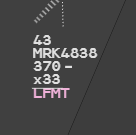
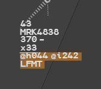
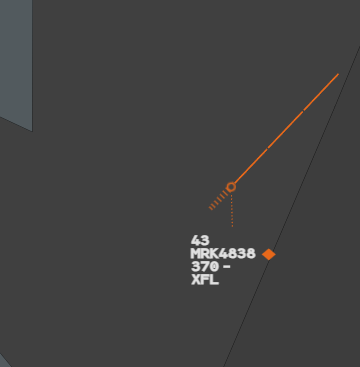
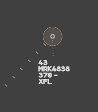

Markings are memory aids. They draw your eye, or your colleagues' eyes, to a flight or to
one of its fields. They are not clearances and are never sent to the pilot.

## Local and Suite Highlight

A highlight makes one field of a label stand out and keeps it in view.

| Highlight | Gesture | Looks like | Seen by |
|---|---|---|---|
| **Suite Highlight** | **Middle click** on the field | Rust background under the field | You and the g-atm positions of your suite |
| **Local Highlight** | **Ctrl + middle click** on the field | Pink text | You alone |

The same gesture again removes the highlight.

:::note
Your suite is the set of positions that hold the same responsibility as yours. Suite
objects are shared only between g-atm positions: a controller on another client sees
nothing. See [Sharing between positions](/5g-atm-doc/cco/sharing/).
:::

A Local Highlight on the destination: `LFMT` is pink, and stays on the base label.

### What can be highlighted

Every field of the label: the fields of the base and selected formats, the first level of
the extended format (Mode S data, aerodromes, STAR and runway, Comm Resp, next sector
frequency, op text, clearance line) and the fields of the TRAJ, INFO and ID tabs. Even the
vertical trend.

Not the indicators and alerts that have a colour of their own (STCA, TCT, emergency codes,
INTRU, warning, SEQi…): their colour must not be hidden.

On a track with no flight plan (uncorrelated), only the callsign can be highlighted, and
only with a Suite Highlight (see [Correlation alerts](/5g-atm-doc/correlation/alerts/)).

### What a highlight forces

- A highlighted field of the **selected** format appears on the **base** label, at its
  place.
- A highlighted field of the **extended** format appears **under** the base label, one
  line per line of origin.
- A highlighted field of a **tab** stays in its tab: it is not forced onto the base label.
- A highlighted flight stays on the picture **even if the filters would hide it**.

Suite Highlights on `@h044`, `@i242` (extended format) and `LFMT`: all three stay under the
base label.

:::caution[Short press or held]
On CFL, XFL, iFlux (ADES) and Comm Resp, the middle button does two things. A **short**
middle click highlights. A middle click **held** runs a contextual filter for as long as
you hold (see [Contextual filters](/5g-atm-doc/conflicts/contextual-filters/)).
:::

## Warnings

A warning colours a flight so that you do not lose it: you have three colours to sort
flights between them.

| Warning | Symbol |
|---|---|
| **Blue** | Moon |
| **Orange** | Diamond |
| **Yellow** | Star |

The track symbol, history dots, speed vector and leader line take the colour. In the
label, only the symbol is coloured, at the end of line 1 (base and selected formats).
Without a warning, the selected label shows the moon in the label colour.

An orange warning: the label text stays white, the diamond closes line 1.

### Setting and removing a warning

On the track symbol:

1. **Middle click**: blue.
2. **Middle click** again: orange, then yellow, then blue again.
3. **Right click** on the track symbol: removes the warning.

From the label, useful when tracks overlap: **left click** on the moon of the selected
label. Each click moves to the next warning: blue, orange, yellow, then none.

### What a warning does

- It keeps the flight on the picture **even if the filters would hide it**.
- It shows the flight's **speed vector**, even when speed vectors are off, at the length
  chosen for all vectors.
- It is shared with the g-atm positions of your suite.

## Track Ring

The Track Ring draws a circle around a track, to keep a distance in view.

1. **Ctrl + left click** on the track symbol: the Track Menu opens.
2. Click **Track Ring**: a ring of the value shown next to the entry (`1NM` at first).
3. Or hover **Track Ring** and choose **1NM**, **3NM** or **6NM** in its submenu. The value
   you choose becomes the one shown next to the entry.

The value is the **diameter** of the circle, centred on the track symbol. Click
**Track Ring** again (it is ticked) to remove the ring.

A 1 NM Track Ring: a thin brown circle, lightly filled.

The other entries of the Track Menu are described in
[Radar Menu and Track Menu](/5g-atm-doc/position/radar-menu/).

---

*4-Flight booklet 3.0: §4.2 (p. 33–36).*
