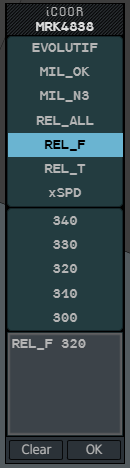
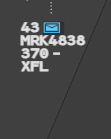
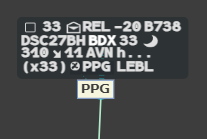
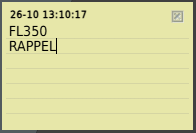

Annotations let you write down what no protocol field carries: a flight you have dealt
with, a message for your colleagues, a point agreed on the telephone, a reminder.

| Tool | Where | Seen by |
|---|---|---|
| **iCoop** | A box on line 0 of the label | You and the g-atm positions of your suite |
| **iCoor** | A pencil or an envelope on line 0 | You and the g-atm positions of your suite |
| **Xcoor**, **Ecoor** | Over the exit point or the entry point | You alone |
| **Notepad** | A post-it on the radar picture | You alone |

Your suite is the set of positions that hold the same responsibility as yours. Suite
objects are shared only between g-atm positions (see
[Sharing between positions](/5g-atm-doc/cco/sharing/)).

## iCoop

The iCoop is a cooperation box at suite level: tick it to tell your suite, and yourself,
that the flight has been dealt with.

- It is the first field of line 0 of the **selected** label, on PREPA coordinated,
  assumable and assumed flights.
- **Left click** or **right click** on it ticks or unticks it.
- Any click on it also marks the flight **Seen** and acknowledges its REVs (see
  [Seen, Not Seen and REV](/5g-atm-doc/flights/seen-rev/)).
- It starts unticked. Any REV on the flight unticks it.

:::note
The booklet lets a centre show an unticked iCoop on the base label too. g-atm keeps the
iCoop in the selected format only.
:::

## iCoor

The iCoor posts a short message on a flight for the other controllers of your suite.

### Posting a message

1. In the selected label, **left click** on the pencil (line 0, after the ground speed).
   The iCoor Menu opens.
2. Build the text:
   - click one of the preset texts: it replaces the content of the text area;
   - click a level in the list: it is added at the end (`REL_F 320`), or replaces the
     level that already ends the text. The list opens on the flight's level, marked by
     an arrow;
   - or type in the text area.
3. Click **OK**, or press `Enter`.

**Clear** empties the text area (greyed when it is already empty). **OK** on an empty text
area removes the note. `Escape` closes the menu without changing anything.

The preset texts are EVOLUTIF, MIL_OK, MIL_N3, REL_ALL, REL_F, REL_T and xSPD. They are a
local setting of the real system and can differ from one centre to another; g-atm uses
those of the booklet.

### What the others see

| | On your position | On the other positions of your suite |
|---|---|---|
| **Symbol** | An open envelope, in the label colour, in place of the pencil | A **blue closed envelope**, already on the base label |
| **Read** | — | After 5 seconds of hovering the envelope, or when they open the menu. The envelope opens and takes the label colour; it then shows in the selected format only |

Hovering the envelope shows the text in a tooltip. **Left click** on it opens the menu with
the text. **Right click** on it deletes the note, for the whole suite.

A message received and not read yet: the blue envelope is on the base label.

### Released flights

To note that a flight is released, choose a text starting with `REL` (REL_ALL, REL_F,
REL_T), then click a level, or type a heading and a speed. `REL` then shows next to the
envelope on line 0, on the base and selected labels: blue until read, then in the label
colour. It stays on the base label.

## Xcoor and Ecoor

Xcoor and Ecoor note the result of a coordination made on the telephone: the exit point
(Xcoor) or entry point (Ecoor) you agreed, or a heading.

| Note | Field | Available on |
|---|---|---|
| **Xcoor** | Exit point (Xdata), line 3 | Assumed, assumable and PREPA coordinated flights |
| **Ecoor** | Entry point (ENAV), line 2 | PREPA coordinated flights only |

### Posting a note

1. In the selected label, **left click** on the exit point (resp. the entry point). The
   xCOOR (resp. eCOOR) menu opens.
2. Choose a preset, **HDG** or **DCT**, and complete it (`HDG 270`); or pick a point of the
   route ahead in the list; or type. The arrow marks the point the field shows now.
   While the menu is open, the point you pick is joined to the flight by a preview line.
3. Click **OK**, or press `Enter`.

To remove a note, open the menu, click **Clear**, then **OK**.

The note takes the place of the point, behind its symbol (ⓧ for Xcoor, ⓔ for Ecoor). On
the base label the symbol shows alone; hover it to read the note.

:::caution[A note, nothing more]
An Xcoor or Ecoor changes nothing: not the XNAV or ENAV underneath, not the CNAV, not the
trajectory. It is not shared: your Xcoor never fills the next sector's Ecoor. It is
dropped when the flight's state no longer has the field (an Ecoor when the flight stops
being PREPA coordinated, an Xcoor when it becomes SURV or AUTRE).
:::

:::note[In a g-atm simulation]
On a simulation server, your Xcoor becomes the Ecoor of the next sector, and the other
way round (see [Joining a simulation](/5g-atm-doc/simulation/joining/)).
:::

## Notepad

The Notepad is a post-it on your radar picture, for anything you want to keep in front of
you. It stays on your position.

1. **Tools → Notepad**, or the **Note** key (`Scroll Lock`). A yellow post-it appears at
   the top left of the picture, dated (UTC).
2. Type your text: one line per ruled line.
3. **Left click** on the date to change the colour: yellow, pink, blue.

Each call adds one more post-it, slightly offset from the previous one. **Drag** a
post-it by its background to move it. Close it with the box at its top right.

:::caution
Post-its are not saved: they disappear when you close g-atm.
:::

---

*4-Flight booklet 3.0: §4.1, §4.3 (p. 33, 36–40).*
