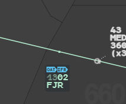
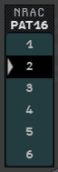
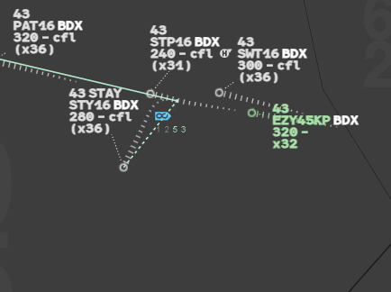
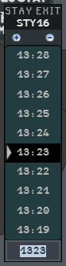

Some flight plans carry particular items: a change of flight rules or flight type on the
way (a switch), several aircraft flying together (a patrol), or a time spent manoeuvring in
an area (a STAY). This page shows how g-atm displays them and how you change them.

## Mixed flights: switch points

A switch is a change of flight rules (VFR/IFR) or of flight type (GAT/OAT) filed in the
plan. The point where it happens shows on the flight's
[Flight Leg](/5g-atm-doc/labels/flight-leg/) with a blue symbol: **GAT**, **OAT**, **VFR** or
**IFR**, then the point name, the estimated time and the requested flight level (RFL) there.

For a double change (flight type and flight rules on the same point) both symbols show,
flight type first, then flight rules.

Point labels of the Flight Leg are drawn above the track labels. They are translucent: a
label underneath still reads through, and a click on it still reaches the label.

### Lose, remove or insert a switch

- A **direct** or a resume of navigation does not remove the switch: its symbol stays at
  the abeam point.
- A **route modification** loses the switch if its point is no longer on the new route. To
  remove a switch on purpose, modify the route graphically through a point abeam the switch
  point.
- To **insert** a switch, open the **Route MOD** menu (Callsign Menu → **Flight Plan** →
  **Route Mod...**), choose the point in **From**, and type in **Then** the new piece of
  route with the switch: previous point, switch type, next point (for example
  `<point> OAT <point>`). Then choose the rejoin point in **Rejoin**.

The Route MOD menu is described in [Changing the route](/5g-atm-doc/profile/route/).

g-atm rejects (`Route rejected`) a sequence that does not hold together: a switch type
follows the point it applies to, and a point carries at most one change of flight type and
one change of flight rules.

## Patrols

A flight of more than one aircraft is a patrol. A **+** follows its callsign on the label
and in the lists. The number of aircraft (`x2`) is in the **DyP Info** and in the **INFO**
tab of the extended label (`x2/M`).

To change the number of aircraft:

1. Left click the number field (NRAC) in the INFO tab of the extended label, or in the
   DyP Info. The **NRAC** menu opens.
2. Left click the number.

The menu goes from 1 to 9 (six rows show at a time). The value amends the flight plan;
choosing 1 removes the **+**.

:::note[IVAO]
The network does not carry the number of aircraft in its plan amendments. Your position
keeps the value you chose as long as the server sends the same plan back; it gives way when
the pilot files a new plan.
:::

## STAY

A STAY lets a flight manoeuvre freely in an area for a while. The plan gives the entry
point, the exit point and the duration, in the route: `<entry> STAY1/<hhmm> <exit>`.

### A filed STAY

The Flight Leg shows the entry and exit points of the STAY with their symbols, estimated
times and RFL. The exit estimate is the time at the entry point plus the duration, and the
following points are shifted by as much.

### Entering the STAY

The flight enters the STAY by itself when it **overflies the entry point**: with no
clearance, or on a direct to the entry point or to a point before it. Then:

- **STAY** shows in line 0 of the label, after the speed, in the label colour, from the base
  label on;
- progress is blocked: the Flight Leg starts again from the entry point, and a dotted line
  joins the track to it, wherever the flight turns.

A flight on a heading, on a direct beyond the entry point or off its route passes abeam the
point and does not enter by itself. Force it in:

1. Open the **Callsign Menu**.
2. Left click **Force STAY entry** (between **Hold** and **Flight Plan**).

**Force STAY entry** is offered only on a flight you have assumed (RESP, not yet
transferred) whose plan has a STAY it has not entered.

### Change the exit time

The flight must already be in STAY.

1. Left click the **STAY** mention on the label. The **STAY EXIT** menu opens on the
   current exit time.
2. Either left click **+** or **−** to add or remove one minute (the menu stays open), left
   click a time in the list, or type a time (`HHMM`) and press **Enter**.

Nothing happens when the exit time passes.

### Leaving the STAY

Overflying the exit point does **not** take the flight out of the STAY, even before the
time. To end it, whatever the time, give a **direct** to any point or a **heading** (other
than the one the flight had when it entered).

### Add or remove a STAY

Open the **Route MOD** menu, choose the point in **From**, type the new piece of route in
**Then**, and choose the rejoin point in **Rejoin**. In **Then**:

- to add a STAY: `<entry> STAY1/<hhmm> <exit>` (the number of the STAY, then its duration);
- to remove it: the old entry point, then the old exit point.

Keep the switch point and the STAY entry point apart: g-atm rejects a point that carries
both.

:::caution[Limits]
- Only the first STAY of a plan is followed.
- The STAY freezes the estimates of the Flight Leg only: the times in the lists and the
  transition data are not frozen.
- **Reset Estimates** is refused for a flight in STAY.
- The booklet's option to show switch and STAY in the Sector List is not in g-atm: read
  them on the label and the Flight Leg.
:::

---

*4-Flight booklet 3.0: §15.2.b–d, §15.3, §15.4 (p. 190–195).*
