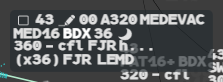

VFR and military flights are hidden by default. Some flights also carry a mission type or a
special transponder code that the label shows, or that you have to look for.

## Show VFR and military flights

In the Filter Area of the Global Menu (right end):

- left click **VFR** or **MIL**, or press the **VFR** key (`F9`) or the **MIL** key (`F8`).
  The button turns blue while those flights are shown;
- or left click **See ALL**, or press **Tous vols** (`F10`), to show every filtered flight,
  from the ground to the ceiling, whatever its code.

Press the same button or key again to hide them. The Filter Area is described in
[Filter Area and filtering](/5g-atm-doc/position/filters/).

A flight that is **PREPA coordinated** or **RESP**, or in an alert or a coordination, is
always shown, whatever the filter (see [States and colours](/5g-atm-doc/flights/states/)).

:::note[IVAO]
The real 4F recognises VFR and military flights by their transponder code. On IVAO:

- a **VFR** flight squawks `7000`, or has filed a VFR plan (rule `V`);
- a **military** flight has filed flight type `M`: the network gives out no military codes.

The two are independent: a military flight depends on the MIL button only, whatever its
flight rules.
:::

:::note[VFR plans]
The booklet warns that VFR plans never correlate, because the flight plan system does not
handle them. On IVAO VFR plans are filed like the others and correlate normally. A track
with no plan gets an APL, as for any flight (see
[Finding and editing plans](/5g-atm-doc/correlation/flight-plans/)).
:::

## Mission types

Some missions filed in field 18 of the plan (`STS/`) show on the label:

| Mission | Where |
|---|---|
| `MEDEVAC`, `SAR`, `HEAD`, `FFR` | End of line 0 of the **selected label**, in the label colour |
| Others: `HOSP`, `HUM`, `STATE`… | Look in the **DyP Info** or the **INFO** tab of the extended label |

When several line-0 missions are filed, the first of `MEDEVAC`, `SAR`, `HEAD`, `FFR` is
shown. See [DyP Info](/5g-atm-doc/labels/dyp-info/) and
[Label formats and tabs](/5g-atm-doc/labels/formats/).

## Special transponder codes

The real 4F can show a message for some non-emergency codes (such as RVTL or MARPOL) in
line 0 of the base label, in the label colour. The codes are set up by each centre.

:::caution[Not in g-atm]
g-atm has the mechanism, but its table of special codes is empty in 2.0.0: the booklet gives
no code. No flight shows such a message.
:::

Emergency codes are a different matter: 7500, 7600, 7601 (RVMC), 7700 and the other forced
codes always show, with their mention. See
[Monitoring and other alerts](/5g-atm-doc/alerts/monitoring/).

---

*4-Flight booklet 3.0: §15.1, §15.2.a (p. 189–190).*
