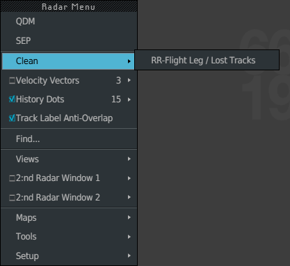

**CLEAN** clears the analysis leftovers from the picture in one action. The **standard
configuration** is the display your position starts with, and the one you go back to on
demand.

## CLEAN

Two ways:

- Radar Menu (**Ctrl + left click** on the image) **▸ Clean ▸ RR-Flight Leg / Lost
  Tracks**. The entry is on the second level on purpose, so that a stray click cannot
  clean your picture.
- The **CLEAN** key (`End`).

| CLEAN removes | CLEAN leaves |
|---|---|
| Every Flight Leg on display | SEP, QDM and CPA measures |
| Every set of Range Rings | The analysis group |
| LKP (Last Known Position) markers older than 15 seconds: hidden, you can show them again | Individual velocity vectors and Track Rings |
| Lost tracks older than 15 seconds: removed | Markings, iCoor, notes, Datablocks |

CLEAN changes the display only. It never releases a flight, never cancels a clearance and
never touches flight data. For LKP and lost tracks, see
[FPASD and lost tracks](/5g-atm-doc/correlation/lost-tracks/).

## The standard configuration

On the real position, each sector and role receives its standard display from offline
parameters. In g-atm you save it yourself, once per position.

### What it holds

| Saved | Details |
|---|---|
| Filters | Level band, VFR, MIL. See ALL always comes back off |
| Maps | The maps you chose. Your sector drawings are not part of it: the mapping lights them |
| Radar image | Zoom and centre |
| Views 1 to 3 | See [Moving around the picture](/5g-atm-doc/position/navigation/) |
| Windows and lists | Open or closed, position, size |
| List settings | Columns shown, sort column and direction, font, header line |
| Airport lists | The lists you created for the position (arrival, departure, sequencing…) and their aerodromes |
| Secondary images | Those on screen when you save |
| Flight Leg Auto | On or off |

Windows that belong to one flight (static DyP Info, CPDLC windows) and dialogues (OP CONF
CHG PREP, column and SETTING menus of a list) are never part of a standard.

The recall also puts the labels back in their standard position and their base fields
back to the standard set.

### Save it

1. Set the position as you want it: filters, maps, picture, windows, lists.
2. **Tools → External Applications → Standard Configuration → Save Current as Standard**.

The standard belongs to your position: its key is the text of the OE/Role field
(`RAW/TACTICAL`), or `FREE`. Another sector or another role has its own standard. A
position with no saved standard gets g-atm's: band 55–660, VFR and MIL hidden, the
default picture, no map chosen, lists as g-atm opens them.

The standards are saved in `%APPDATA%\com.jules.g-atm\standard_config.json`, with a copy
in `standards.json` in the same folder.

### When it is recalled

- When g-atm starts.
- When the position changes: from FREE to a sector or back, another sector, another role.
- When you acknowledge the blue OE/Role field after a change of mapping, and when a
  prepared position becomes armed. See [OP CONF and PREPA mode](/5g-atm-doc/cco/op-conf/).
- On demand: the **Conf. STD** key (`F6`), or **Set Up → Standard Configuration Recall**.

The standard recall **does not clean**: Flight Legs, Range Rings and lost-track markers
stay. Use CLEAN for that.

:::tip
To go back to the standard filters only, without touching the rest, use DEFAULT or the
**Default (or Visu STD)** key (`F4`). See
[Filter Area and filtering](/5g-atm-doc/position/filters/).
:::

---

*4-Flight booklet 3.0: §1.8–1.9 (p. 9–10).*
