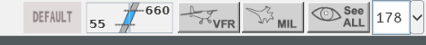
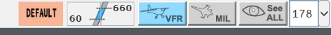

The Filter Area, at the right end of the Global Menu, decides which tracks the radar
image shows. Some flights stay on the picture whatever you set: these are the
**filtering exceptions**.

From left to right: DEFAULT, the level band, VFR, MIL, See ALL and the range field.

## The controls

| Control | What it does | Key |
|---|---|---|
| **DEFAULT** | Grey while every filter is at its standard value. As soon as one differs, it turns **salmon pink**. Left click: back to the standard filters (level band, VFR, MIL, See ALL) | **Default (or Visu STD)** (`F4`) |
| **Level band** | Lower value bottom left, upper value top right. **Mouse wheel** on a value: 5 FL per notch, wheel forward to go up | **Filtre +1000 ft** (`Page Up`) raises the upper value by 10 FL; **Filtre -1000 ft** (`Page Down`) lowers the lower value by 10 FL |
| **VFR** | Shows VFR traffic. The button face turns blue when on | **VFR** (`F9`) |
| **MIL** | Shows military traffic. Blue when on | **MIL** (`F8`) |
| **See ALL** | Shows every track, correlated or not, from the ground up, whatever its code. Blue when on | **Tous vols** (`F10`) |
| **Range field** | The extent of the picture, in NM. See [Moving around the picture](/5g-atm-doc/position/navigation/) | |

The lower value never goes above the upper one. A lower value of 0 means "down to the
ground".

Any change to the standard filters turns DEFAULT pink, so you can see at a glance that
the picture is not the standard one.

### The standard filters

At start, and on every standard recall, the filters take the values of your position's
standard: those you saved, or else the band 55–660 with VFR and MIL hidden. See
[CLEAN and standard configuration](/5g-atm-doc/position/clean-standard/).

:::note
The `F4` key does two things at once: it restores the standard filters and brings back
the secondary images you closed. See
[Secondary images and tracking](/5g-atm-doc/position/secondary-images/).
:::

## Which flights the filters hide

The filters never hide a flight that concerns you.

- **RESP, assumable and PREPA coordinated flights** are always shown in the air, whatever
  the filters.
- **SURV flights** are not subject to the level band.
- **AUTRE flights and PREPA non-coordinated flights** are the only ones the level band
  hides.
- **VFR and MIL** hide their flights first, then the band applies to what is left.

For these state names, see [States and colours](/5g-atm-doc/flights/states/).

How g-atm recognises VFR and military flights on IVAO:

| Category | Recognised by |
|---|---|
| VFR | Squawk 7000, or flight rules `V` in the filed plan |
| MIL | Flight type `M` in the filed plan. IVAO assigns no military codes, so the plan decides |

A military flight depends only on the MIL button, whatever its flight rules.

### Aircraft on the ground

An en-route centre has no radar track of an aircraft at the stand. On the ground, only
your own flights (assumed or assumable) stay on the picture because of their state. Other
aircraft on the ground follow the level band, unless one of the exceptions below holds
them, or the lower value is 0.

## Filtering exceptions

A track stays on the picture, **whatever the level band, VFR and MIL**, when any of these
is true. The order follows the booklet.

| Kind | Cause |
|---|---|
| Alert | INTRU (yellow or blue), robustness indicator `?` on the label, STCA, TCT, HCT, DUPE |
| Alert pair | STCA Info: when one flight of the pair is on the picture by itself, it holds the other one |
| Marking | Local or Suite Highlight, iCoor filled in, Track Ring, Flight Leg displayed |
| Tool | Warning, individual velocity vector, analysis group, Datablock, SEP, CPA, QDM |
| Coordination | POINT or NEGO in progress, sent or received |
| Track status | LOST, emergency descent (E.DESC) entered on the flight |
| CPDLC | A datalink dialogue or request concerning your position |
| Focus | You hover the flight's row in a list (Explicit Focus) |
| Others | A holding constraint entered on the flight; a Tracking Radar Window open on it; an APL; a plan without a track |
| Code | Squawk 7500, 7600, 7601, 7700, 7400 (SURT) or 5677 (ATTN) |

**See ALL** lifts every filter. For the alert and marking names, see the
[Glossary](/5g-atm-doc/reference/glossary/).

:::caution[Not in g-atm]
- Exceptions tied to VV/SSR volumes do not exist: these volumes are parameters of a
  real centre, and nothing provides them.
- The "non-urgent codes per site parameters" (RVTL, MARPOL…) are not configured: no
  extra code is forced by default.
- The standard level band does not depend on the type of sector: it is the one you save
  in your position's standard.
:::

---

*4-Flight booklet 3.0: §1.3.c (p. 3–6).*
