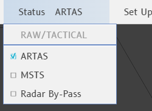
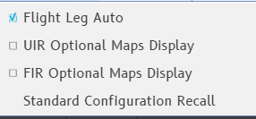
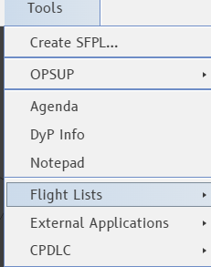

The Global Menu is the strip across the top of the radar image. It holds the clock, the
three menus, your position, the system and mail indicators, and the Filter Area.

## Left to right

| Element | What it does |
|---|---|
| **Clock** | UTC time, `hh:mm:ss` |
| **Status** | Menu: your role, and the radar source. The label next to it shows the source in use (ARTAS) |
| **Set Up** | Menu: Flight Leg Auto, optional maps, standard configuration recall |
| **Tools** | Menu: the tools and windows of the position |
| **Mode field** | `FREE` while no position is chosen, `PREPA` while a position is prepared but you are not in session, empty once the position is armed |
| **OE/Role field** | Your position, for example `RAW/TACTICAL`; `------/------` when free. See below |
| **System Warning button** | At the right end of the OE/Role field. See [System Warning](#system-warning) |
| **Envelope** | Opens the Messages box. See [Messages](#messages) |
| **Filter Area** | Right end of the strip. See [Filter Area and filtering](/5g-atm-doc/position/filters/) |

Here a system message and a text message are both waiting to be read.

### The OE/Role field

- **Left click**: opens the OP CONF CHG PREP window, where you choose your sectors and
  role. See [OP CONF and PREPA mode](/5g-atm-doc/cco/op-conf/).
- **Hover**: a tooltip lists every sector you are responsible for.
- After a change of mapping the field turns **blue** (REV, see the
  [Glossary](/5g-atm-doc/reference/glossary/)). A **left click** or
  **right click** on it acknowledges the change, and the standard configuration of the
  new position applies.

:::caution[Not in g-atm]
The degraded-mode box that sits between Tools and the Mode field on the real position
does not exist: g-atm has no degraded modes.
:::

## Status

The first row repeats your role and responsibility; you cannot click it. The three rows
below choose the radar source: **ARTAS**, **MSTS** or **Radar By-Pass**.

IVAO has a single source of positions: the choice only changes the label next to
Status.

## Set Up

| Entry | What it does |
|---|---|
| **Flight Leg Auto** | Check box, ticked at start. When ticked, hovering a label or a list row shows the flight's route. See [Flight Leg](/5g-atm-doc/labels/flight-leg/) |
| **UIR Optional Maps Display** | Check box: draws the upper airways of the sector file |
| **FIR Optional Maps Display** | Check box: draws the lower airways of the sector file |
| **Standard Configuration Recall** | Recalls the standard configuration of your position, like the **Conf. STD** key (`F6`). See [CLEAN and standard configuration](/5g-atm-doc/position/clean-standard/) |

## Tools

| Entry | What it does |
|---|---|
| **Create SFPL...** | Opens the window to create a flight plan. See [Finding and editing plans](/5g-atm-doc/correlation/flight-plans/) |
| **OPSUP ▸** | Opens nothing: the booklet never describes its submenu |
| **Agenda** | Opens or closes the Agenda. See [Agenda and Datablocks](/5g-atm-doc/conflicts/agenda/) |
| **DyP Info** | Opens the dynamic DyP Info window again after you closed it. See [DyP Info](/5g-atm-doc/labels/dyp-info/) |
| **Notepad** | Places a new note on the image. See [Notepad](/5g-atm-doc/markings/notes/) |
| **Flight Lists ▸** | The lists, below |
| **Stack Manager Windows ▸** | Only on a position with a STAMAN: reopens a STAMAN closed by its cross. See [STAMAN](/5g-atm-doc/traffic/staman/) |
| **External Applications ▸** | What g-atm adds to the position, below |
| **CPDLC ▸ Check Stuck Micro** | Sends the stuck-microphone message to every flight in datalink. See [Other messages](/5g-atm-doc/cpdlc/other-messages/) |

### Flight Lists

A tick means the list is open; click to open or close it. The airport lists show one row
per list you created (for example `ARR : LFXX`) and a **Create...** row.

| Entry | Page |
|---|---|
| **Sector Lists ▸ Sector** | [Splitting, grouping, roles](/5g-atm-doc/cco/regrouping/) |
| **Departure Lists ▸**, **Predeparture Lists ▸** | [Departures](/5g-atm-doc/traffic/departures/) |
| **Arrival Lists ▸**, **Sequencing Lists ▸** | [Sequencing arrivals](/5g-atm-doc/traffic/sequencing/) |
| **Holding Lists ▸** (greyed when no holding point has a list) | [Holding](/5g-atm-doc/traffic/holds/) |
| **Lost List** | [FPASD and lost tracks](/5g-atm-doc/correlation/lost-tracks/) |
| **FL Negotiations** | [NEGO and FL?](/5g-atm-doc/coordination/nego/) |
| **NotSeen/Rev** | [Seen, Not Seen and REV](/5g-atm-doc/flights/seen-rev/) |
| **Sector Uncorrelated APL** | [Finding and editing plans](/5g-atm-doc/correlation/flight-plans/) |

### External Applications

Everything the real position does not have is grouped here.

| Entry | What it does |
|---|---|
| **IVAO Connection** | Check box: opens the Connection to IVAO panel. See [Account settings](/5g-atm-doc/start/configuration/) |
| **Sector File ▸** | **Install…** picks a sector package (`.zip` or `.isc`) on disk; **Sector ID** and **Download** fetch one from IVAO; below, the installed sector files, the loaded one ticked. Click a name to load it; hover it for its full name |
| **Standard Configuration ▸** | **Save Current as Standard**, **Save Current as View 1** to **3**. See [CLEAN and standard configuration](/5g-atm-doc/position/clean-standard/) |
| **Local Settings ▸** | The site parameters of your workstation. See [Local Settings](/5g-atm-doc/reference/local-settings/) |
| **Flight Leg Phase Colors** | Check box: climbing parts of the Flight Leg in green, descending parts in blue |
| **Teamspeak** | Check box: the voice window. See [TeamSpeak](/5g-atm-doc/voice/teamspeak/) |
| **CPDLC Station ▸** | The station state (`LOGGED OFF`, `LOGGED WITH …`), **Connect** or **Disconnect**, and a **Logoff** row per flight in datalink. See [Setting up datalink](/5g-atm-doc/cpdlc/setup/) |
| **ATIS** | Check box: the ATIS window. See [Windows and screens](/5g-atm-doc/position/windows/) |

## System Warning

The System Warning button shows what g-atm notices about its own links: the network
(`NETWORK LINK ESTABLISHED`, `NETWORK LINK LOST`) and the datalink station (its state,
and the error its server returned). g-atm adds no other message.

- **At rest**: a microphone without waves.
- **A message arrives**: it shows for 5 seconds in a light-blue strip just below the
  button, newest on top; hover a line for its UTC time. The button turns to a
  microphone with waves on a light-blue background, and stays so until you open the
  window.
- **Left click** on the button: opens or closes the **System Warning** window, titled
  `System Warning : n : ^TIME`, with a Time and a Msg column. It keeps the last 100
  messages, times in UTC.

## Messages

The envelope opens **Messages**, the text messages with other positions and on
frequencies.

- **Unread**: a closed envelope with speed lines, on a blinking blue background, until
  you open the box. Once read, the open envelope comes back.
- **Left click** on the envelope: opens or closes the Messages window.

In the window, the conversations are on the right, under **CONVERSATIONS**; the selected
one is on the left, with the input line and **SEND** (or `Enter`) below it. A
conversation with an unread message blinks in the list.

| Conversation | How you get it |
|---|---|
| **Your frequency** (`121.430`) | Always there; it follows your position and cannot be closed. What you send is read by everyone on the frequency, pilots included |
| **Another frequency** | **+**, type the frequency (`133.100`), `Enter`. Close it with its cross |
| **Another position** | **+**, type its callsign, `Enter`: a private conversation |

g-atm writes two messages on your frequency by itself:

| When | Message |
|---|---|
| You transfer a flight to the next position | `ABC123, Contact LFXX_APP on 125.000, good day.` |
| You release a flight | `ABC123, Switch to UNICOM 122.800, good day.` |

The transfer message needs the frequency of the next position, from the network's list
of controllers. If that position is not online, the transfer still happens and no
message is sent.

:::note
Each conversation keeps its last 200 messages.
:::

---

*4-Flight booklet 3.0: §1.2 (p. 2).*
