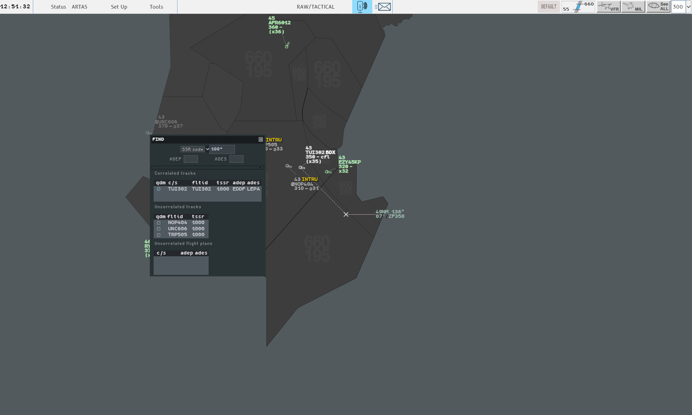

The g-atm screen is laid out like a 4-Flight position: one strip of menus across the top,
the radar image below it, and windows that you open when you need them.

## What is where

The picture shows a position in session, with one window open over the image.

| Area | Where | What it holds | Page |
|---|---|---|---|
| **Global Menu** | The strip at the top | UTC clock, Status, Set Up and Tools menus, the Mode field, your position (OE/Role field), the System Warning button, the mail envelope | [Global Menu](/5g-atm-doc/position/global-menu/) |
| **Filter Area** | Right end of the Global Menu | DEFAULT, the level band, VFR, MIL, See ALL, the range field | [Filter Area and filtering](/5g-atm-doc/position/filters/) |
| **Radar image** | Everything below | Sectors and maps underneath, then tracks, labels and the tools you place | [Moving around the picture](/5g-atm-doc/position/navigation/) |
| **Secondary images** | Floating frames inside the radar image | Up to two extra radar views, plus one tracking window per followed flight | [Secondary images and tracking](/5g-atm-doc/position/secondary-images/) |
| **Windows** | Anywhere, on any screen | Agenda, lists, DyP Info, Messages, System Maps, CPDLC windows… | [Windows and screens](/5g-atm-doc/position/windows/) |

The main window keeps the Windows title bar, with the version number. On the real
position the screen starts with the Global Menu.

## The object you click decides the menu

There is no toolbar over the radar image. Menus open from what you click.

| Gesture | Where | Opens or does |
|---|---|---|
| **Ctrl + left click** | Empty radar image | The **Radar Menu**: display settings and tools |
| **Ctrl + left click** | A chain head (the track symbol) | The **Track Menu** of that flight |
| **Left click** | A label field | The menu of that field |
| **Left click** | A chain head | Adds the flight to the analysis group, or removes it |
| **Middle click**, held | Some label fields | A contextual filter, for as long as you hold |
| **Right click** | Anywhere in an interaction | Leaves it: closes the menu, cancels the armed tool |

See [Radar Menu and Track Menu](/5g-atm-doc/position/radar-menu/),
[Label fields](/5g-atm-doc/labels/fields/),
[Group, SEP, QDM, CPA](/5g-atm-doc/conflicts/group-sep-qdm/) and
[Contextual filters](/5g-atm-doc/conflicts/contextual-filters/).

## Words used for mouse gestures

The guide always writes gestures the same way.

| Term | Meaning |
|---|---|
| **Left click**, **right click**, **middle click** | One press and release of that button |
| **Ctrl + left click** | Left click with the Ctrl key held |
| **Drag** | Press the left button, move, release |
| **Mouse wheel** | Turn the wheel; one notch is one step |
| **Fake double click** | The 4F gesture: a left click opens a menu with its usual entry already under the pointer, and a second left click validates it. It is two separate clicks, slower than a double click |

Many menus open with their first or most likely entry under the pointer, so the second
click validates the common action without moving the hand.

## Suite or Local

The booklet marks some actions **Suite** (seen by every position of your sector suite)
and others **Local** (seen only by you). In g-atm, "Suite" means the other g-atm
positions working with you: other IVAO clients do not receive these markings. See
[Sharing between positions](/5g-atm-doc/cco/sharing/).

## Keys

The real position has a keyboard with named keys (VUE 1, MIL, CLEAN…). g-atm maps each of
them to a PC key; this guide gives both, for example the **CLEAN** key (`End`). The full
table is in [Mouse and keyboard](/5g-atm-doc/reference/mouse-keyboard/). A named key does
nothing while you type in a field, and nothing with Ctrl or Alt held.

---

*4-Flight booklet 3.0: §1.1–1.2 (p. 1–2).*
