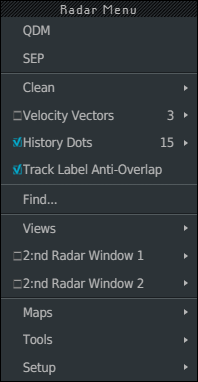
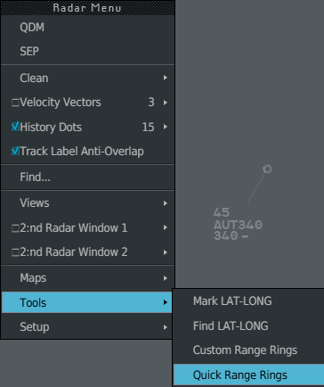
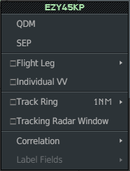

Two menus open with **Ctrl + left click**: the **Radar Menu** on the radar image, for the
display and the tools, and the **Track Menu** on a track, for that one flight. This page
lists their entries; each links to the page that details the tool.

## Radar Menu

**Ctrl + left click** on an empty part of the radar image. The menu opens at the pointer.
Hover a row with **▸** to open its submenu; left click an entry to run it.

The menu as it opens on a fresh position: History Dots and Track Label Anti-Overlap on,
velocity vectors off.

| Entry | What it does | Details |
|---|---|---|
| **QDM** | Arms the bearing and distance tool | [Group, SEP, QDM, CPA](/5g-atm-doc/conflicts/group-sep-qdm/) |
| **SEP** | Arms the separation tool | [Group, SEP, QDM, CPA](/5g-atm-doc/conflicts/group-sep-qdm/) |
| **Range Rings ▸ Interval ▸** 5 Nm, 10 Nm | Only when a set of Range Rings is selected: the spacing of its circles. Open the menu with **Ctrl + left click** at the centre of the set | [Range Rings](/5g-atm-doc/conflicts/range-rings/) |
| **Clean ▸ RR-Flight Leg / Lost Tracks** | Clears Flight Legs, Range Rings and old lost-track markers. On a second level so you cannot clean by accident | [CLEAN and standard configuration](/5g-atm-doc/position/clean-standard/) |
| **Velocity Vectors** ▸ 1, 3, 6, Cancel Ind. | Check box: speed vectors on every track. The number is their length in minutes; the submenu changes it. **Cancel Ind.** removes the individual vectors | [Group, SEP, QDM, CPA](/5g-atm-doc/conflicts/group-sep-qdm/) |
| **History Dots** ▸ 5, 10, 15 | Check box: the past positions of each track. The number is how many | |
| **Track Label Anti-Overlap** | Check box: labels move by themselves so as not to cover each other | [Label formats and tabs](/5g-atm-doc/labels/formats/) |
| **Find...** | Opens the FIND window | [Finding and editing plans](/5g-atm-doc/correlation/flight-plans/) |
| **Views ▸** | Opens nothing (see below) | |
| **2:nd Radar Window 1** and **2** ▸ Define, Recall | Check box: shows or hides the secondary image. **Define** draws a new one, **Recall** brings it back | [Secondary images and tracking](/5g-atm-doc/position/secondary-images/) |
| **Maps ▸** | Opens nothing (see below) | |
| **Tools ▸** | Mark LAT-LONG, Find LAT-LONG, Custom Range Rings, Quick Range Rings | [Range Rings](/5g-atm-doc/conflicts/range-rings/) |
| **Setup ▸** | Opens nothing (see below) | |

**Custom Range Rings** and **Quick Range Rings** arm the two ways of placing Range Rings.

Several entries have a key as well:

| Entry | 4F key | PC key |
|---|---|---|
| QDM | **QDM** | `q` |
| SEP | **SEP** | `s` |
| Velocity Vectors on or off | **VV ON/OFF** | `v` |
| Vector length | **VV 1'**, **VV 3'**, **VV 6'** | `1`, `3`, `6` |
| Clean | **CLEAN** | `End` |
| Find... | **Find** | `f` |
| Quick Range Rings | **Quick RR** | `t` |

:::caution[Not in g-atm]
- **Views**, **Maps** and **Setup** show their arrow but open nothing: the booklet never
  describes their submenus. Use the keys **VUE 1** to **3** (`F1`–`F3`) for views and
  the **MAPS** key (`Home`) for maps.
- **Mark LAT-LONG** and **Find LAT-LONG** only close the menu.
- The booklet's older captures show a **Close UIR** entry at the top. The 3.0 capture of
  this menu does not have it, and nothing says what it does: it is not in g-atm.
- **Flight Leg Auto** is not in this menu: it is in the Global Menu, under Set Up.
:::

## Track Menu

**Ctrl + left click** on a chain head, the symbol at the current position of a track.
When two tracks are close, the nearest chain head under the pointer wins.

The callsign at the top is written in the colour of the flight's state.

| Entry | What it does | Details |
|---|---|---|
| **Create APL...** | First entry, only on an uncorrelated track: creates a plan for it | [Finding and editing plans](/5g-atm-doc/correlation/flight-plans/) |
| **QDM**, **SEP** | Arm the tool, already started from this flight | [Group, SEP, QDM, CPA](/5g-atm-doc/conflicts/group-sep-qdm/) |
| **Flight Leg** | Check box: shows or hides the route of this flight. Not offered on an uncorrelated track or an APL | [Flight Leg](/5g-atm-doc/labels/flight-leg/) |
| **Individual VV** | Check box: a speed vector on this flight only | [Group, SEP, QDM, CPA](/5g-atm-doc/conflicts/group-sep-qdm/) |
| **Track Ring** ▸ 1NM, 3NM, 6NM | Check box: a ring around the track. Click the row to toggle the ring at the value shown; the submenu picks another size | [Highlights, warnings, Track Ring](/5g-atm-doc/markings/highlights/) |
| **Tracking Radar Window** | Check box: opens or closes a window that follows this flight | [Secondary images and tracking](/5g-atm-doc/position/secondary-images/) |
| **Correlation ▸** | **Manual Correl**, **Cancel Correl** when they apply to this track; **Downgrade ModeS Correl** is always greyed | [Correlation alerts](/5g-atm-doc/correlation/alerts/) |
| **Label Fields ▸** | Greyed: the booklet never describes it | |

A **right click** or `Escape` closes the Track Menu without doing anything.

---

*4-Flight booklet 3.0: §1.6–1.8 (p. 6–9).*
