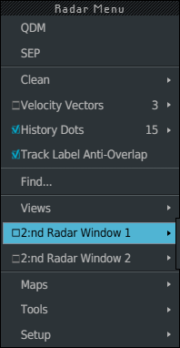
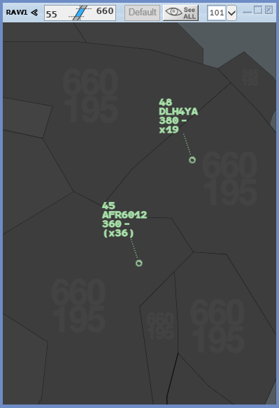
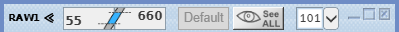
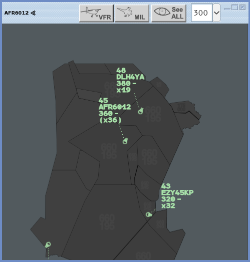

A secondary image is a second radar view inside the main one: another zoom, another
area, its own level band. You have two of them, **2:nd Radar Window 1** and **2**. A
**Tracking Radar Window** is a secondary image that stays centred on one flight.

## Define a secondary image

1. **Ctrl + left click** on the radar image to open the Radar Menu.
2. Hover **2:nd Radar Window 1** (or **2**), then left click **Define**.
3. **Drag** on the main image over the area you want: a frame follows the pointer.
4. Release. The window appears on that area, at the scale of the main image, centred on
   what the frame covered.

A **right click** before you drag cancels **Define**. Defining an image again replaces
the previous one.

## The window

The window has a blue frame and a light bar. Under the bar, the picture shows the same
traffic as the main image, with its trails, speed vectors and labels, at the window's own
view and under its own filters.

From left to right:

| Element | What it does |
|---|---|
| **Name** | Your responsibility and the image number (`RAW1`, `RAW2`), with two chevrons |
| **Level band** | The image's own band. **Mouse wheel** on a value, as in the Filter Area |
| **Default** | Greyed while the band is the standard one. Left click: back to the standard band, See ALL off |
| **See ALL** | Every track in this image, whatever the filters |
| **Range field** and chevron | The extent of this image, in NM: type a value and `Enter`, or pick one in the list |
| **Reduce** | Folds the window up to its bar; click again to unfold |
| **Enlarge** | The window covers the whole main image; click again to go back |
| **Close** | Closes the window. It keeps its definition for **Recall** |

A new image starts with the level band, VFR and MIL settings of the Filter Area at the
moment you define it. It has no VFR or MIL button of its own.

## Work in the window

- **Move the window**: drag its bar.
- **Zoom**: **mouse wheel** over the picture. The point under the pointer stays in place.
- **Pan**: drag the picture.
- **Ctrl + left click** opens the same menus as on the main image: the Radar Menu on the
  picture, the Track Menu on a track.
- **Range Rings** can be placed in a secondary image.
- A **right click** in the window does nothing to the main image underneath.

The labels in a secondary image can be read, not clicked: give clearances from the main
image.

Nothing you placed on the main image is copied into a new window: no Flight Leg,
individual vector, Track Ring, group, SEP, QDM, CPA or Range Rings. Its maps are those of
your standard, without the ones you added or removed by hand. The **Velocity Vectors**
setting of the Radar Menu applies to every image.

## Recall a secondary image

A closed secondary image comes back as it was:

- Radar Menu, **2:nd Radar Window 1** (or **2**) **▸ Recall**;
- or left click the row **2:nd Radar Window 1** itself: its check box shows or hides the
  image;
- or the **Default (or Visu STD)** key (`F4`), which brings back every closed secondary
  image (and restores the standard filters at the same time).

**Save Current as Standard** keeps the secondary images on screen in your position's
standard; the standard recall brings them back. See
[CLEAN and standard configuration](/5g-atm-doc/position/clean-standard/).

## Tracking Radar Window

A window that follows one flight and stays centred on it.

1. **Ctrl + left click** on the flight's chain head: the Track Menu opens.
2. Left click **Tracking Radar Window**.

The window opens in the middle of the main image.

- Its bar carries the callsign of the flight, **VFR**, **MIL**, **See ALL**, the range
  field and the three window buttons. It has no level band: it shows all levels.
- **Mouse wheel** zooms, centred on the flight. The picture does not pan.
- The Track Menu shows **Tracking Radar Window** ticked while it is open. Untick it, or
  click the window's cross, to close it. A closed tracking window is gone: there is no
  Recall.
- While the window is open, the flight is a filtering exception of the main image: it
  stays on the picture whatever the Filter Area.
- When the flight leaves the network, its window closes.

:::caution[Not in g-atm]
The booklet lets you show the secondary images on the screen you want. In g-atm they
live inside the main image: they cannot be moved to another screen.
:::

:::note[Next version]
In the next release, a secondary image or a tracking window becomes a full radar image:
everything you do on the main image, you can do in it.

- **Shared by every image**: what belongs to the flight. Clearances and label fields
  (CFL, CNAV, AHDG, ASP, rate, XFL, EFL, TaFL…), states, assume and transfer, LOST,
  coordinations (POINT, NEGO, FL?, SKIP, SHRQ), markings, Seen / Not Seen and REV, CPDLC,
  holds, sequence, Datablocks. A gesture made in any image acts on the flight, and every
  image shows the result. Menus opened from a label in a secondary image open under the
  pointer.
- **Proper to each image**: the view and its tools. Zoom, centre, level band, See ALL,
  VFR, MIL, contextual filter; maps; Range Rings; SEP, QDM, CPA, group, extrapolation;
  Flight Legs shown; vectors and Track Rings placed on a flight; label positions; the
  hovered label. Placing a measure or moving a label in one image changes nothing in
  another, and what an image's tools hold is a filtering exception of that image only.
- The Radar Menu and Track Menu act on the image where they open. Tool keys (SEP, QDM,
  verrouiller SEP, VV keys) act on the image under the pointer. Radar Menu **Clean**
  cleans its own image; the **CLEAN** key (`End`) cleans the screen.
- The **MAPS** key (`Home`) opens System Maps for the image under the pointer: each
  secondary image has its own maps, starting from those of the standard.
- A new image starts with no tools and with the track display (vectors, dots) of the
  main image. Closed by its cross, a secondary image keeps its tools for Recall;
  redefined, it loses them, and so does a tracking window when it closes.
:::

---

*4-Flight booklet 3.0: §1.6–1.7 (p. 6–8).*
