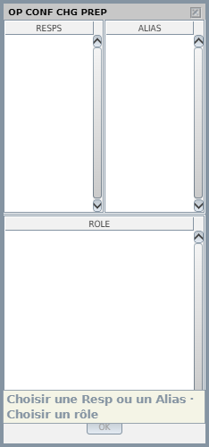

Lists, the Agenda, DyP Info and most other windows are separate windows of the operating
system, not panels drawn in the radar image. You can put them on any screen, and they
come back where you left them.

## Separate windows

These open as separate windows: the Agenda, every flight list, the STAMAN, DyP Info
(dynamic and static), the CPDLC windows of a flight, Messages, System Warning, System
Maps, OP CONF CHG PREP, Teamspeak, ATIS, and the column and SETTING menus of a list.

- They stay **on top** of the radar image: a window you opened never hides behind it.
- They have **no system title bar** and no taskbar button: the radar image is g-atm's
  only entry in the taskbar. Move a window by **dragging** its title strip.
- Their **size** comes from their design; lists, DyP Info and CPDLC windows fit their
  content. Only the **Agenda** can be resized, in height: the taller it is, the more
  minutes its time line shows.
- **Close** a window with its cross, or with the menu entry that opened it. Both do the
  same, and the menu's check box follows.

Menus that open next to a label field (CFL, heading, speed…), the Radar Menu and the
Track Menu are not windows: they live in the radar image and close when you click
elsewhere. The [secondary images](/5g-atm-doc/position/secondary-images/) also live in
the radar image.

## Which screen

| Window | Where it opens the first time |
|---|---|
| **Agenda** | On the secondary screen, the one without the radar image, near its top-left corner. With a single screen, where Windows places it |
| Static DyP Info, CPDLC windows of a flight | At the pointer |
| OP CONF CHG PREP | Under the OE/Role field |
| Any other window | Where Windows places a new window |

After that, every move and resize is saved. A window opens again where you left it, and
the windows open when you quit reopen at the next start, in the same place (except OP
CONF CHG PREP). The position and size of windows are also part of the
[standard configuration](/5g-atm-doc/position/clean-standard/).

### When a screen goes off

When a screen is switched off or unplugged, Windows minimises the windows that were on
it. g-atm keeps their last real place: they come back there when the screen does. A
saved place that no longer touches any screen is ignored, and the window opens as the
first time.

:::caution
A window minimised that way has no taskbar button. Bring the screen back, or close the
window from its menu entry and open it again.
:::

## Cross-highlight

Hover a flight in one place, and g-atm highlights it everywhere:

- on the radar image (its label or its chain head),
- in a list (its row),
- in a Datablock of the Agenda.

The flight's row in every list turns darker and its label on the radar image opens in the
selected format. Hovering a Datablock highlights both of its flights. The dynamic DyP
Info shows the flight whose label you hover. Hovering a list row also keeps the flight on the picture, even if the
filters would hide it (Explicit Focus).

## Tooltips

g-atm shows the 4F tooltip: a cream bubble at the tip of the pointer.

Here the tooltip says that a responsibility (or an alias) and a role are still to be
chosen.

You find tooltips on the OE/Role field (the sectors you are responsible for), on a greyed
button (why it is greyed: a DLK button, the OK of OP CONF CHG PREP), on a `tot` in a
list (the CTOT or "Flight suspended"), on a sector file name (its full name) and in the
Teamspeak window. A tooltip always stays inside its window.

## Windows g-atm adds

The real position has none of these. They are dressed like the 4F input windows: hatched
title strip, title on the left, cross in its box, grey field names.

| Window | How to open it | What it is for |
|---|---|---|
| **Connection to IVAO** | Tools → External Applications → **IVAO Connection** | Host, Port, Voice host, Voice port, Callsign, Name, VID, Password; **Connection** and **Disconnect**. Errors show in red below. It opens under the Global Menu, inside the main window. See [Account settings](/5g-atm-doc/start/configuration/) |
| **Messages** | The envelope of the Global Menu | Text messages with other positions and on frequencies. See [Global Menu](/5g-atm-doc/position/global-menu/#messages) |
| **Teamspeak** | Tools → External Applications → **Teamspeak** | Voice. See [TeamSpeak](/5g-atm-doc/voice/teamspeak/) |
| **ATIS** | Tools → External Applications → **ATIS** | Below |
| **System Maps** | The **MAPS** key (`Home`) | The maps drawn on the image. See [System Maps](/5g-atm-doc/position/system-maps/) |

### ATIS

The ATIS of your position is built by g-atm (voice room, CPDLC station). The ATIS window
adds one line of your own: a remark.

1. Open **Tools → External Applications → ATIS**. The top line reads **ON NETWORK** or
   **OFFLINE**; you can publish only in session.
2. Type the remark (200 characters at most), for example a welcome sentence.
3. **PUBLISH**, or `Enter`. It goes out as `RMK …`, before the CPDLC line.
4. **CLEAR** removes it.

Under **On the network**, the window shows the ATIS exactly as pilots receive it, your
remark highlighted.

---

*4-Flight booklet 3.0: §1.4 (p. 6), §1.10 (p. 10).*
