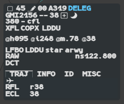
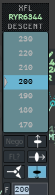
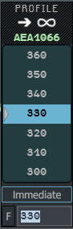

g-atm computes a vertical **profile** for each flight, as Coflight does on the real
system. This page explains the levels it shows you, and the menus that change them: XFL,
EFL and PROFILE.

:::note[IVAO]
There is no Coflight on IVAO. g-atm builds the profile itself from the filed flight plan,
the letters of agreement of the sector files, the clearances and your changes.
:::

## The profile and its levels

The profile climbs as early as possible to the filed levels and descends as late as
possible to the destination, respecting the intermediate filed levels on the way down.
It starts from the flight's present position. Its three phases, **climb**, **cruise** and
**descent**, are set by the top of climb (TOC) and the top of descent (TOD).

| Term | What it is |
|---|---|
| **RFL** | A level filed in the flight plan. You cannot change it |
| **ECL** | A cruise level computed for a part of the route, from the RFLs and your changes. You can change it |
| **Constraint** | A level the letters of agreement impose at a sector boundary. The profile holds it up to the boundary, then goes on to its ECL. A constraint on an arrival is reached at the latest at the boundary |
| **TaFL** | The highest ECL ahead of the flight, up to the exit of the ATSU. In descent, once below its highest ECL, the successive ECLs down to the aerodrome |
| **xRFL** | The filed level in force at your sector exit. Compare it with the XFL to see if the flight can go on to its filed level |
| **ELO** | The level the profile gives at the boundary between two sectors, shown in brackets when nothing is agreed on that transition |

The constraints are the ones written in the letters of agreement of your centre's sector
files: that is how g-atm reads "set locally".

## Where you see them

- The **TaFL** is on the callsign line of the label, after the next sector. **Hover** it to
  read the xRFL: `xRFL:380`. `TAFL` in capitals means the flight has no profile at all.
- The **phase** is the third line of the XFL and EFL menu banner (`CLIMB`, `CRUISE`,
  `DESCENT`). In their list, an `R` follows each filed level of that phase.
- An **ELO** is written in brackets: `(x34)` in the XFL place, `(33)` in the EFL place.
  Enter an XFL (or EFL) to replace it by an agreed level.
- The **Traj** tab of the extended label shows, under the next route points (three at
  most, then `...` if the route goes on), a line **RFL** (`r38`) and a line **ECL** (`38`).
  Each column carries the levels of the segment that leads to its point.
- The **OPText** is a note shared by the centre. When a flight has one, a tag follows the
  TaFL field; **hover** it to read the text. The extended label shows it in full.

The OPText `DCT` has its own line; the Traj tab, past the last route point, shows the
aircraft alone with `RFL r38` and `ECL 38`.

On the base label, the tag follows the TaFL `34`; its tooltip gives the text.

The OPText reaches you from another g-atm position of the centre. It can also be typed
in the **OP_TEXT** field of the Modify SFPL window (see
[Finding and editing plans](/5g-atm-doc/correlation/flight-plans/)).

## The XFL and EFL menus

**Left click** the XFL field to open the XFL menu. On a PREPA Coordinated flight, the
level field shows the EFL: **left click** it to open the EFL menu, which is the same.

1. Scroll the list with the **mouse wheel**.
2. If needed, press a transition or the deferred point button first (see below).
3. **Left click** the level. Or type it in the **F** field and press `Enter`.

The flight is descending, the marker points at its XFL 200, and the floor button is
pressed: the flight leaves by the floor.

| Button | Use |
|---|---|
| **Nego** | Negotiate the level instead of setting it: see [NEGO and FL?](/5g-atm-doc/coordination/nego/) |
| **FL?** | Ask the next sector for a level. Greyed when no next sector is online |
| Deferred point (two triangles) | Choose where the new XFL starts to apply |
| Ceiling, wall, floor (right column) | The transition by which the flight leaves your sector |

The level in force is on a black band, with the marker. The menu opens on it, or on the
ELO.

- An XFL you enter is **underlined** on the label. It is shown as entered, even above the
  TaFL, and g-atm accepts it even if the profile cannot reach it.
- To turn an ELO into an agreed XFL quickly, use the **fake double click** on it: the first
  click opens the menu with the ELO under the pointer, the second one validates it.
- In the EFL menu, the transition and deferred point buttons are greyed. A short
  **middle click** on a level prepares it, as in the CFL menu.
- A held **middle click** on a level runs a simulated filter (see
  [Contextual filters](/5g-atm-doc/conflicts/contextual-filters/)).

### The three transitions

A level can be a floor or ceiling level, or a "wall" level, depending on the sector. The
three buttons on the right are the ceiling (up), the wall and the floor (down). The button
of the present transition is pressed (blue) when the menu opens.

To change the transition, press its button **before** you click the level. The prefix of
the XFL on the label follows: `x` for the wall, an arrow up or down for the ceiling or the
floor (see [Label fields](/5g-atm-doc/labels/fields/)).

### Deferred application point

Use it when the flight should change level later, from a given point.

1. Press the deferred point button, then click the level.
2. The flight's Flight Leg is drawn and the pointer becomes a cross. A mark follows the
   pointer along the leg.
3. **Left click** to choose the point. **Right click** or `Escape` gives up: nothing is set.

### Levels outside your volume

In the CFL, EFL and XFL menus, a level may have a coloured background:

| Background | Meaning |
|---|---|
| Brown | Completely outside your volume: above its highest ceiling or below its lowest floor |
| Grey | Partly outside: some of your volume covers it, some does not (a step) |

By default g-atm shows brown only: an IVAO position often holds a group of sectors, and
grey would cover most of the list. Choose in **Tools** → **External Applications** →
**Local Settings**: **FL Tint: Brown**, **FL Tint: Brown and Grey** or **FL Tint: None**.
See [Local Settings](/5g-atm-doc/reference/local-settings/).

## The PROFILE menu: TaFL and ECL

### Changing the TaFL

To change a flight's **cruising level**, change its TaFL.

1. **Left click** the TaFL field. The PROFILE menu opens: an arrow and the infinity sign
   under the title say the change runs to the end of the profile.
2. Press **Immediate** if needed.
3. Scroll and **left click** the level, or type it in the **F** field.

A TaFL change applies from the flight's entry into your sector, so you may not see it
at once. Press **Immediate** when the flight is not in your sector yet and you want it to
apply from its present position. A flight that will never enter your sector gets it from
its position anyway. The TaFL field is never bold after a change: there is no REV on it.

:::caution
An immediate TaFL change can take the flight completely out of the sector service the
profile had computed.
:::

### Changing an ECL

Use it to keep a flight at a level up to a given point.

1. Open the extended label, **Traj** tab.
2. **Left click** the point. The PROFILE menu opens, with an arrow and the point's name
   under the title.
3. Choose the level.

## What each change does

| Change | Effect on the profile |
|---|---|
| **TaFL** | The profile goes to the new TaFL. A constraint is kept. All later ECLs are overwritten, and earlier ECL changes are erased |
| **XFL** | The TaFL does not change. The new exit level frees the flight from a constraint between sectors, or changes the transition (floor or ceiling to wall, or back) |
| **ECL** | The profile goes to the new ECL up to the chosen point, then to the next ECL |
| **CFL** | In climb, a CFL above the XFL makes the profile go to the next ECL above, and the XFL is updated. Later constraints lower than the CFL (higher in descent) are broken |

Answer two questions, in this order: do I need to change the cruising level (TaFL)? Do I
need to change the exit level (XFL)? And update the exit contract **before** you clear
the flight.

:::note[IVAO]
The XFL you enter is sent on the network with the clearances when you hold the flight.
The EFL, the transition, the deferred point and the TaFL and ECL changes stay on your
position: the network does not carry them.
:::

---

*4-Flight booklet 3.0: §8.1–8.3 (p. 79–94).*
