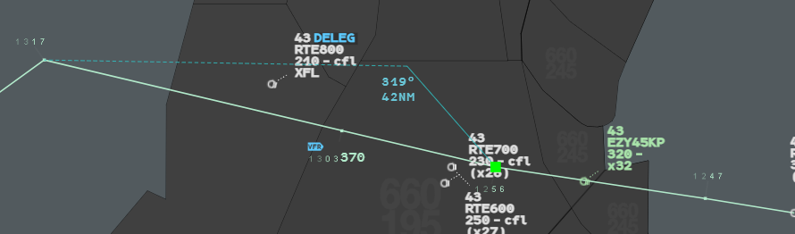
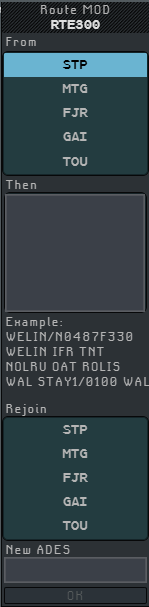
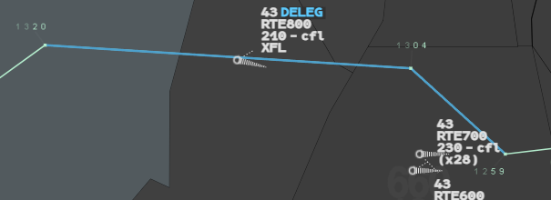
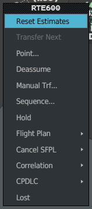

A route modification replaces part of a flight's route: you keep the route up to a point,
add new points, and rejoin the route further on. You can do it on the picture, in the
Route MOD window, or with a direct off the route in the CNAV menu.

:::note[IVAO]
A route modification is an amendment of the flight plan. g-atm sends it with the same
packet as Modify SFPL: the pilot and the other controllers receive the amended route, and
everything that comes from the route (Flight Leg, profile, sectors crossed, labels) follows.
:::

Whatever the way, everything written **between** the start point and the rejoin point is
lost: points, filed levels and speeds, switch points (IFR, VFR, OAT, GAT), STAY. A
modification that starts from the aircraft's position also sets its CNAV to the first new
point.

## On the picture

1. Show the flight's Flight Leg for good: **left click** on the iFlux field (see
   [Flight Leg](/5g-atm-doc/labels/flight-leg/)).
2. **Left click** on the leg, on the segment you want to change. The modification starts
   from the point that begins this segment, or from the aircraft for the first segment.
3. The pointer becomes a cross. A green square marks the start point. A solid line runs
   through the points you choose to the pointer, and a dotted line from the pointer to
   the point where the route will be rejoined. Under the pointer, the bearing and distance
   from the last point chosen (or from the start point).
4. Add points:
   - **left click** near a point: a menu lists the published points around, the nearest
     first. Click one. A **fake double click** takes the nearest;
   - **Ctrl + left click**: a geographic point, written in the route as degrees and
     minutes (`4352N00351E`).
5. Finish:
   - **left click** on a point of the route ahead: the new route rejoins there; or
   - **middle click**: the **Route Edit** menu opens. **Update** rejoins the route along
     the dotted line, from the last point chosen. **Cancel** gives up.

**Right click** or `Escape` leaves without changing anything.

The green square is the start point; the readout `319°` / `42NM` gives the bearing and
distance from it to the pointer.

The rejoin point is the first point of the route, after the start point, that the flight
can reach without turning more than 45°.

## The Route MOD window

Open it from the Callsign Menu: **Flight Plan** → **Route Mod...**.

| Field | What to put |
|---|---|
| **From** | The point where the change starts, picked in the list of the route points (CNAV included). Empty: from the aircraft's position |
| **Then** | The new items, separated by spaces: points, with or without a speed and level group (`WELIN/N0487F330`), switch points (`WELIN IFR TNT`, `NOLRU OAT ROLIS`), a STAY (`WAL STAY1/0100 WAL`) |
| **Rejoin** | The point where the new route joins the old one. Empty: direct to the destination |
| **New ADES** | A new destination, four letters then a space. Not together with Rejoin |

- After each space, g-atm checks the item and moves to the next line. An unknown item
  turns orange.
- In the lists, a click picks a point (black band); a second click removes it.
- **OK** becomes active when at least one field is filled.
- A refused route shows the reason under **OK**: `From repeated in Then`,
  `Rejoin with New ADES`, `Rejoin before From`, `Unknown item`, `Route rejected`.
- A right click, or a click outside, closes the window.

:::note
New ADES only knows the aerodromes of the sector files loaded. A real aerodrome outside
them is refused.
:::

## The CNAV menu: a direct off the route

When you type in the CNAV menu a point that is not on the route, it is a route
modification (see [Route and heading](/5g-atm-doc/clearances/route-heading/)).

1. **Left click** the CNAV field and type the point.
2. Before you validate, a solid line shows the way to the point and a dotted line the way
   back to the rejoin point.
3. Press `Enter`: the route is amended from the aircraft's position and the CNAV is set.

When no rejoin is possible, the Flight Leg stops at the point. The real system then
refuses the input; g-atm sends a simple direct to the point and leaves the plan as it is.
A geographic point with no rejoin is refused.

## A route changed by someone else

When the route of a flight changes and your position did not make the change, the changed
part of the route is drawn in **action blue** over the Flight Leg. You see it only if the
Flight Leg is displayed. This also covers a changed SID or STAR.

**Right click** on the blue part to acknowledge it. Nothing changes on the label: there is
no REV on the callsign. The 3.0 booklet calls this a system behaviour not used
operationally; g-atm keeps it.

:::note[IVAO]
IVAO does not say who amended a plan. g-atm highlights every route change it did not
make itself, whether you hold the flight or not.
:::

## Reset Estimates

**Reset Estimates** is the first entry of the Callsign Menu of an assumed flight whose last
route point was flown over more than 10 minutes ago, unless the flight is in a stack or in
a STAY. It sets the time of that last point to the current time.

g-atm recomputes the estimates from the position all the time, so they are never in the
past and never block a route modification. The entry is kept for the same situations as
on the real system.

The 3.0 booklet no longer offers it for a flight that was never correlated: that flight's
menu starts with **Modify ETO...** only.

---

*4-Flight booklet 3.0: §8.4 (p. 94–99).*
