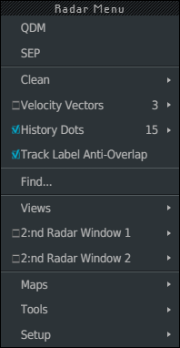

All the gestures of g-atm on one page, grouped by what you want to do. Each row links to
the page that explains it.

## The rules behind every gesture

g-atm follows the 4F logic:

- **Left click** opens a menu, picks a value, adds to a group.
- **Right click** cancels, acknowledges or removes. In a menu, it closes the menu
  without validating anything.
- **Middle click** marks a field, or prepares a value in a menu.
- **Ctrl + left click** opens the context menus (Radar Menu, Track Menu) and a few
  variants.
- **Fake double click**: two left clicks without moving. The first click opens a menu
  with the likely choice already under the pointer; the second takes it. It is not a
  system double click: take your time between the two.
- A **cross-shaped pointer** means a tool is waiting for you to pick flights or points.
  Right click or Escape leaves it.

## Moving around the picture

| Gesture | Effect |
|---|---|
| **Drag** on the picture (left button) | Move the picture. |
| **Mouse wheel** on the picture | Zoom in or out around the pointer. |
| **Ctrl + left click** on the empty picture | Radar Menu. |
| **Ctrl + left click** on a track symbol | Track Menu of that flight. |

See [Moving around the picture](/5g-atm-doc/position/navigation/) and [Radar Menu and
Track Menu](/5g-atm-doc/position/radar-menu/).

## Labels

| Gesture | Effect |
|---|---|
| Hover a label | Selected format. |
| **Mouse wheel** on a label | Extended format on its TRAJ tab; more notches move through TRAJ, INFO, ID, MISC. The label folds back when the pointer leaves it. |
| **Drag** a label (left button) | Move it. The leader returns to its default length after a few seconds. |
| **Left click** on a field | The menu of that field (see the table below). |
| **Middle click** on a field | Suite Highlight (rust background, seen by your suite). Again: removed. |
| **Ctrl + middle click** on a field | Local Highlight (pink text, your screen only). Again: removed. |
| **Middle click held** on CFL, XFL, ADES or the CR field | Contextual filter, for as long as you hold the button. |
| **Right click** on the callsign, iFlux, Icoop or a field in REV | Seen / REV acknowledgement. |

See [Label formats and tabs](/5g-atm-doc/labels/formats/), [Highlights, warnings, Track
Ring](/5g-atm-doc/markings/highlights/) and [Contextual
filters](/5g-atm-doc/conflicts/contextual-filters/).

### Field by field

| Field | Left click | Other gestures |
|---|---|---|
| Callsign | Callsign Menu, first row under the pointer (Assume, Transfer Next…) | **Ctrl + left click**: add to or remove from the analysis group |
| CFL | CFL menu, opened on the exit level | Right click: cancel a failed datalink level |
| XFL | XFL menu, opened on the ELO | |
| EFL (PREPA coordinated) | EFL menu | |
| TaFL | PROFILE menu (cruise level) | |
| CNAV (next point) | Waypoint menu | |
| Heading | AHDG menu | Right click: remove the assigned heading |
| GS (speed) | ASP menu | **Ctrl + left click**: individual speed vector. Right click: remove the assigned speed |
| Rate | VRCD menu | Right click on the rate: remove it |
| Expedite symbol | | Right click: remove it |
| NS (next sector) | Manual Transfer menu, planned sector under the pointer: a second click shoots it | With **CPDLC** (`Alt`) held: transfer by datalink. **Ctrl + right click**: mask or unmask NS. Right click: acknowledge |
| CR (extended label) | Chg Com Resp menu | |
| iFlux or ADES (extended label, lists) | Show the Flight Leg permanently; again to remove it | |
| Xdata / Edata | XCOOR / ECOOR menu | |
| iCoor pencil or envelope | iCoor menu (the note is read) | Hover five seconds: read. Right click on the envelope: delete |
| Icoop | Acknowledge, or undo | Right click: same |
| Received POINT | Answer Point menu | Right click on several POINTs: End Point |
| NEGO symbol | Accept | Right click: refuse (or cancel your own) |
| SHRQ mnemonic | | Right click: hide it on your screen |
| Line 0 mentions (PS, STLN, DELEG, iNS, APW) | | Right click: acknowledge |
| Sequence number | | Right click: clear it |
| Pilot request (CPDLC) | Quick Response menu | Right click on a late request: acknowledge |
| Failed CPDLC dialogue | | Right click: acknowledge, or its CANCEL menu |
| CODE alert | With **CPDLC** (`Alt`) held: Change Squawk by datalink | |
| STAY mention | STAY EXIT menu | |
| NRAC (extended label) | NRAC menu | |
| RVSM (extended label) | RVSM menu | |

## Value menus

CFL, XFL, EFL, Waypoint, AHDG, ASP, VRCD and the other value menus share these gestures:

| Gesture | Effect |
|---|---|
| **Left click** on a value | Issue it. |
| **Mouse wheel** in the list | Scroll the values. |
| Type in the field, Enter | Issue a value that is not in the list. |
| **Middle click** on a value (CFL, Waypoint) | Prepare it without issuing it. The menu reopens on it. |
| **Ctrl + middle click** on the prepared value | Remove the preparation. |
| **DLK** or the **CPDLC** key (`Alt`), then a value (clearance menus) | Send it by datalink. |
| **Right click** in the menu, or a click outside it | Close without issuing anything. |
| Escape | Close without issuing anything. |

In the Manual Transfer menu, **SCH** lists the online positions on the flight's planned
route and **DELEG** the others; ↑ / ↓ or typing picks a row, Enter takes it.

See [Levels: the CFL menu](/5g-atm-doc/clearances/levels/) and [Manual transfer, NS,
DELEG](/5g-atm-doc/frequency/transfer/).

## Analysis tools

| Gesture | Effect |
|---|---|
| **Left click** on a track symbol | Add the flight to the analysis group, or remove it (eight flights at most). |
| **Drag** a track symbol of the group | Extrapolate the group along their routes. |
| **Ctrl** held when you release the drag | Store the situation as a Datablock in the Agenda. |
| **Mouse wheel** over a group member (three flights or more) | Change the flight paired in the SEP / QDM display. |
| **Right click** on the picture | Delete the whole group. |
| **Middle click** on a track symbol | Warning: blue, then orange, then yellow. |
| **Right click** on a track symbol | Remove its warning. |
| QDM key, then two **left clicks** | QDM between two flights, or a flight and a point. |
| SEP key, then two **left clicks** | SEP between two flights. |
| **Mouse wheel** on a QDM label | Show or hide the CPA. |
| **Right click** on a SEP or QDM | Delete it. |
| **Right click** on a Flight Leg | Remove it (or acknowledge someone else's route change). |
| **Left click** on a Flight Leg segment | Graphical route modification. |
| **Left click** on a Range Rings circle | Select it: handles appear to move, resize or set the arc. |
| Delete | Delete the selected Range Rings. |

See [Group, SEP, QDM, CPA](/5g-atm-doc/conflicts/group-sep-qdm/), [Range
Rings](/5g-atm-doc/conflicts/range-rings/), [Agenda and
Datablocks](/5g-atm-doc/conflicts/agenda/) and [Changing the
route](/5g-atm-doc/profile/route/).

## Lists

| Gesture | Effect |
|---|---|
| Hover a row | The flight is highlighted on the picture. |
| **Left click** on a row | Callsign Menu. |
| **Left click** on an interactive cell | That field's menu. |
| **Right click** on a row | Seen acknowledgement. |
| Enter | Same as a left click on the row. |
| ↑ / ↓ | Move the flight up or down the sequence, in a Sequencing List. |

## The 4F keys

The real position has a dedicated keyboard. g-atm gives each of its keys a PC key. The
keys do nothing while you type in a field, with Ctrl, Alt or Cmd held, or when held down
(one press, one action).

| 4F key | PC key | Effect |
|---|---|---|
| **VUE 1**, **VUE 2**, **VUE 3** | `F1`, `F2`, `F3` | Recall view 1, 2 or 3 of your standard. |
| **Visu STD** (Default) | `F4` | Back to the standard filters; brings back the secondary images. |
| **Conf. STD** | `F6` | Recall the standard configuration. |
| **iFlux** | `F7` | Show or hide the iFlux field in the base label. |
| **MIL** | `F8` | Show or hide military flights. |
| **VFR** | `F9` | Show or hide VFR flights. |
| **Tous vols** (See ALL) | `F10` | See ALL on or off. |
| **Filtre +1000 ft** | `Page Up` | Raise the upper level filter by 1,000 ft. |
| **Filtre −1000 ft** | `Page Down` | Lower the lower level filter by 1,000 ft. |
| **MAPS** | `Home` | Open or close System Maps. |
| **CLEAN** | `End` | CLEAN Tools: clear the analysis leftovers. |
| **Type avion** | `Insert` | Show or hide the aircraft type in the base label. |
| **Label STD** | `Pause` | Base label back to its standard fields. |
| **Note** | `Scroll Lock` | Put a Notepad on the picture. |
| **AMID** | `Space` | Over a label: open the AMID. Again: close it. |
| **CPDLC** (DLK) | `Alt` | Arms datalink for the next clearance, like the DLK button; held while you click the NS field, a datalink transfer. |
| **Find** | `F` | Open the FIND window. |
| **QDM** | `Q` | Arm the QDM tool. |
| **SEP** | `S` | Arm the SEP tool. |
| **verrouiller SEP** | `L` | Lock the SEP shown, so it stays. |
| **VV ON/OFF** | `V` | Speed vectors on or off. |
| **VV 1'**, **VV 3'**, **VV 6'** | `1`, `3`, `6` | Speed vector length: 1, 3 or 6 minutes. |
| **RR On/Off** | `R` | Show or hide the Range Rings. |
| **Quick RR** | `T` | Arm a quick Range Rings placement. |

Letters work with or without Caps Lock.

## Other keys

| Key | Effect |
|---|---|
| Escape | Close a value menu; cancel a Range Rings placement. |
| Enter | Validate the value typed in a menu field. |
| Delete | Delete the selected Range Rings. |
| Your push-to-talk key | Transmit. Default **Ctrl + Shift + Space**, set in the [Teamspeak window](/5g-atm-doc/voice/teamspeak/). |

:::caution
If your push-to-talk key is also a 4F key, push-to-talk wins and the 4F action does not
fire. Avoid `Space` (AMID) and the keys above.
:::

:::note[Next version]
In the next version, secondary images take every gesture of the main picture: their
own tools, Range Rings and maps, with the same labels and menus.
:::
