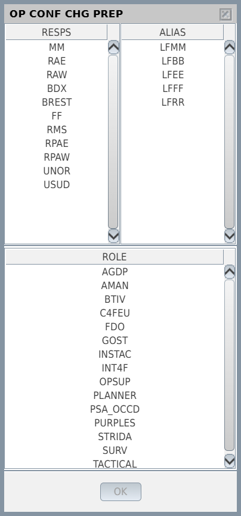
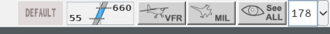
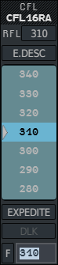
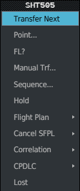

This page walks you through one short session: load the maps, choose your position,
connect, read the picture, assume a flight, give it a level and transfer it. Each step
links to the chapter that explains it in full.

Before you start, [install g-atm](/5g-atm-doc/start/install/) and check that your
`op_config.json` describes your centre ([OP CONF and PREPA
mode](/5g-atm-doc/cco/op-conf/)).

## 1. Launch

Start g-atm a minute before your session. If an update is available, it installs and
g-atm restarts on its own. You then see the Global Menu across the top and the radar
picture below.

## 2. Load the sectors

Open **Tools → External Applications → Sector File**.

- First time: **Install…** a sector package from your disk, or type its IVAO ID in
  **Sector ID** and press **Download**.
- Then tick the sector file of your centre in the list. The maps appear at once.

You only do this once: g-atm loads the same file at the next launch. See [Sector
files](/5g-atm-doc/start/configuration/#sector-files).

## 3. Choose your position

Click the **role field** in the centre of the Global Menu (it reads `------/------` until
you choose). The **OP CONF CHG PREP** window opens.

1. Pick a responsibility in **RESPS**, or a whole grouping in **ALIAS**.
2. Pick your role in **ROLE**, for example `TACTICAL`.
3. Press **OK**.

The role field now shows your choice, for example `RAW/TACTICAL`. Doing this before you
connect means g-atm announces the right frequency from the first second. You can change
it at any time during the session: see [OP CONF and PREPA mode](/5g-atm-doc/cco/op-conf/).

## 4. Connect

Open **Tools → External Applications → IVAO Connection**. Check the fields (host,
callsign, name, VID, password; see [Account settings](/5g-atm-doc/start/configuration/))
and press **Connection**.

When the session opens:

- traffic appears on the picture;
- voice connects to the Voice host and puts you in a channel named after your callsign
  (see [TeamSpeak](/5g-atm-doc/voice/teamspeak/));
- if datalink is set up, your CPDLC station comes online
  (see [Setting up datalink](/5g-atm-doc/cpdlc/setup/)).

## 5. Read the picture

Each flight is drawn in the colour of its state for your position:

| Colour | State | Meaning |
|---|---|---|
| Green | PREPA | Coming to you |
| White | RESP | Yours: you control it |
| Light grey | SURV | No longer yours, still worth watching |
| Dim grey | AUTRE | Of no interest to you a priori |

See [States and colours](/5g-atm-doc/flights/states/).

Set the level band of your sector in the **Filter Area**, at the right of the Global
Menu: the two numbers are the lower and upper levels shown. Flights that concern you
stay visible whatever the band.

**Drag** the picture with the left button to move it, turn the **mouse wheel** to zoom.
See [Moving around the picture](/5g-atm-doc/position/navigation/) and [Filter Area and
filtering](/5g-atm-doc/position/filters/).

## 6. Assume a flight

A flight transferred to you is **assumable**: its label is still green, its callsign
turns white.

1. **Left click** its callsign. The **Callsign Menu** opens with **Assume** right under
   your pointer.
2. **Left click** again without moving: the flight is assumed and its label turns white.

These two clicks are the 4F **fake double click**: the first opens a menu with the
likely choice under the pointer, the second takes it. See [Assume and
shoot](/5g-atm-doc/frequency/assume-shoot/).

## 7. Give a level

1. **Left click** the **CFL** field of the label (the cleared level). The CFL menu opens.
2. **Left click** the level you clear, or type it in the field at the bottom and press
   Enter.

Say the clearance to the pilot on the frequency: the label is your record. To clear by
datalink instead, see [Sending clearances](/5g-atm-doc/cpdlc/uplinks/). Speed, heading
and directs work the same way, on their own fields: see [Levels: the CFL
menu](/5g-atm-doc/clearances/levels/) and the next pages.

## 8. Transfer it

When the flight is about to leave your sector:

1. **Left click** its callsign. On a flight you control, the first row of the Callsign
   Menu is **Transfer Next**.
2. **Left click** **Transfer Next**: the flight is shot to the next sector, and its
   callsign turns grey until the next controller assumes it.

To hand it to another position, **left click** the **NS** field (next sector) instead and
pick the position in the Manual Transfer menu. See [Assume and
shoot](/5g-atm-doc/frequency/assume-shoot/) and [Manual transfer, NS,
DELEG](/5g-atm-doc/frequency/transfer/).

## 9. Disconnect

Open **Tools → External Applications → IVAO Connection** and press **Disconnect**. Voice
closes with the session, and the CPDLC sessions are ended. You can connect again
without restarting g-atm.

## What to read next

| If you want to | Read |
|---|---|
| Know the screen | [The screen](/5g-atm-doc/position/layout/) |
| Know every field of a label | [Label fields](/5g-atm-doc/labels/fields/) |
| Have every gesture and key in one place | [Mouse and keyboard](/5g-atm-doc/reference/mouse-keyboard/) |
| Measure and separate | [Group, SEP, QDM, CPA](/5g-atm-doc/conflicts/group-sep-qdm/) |
| Control by datalink | [CPDLC overview](/5g-atm-doc/cpdlc/overview/) |
