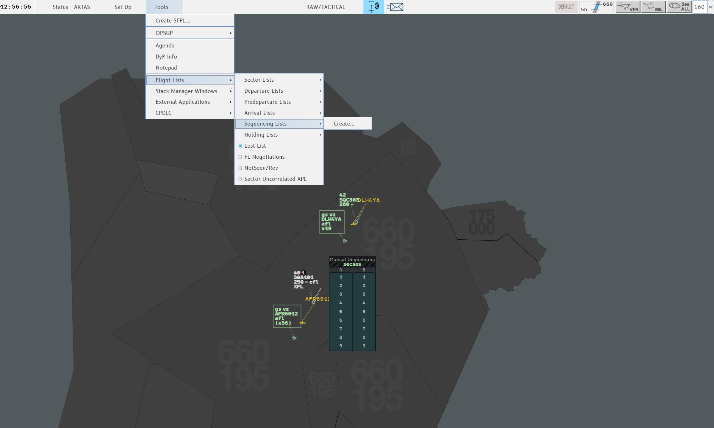

g-atm is an air traffic control client for the **IVAO** network. It reproduces
**4-Flight** (4F), the system of the French en-route control centres: its screen, its
labels, its menus, its colours and its working methods.

## Who it is for

IVAO controllers working an en-route (CTR) or approach (APP) position who want the
4-Flight working environment. The guide assumes you already know how to control: it
explains the software, not the job.

If you know the real system, the guide follows the chapter order of the 4-Flight
training booklet, so you can go from a booklet chapter to the same chapter here.

## How it works

There is no toolbar full of buttons. Almost everything is done **on the label**: you
click the field you want to change, a small menu opens next to it, you pick a value. The
rest lives in the **Global Menu** across the top of the screen (Status, Set Up, Tools)
and in two context menus, the Radar Menu and the Track Menu.

The top band holds the clock, the Status, Set Up and Tools menus, your position and role
in the centre, the message icons, and the Filter Area on the right.

## What it gives you

- A radar picture with sector maps, tracks, comets, speed vectors and labels in the 4F
  formats (base, selected, extended with its tabs).
- The 4F flight states and colours: PREPA, RESP, SURV, AUTRE.
- Clearances from the label: level (CFL), exit and entry levels (XFL, EFL), route and
  directs, heading, speed, rate.
- Frequency states: assume, shoot, manual transfer, SKIP, SHRQ, Reclaim, LOST.
- Coordination: POINT, NEGO, FL?, iCoor notes, highlights (most of it between g-atm
  positions, see below).
- Analysis tools: group, SEP, QDM, CPA, extrapolation, Range Rings, Agenda and
  Datablocks.
- Safety nets and monitoring: STCA, TCT, APW, CLAM, INTRU and the alert lists.
- Arrivals and departures: sequencing, runway and STAR, holds, STAMAN, departure lists.
- Configuration changes: the OP CONF CHG PREP window, splitting and grouping sectors.
- **CPDLC** over the Hoppie network.
- **Voice** over the IVAO TeamSpeak servers, connected with your network session.

## What was built

g-atm was first brought to parity with the booklet *4-Flight pour les nuls*, version
2.1, chapter by chapter: each section of the booklet was compared with the application,
fixed, and checked on a traffic simulator. Version **2.0.0** then follows the newer
booklet, *Livret 4-Flight version 4F3.0*: new alerts (APW), new menu entries, local
settings, and the many small changes between the two editions.

## What it is not

- **Not a pilot client.** It connects as an ATC position only.
- **Not a tower or ground client.** The screen and tools are built for radar control.
- **Not the real 4-Flight.** It runs on what the IVAO network carries. There is no
  CoFlight flight data processing, no OLDI link between centres, and no Mode S downlink
  on IVAO. A simple POINT reaches other IVAO clients; the other coordination tools (NEGO,
  FL?, iCoor…) and the data a suite shares work between g-atm positions only.
- **Not complete.** Some booklet chapters were left out on purpose (degraded modes, the
  backup screen, defence tools) and a few functions have nothing behind them on IVAO.
  The list, with the reasons, is in [What g-atm does not
  do](/5g-atm-doc/reference/not-implemented/).
- **Not a substitute for your division's rules.** Procedures, letters of agreement and
  phraseology are still yours to follow.

## Platforms

g-atm is a desktop application. Each release provides installers for **Windows**
(x86-64), **macOS** (Apple Silicon and Intel) and **Linux** (x86-64). It is developed and
tested on Windows. See [Install and update](/5g-atm-doc/start/install/).

:::note
Opening an IVAO session is limited to the VIDs on g-atm's access list. If your VID is
not on it, the connection is refused: ask the maintainer of g-atm.
:::
