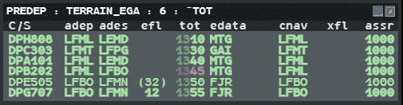
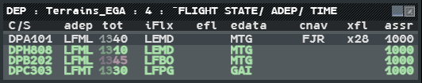
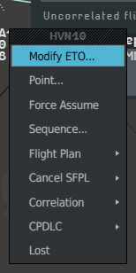

Departures from airfields near your area can show on the radar late. Two lists let you see
them earlier: the **Pre-departure List** and the **Departure List**. Both hold flight plans
that the radar has not correlated yet.

:::note[IVAO]
On the real system a departure is "uncorrelated" until the radar sees it climb. The network
gives a position even for an aircraft at the gate, so g-atm counts as uncorrelated a plan
with no track (created at your position, track lost, correlation cancelled) or a plan whose
aircraft is still **on the ground**. A flight leaves both lists when it correlates, which on
IVAO means when it takes off. An aircraft on the ground near its destination has landed: it
is not a departure.
:::

## The Pre-departure List

The Pre-departure List is the wake-up list: it lets you find the flights to activate.
Open it from **Tools → Flight Lists → Predeparture Lists**, then the list you want, or
**Create...** to make one for an airport (dialogue **ADEP**; see
[Lists by airport](/5g-atm-doc/traffic/sequencing/#lists-by-airport)).

It holds the uncorrelated plans of its airports whose flight is **PREPA** (coordinated or
not) or **RESP** (see [States and colours](/5g-atm-doc/flights/states/)), and the plans
created at your position that are not activated yet. It opens sorted by departure time
(`^TOT`) and shows 12 flights before a scrollbar.

| Column | Meaning |
|---|---|
| `C/S` | Callsign. **Left click**: the Callsign Menu, with **Activate** first while the plan is not activated |
| `adep`, `ades` | Departure and destination |
| `efl` | Entry level, in brackets while only estimated |
| `tot` | Departure time of the filed plan, hours dim, minutes bright. **Left click**: change it |
| `edata` | Entry point into your volumes |
| `cnav` | The departure airfield until the plan is activated, then the flight's next route point |
| `xfl` | Exit level. Often empty for an aircraft still on the ground |
| `assr` | Assigned code |

A **pink** `tot` means the flight has a CTOT (the tooltip gives it). An **orange** `tot`
means the flight is suspended (tooltip "Flight suspended").

:::caution[IVAO]
The network has no CTOT and no suspended flights: only the simulator shows them.
:::

## The Departure List

The Departure List shows the **activated** flights from its airports, as long as their plan
is not correlated. Open it from **Tools → Flight Lists → Departure Lists**. With
**Create...**, a dialogue asks for the airport.

You find in it most of what the selected label would show:

| Column | Meaning |
|---|---|
| `C/S`, `adep` | Callsign, departure |
| `tot` | Departure time. **Left click**: change it |
| `iFlx` | Inbound flux |
| `efl`, `edata` | Entry level and entry point |
| `cnav` | Next route point |
| `xfl` | Exit level |
| `assr` | Assigned code |

It is sorted by flight state, then airport, then time (`^FLIGHT STATE/ ADEP/ TIME`). The
column menu also offers `atyp`, `ades` and `cfl`.

Departure Lists set up in advance for your position pop up: they open by themselves as soon
as a flight enters them. Lists you create do not.

## Activate a flight

On IVAO there is no activation message from the airfield: you always activate by hand, and
the activation stays on your position.

1. Find the flight: in the Pre-departure List, on the radar, or with **FIND** (see
   [Finding and editing plans](/5g-atm-doc/correlation/flight-plans/)).
2. Open the **Callsign Menu**.
3. Left click **Activate** (the first entry of a plan not yet activated). The flight is
   activated and moves to the Departure List.

A plan with no track then shows on the radar as an FPASD at its theoretical position. Its
label follows the flight state (PREPA coordinated or RESP), with `gs` and `vz` in line 0 and
the CFL never hidden. See [FPASD and lost tracks](/5g-atm-doc/correlation/lost-tracks/).

## Change the departure time

While the flight has not taken off:

1. Left click the `tot` cell of its row, in either list. A **TOT** entry opens on the radar
   picture.
2. Type the time on four digits (`HHMM`) and press **Enter**.

The filed plan is amended on the network (its departure time, like the EOBT field of the
Modify SFPL window).

## Change the entry time of a late flight: Modify ETO

For an active plan that the radar has never correlated (a plan created at your position, or
a flight on the ground you activated), the Callsign Menu starts with **Modify ETO...** and
has no **Hold**.

1. Open the Callsign Menu (from the radar or from FIND).
2. Left click **Modify ETO...**. An **ETO** entry opens.
3. Type the time on four digits and press **Enter**.

The time you enter is the flight's entry time into your volumes (the `etn` column of the
lists) until it correlates. The theoretical position of a plan with no track moves by the
same amount.

A plan that has lost its track keeps the menu of its flight: no **Modify ETO...**.

---

*4-Flight booklet 3.0: §13.3 (p. 175–178).*
