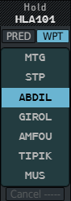
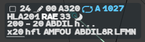
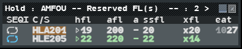
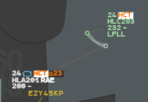

A hold constraint says that a flight will hold on a point. g-atm then shows the hold on the
label, lists the flight in the Holding List of the point, and watches the stack for
overlapping levels.

## Enter a hold

1. Left click the callsign, then **Hold** in the Callsign Menu. The **Hold** menu opens.
2. Choose a tab:
   - **PRED**: the predefined stacks of your position that the flight's route goes
     through;
   - **WPT**: the named points of the route still ahead of the flight, for a hold on a
     point that is not predefined.
3. Left click the point. The menu closes.

The menu always opens on **PRED**. Both tabs list only points the flight still has to
pass, from its next point or from its current direct: the trajectory must go through the
hold point. The departure and destination airports are not offered, nor a point whose
entry the flight has already overflown.

At the bottom, **Cancel -----** is greyed while there is no hold; with a hold it carries
the point name (**Cancel ABDIL**, for example) and cancels it. **Escape** or a click
outside closes the menu.

:::note[Predefined stacks]
The predefined stacks and their level bands come from `predefined_holds.json` in the
`sectors` folder of the application data, chosen by the prefix of your position callsign.
Without the file, PRED is empty and holds still work through WPT. See
[Files and folders](/5g-atm-doc/reference/files/).
:::

The Callsign Menu has no **Hold** for an abbreviated plan (APL) or for a plan never
correlated.

## On the label

Once the hold is entered, three fields appear in line 0, after the aircraft type on the
selected label (after the speed on the base label), before any mention:

| Field | Meaning |
|---|---|
| **SEQi** | The holding symbol (two circling arrows) |
| Stack letter | First letter of the stack. Selected label only |
| **EAT** | Expected approach time, or the `eat` mnemonic while none is set. Selected label only |

On the selected label, line 3 carries the **HFL** (holding level), or the `hfl` mnemonic.

The SEQi, the letter and the EAT are **blue** until you have passed them to the pilot:

- **right click the SEQi** when the hold clearance is passed: it takes the label colour;
- **right click the EAT** when the expected approach time is passed.

**Left click the SEQi** to open the Hold menu again (to cancel the hold, for example).

## Expected approach time: the EAT menu

1. Left click the EAT field. The **EAT** menu opens.
2. Type the time on four digits (`HHMM`) and press **Enter**.

The EAT shows in blue until you acknowledge it with a right click. To remove it, open the
menu and left click **Cancel EAT** (greyed while no time is set).

:::caution[Cancelling a hold keeps the EAT]
Cancelling a hold does not remove its EAT, except for a hold on the IAF (set up in the
stack's settings, otherwise the last point of the flight's STAR). The SEQi and the stack
letter turn **yellow**, the EAT stays, and the flight stays in the Holding List: cancel the
EAT by hand. The HFL, which belongs to the stack, goes with the hold.
:::

## Holding level: the HFL menu

1. Left click the HFL field (`hfl`). The **HFL** menu opens, seven levels at a time.
2. Left click the level you want.

The menu opens on the current HFL or, without one, on the level the system computes for
leaving the stack: the lowest of the flight's level at the hold point (from its profile,
when the hold was entered), its CFL (cleared level, see the
[glossary](/5g-atm-doc/reference/glossary/)) and its HFL. A predefined stack offers only
its own band of levels; a hold on a route point offers 660 down to 010.

### Reserve a level

**Middle click a level** in the HFL menu to reserve it in the stack. The level turns grey
and can no longer be chosen, except by the flight that already holds it. Middle click it
again to release it. Reserved levels also show in the title of the Holding List.

### On the base label

On the base label the HFL is hidden. It shows there, in line 3, when you mark it
(**middle click** the field on the selected label, see
[Highlights](/5g-atm-doc/markings/highlights/)) or when it is in REV.

### HFL rules

- **In the hold:** once the flight has entered the hold volume, a CFL you enter also becomes
  its HFL.
- **Before the hold:** if the CFL is lower than the HFL, the HFL turns to the alert colour
  (orange-yellow) on the label and in the list.
- The HFL never changes the exit level (XFL): the 3.0 booklet removed that rule.

## Cancel a hold

A hold stays as long as the flight's trajectory goes through its point.

- The **Cancel** entry of the Hold menu (open it from the Callsign Menu or the SEQi).
- A **direct** beyond the hold point, or off the route, cancels it. A direct to the hold
  point, or to a point before it, keeps it.
- A **route modification** that removes the point cancels it.
- A **heading** cancels it once the flight is inside the hold volume. Before that, a
  heading is taken as vectoring towards the hold.

Once the flight has overflown the entry point, you cannot hold it again on that point. To
make the point available again, modify the route so that it passes through the point once
more, with an intermediate point (see [Changing the route](/5g-atm-doc/profile/route/)).

## The Holding List

The Holding List shows the flights holding on one point. For a predefined stack it opens
by itself with the first hold entered, and closes with its last hold. For a hold on a route
point it never opens by itself: **Ctrl + left click the SEQi** of a holding flight. You can
also open it from **Tools → Flight Lists → Holding Lists**, entry `Hold : <point>`.

The title reads `Hold : <point> -- Reserved FL(s) <levels> -- : <number of flights>`. The
list is sorted by HFL, lowest first; **Shift + left click** a header for another sort.

| Column | Meaning |
|---|---|
| `SEQI` | Holding symbol, blue until acknowledged. **Left click**: the Hold menu |
| `C/S` | Callsign |
| `hfl` | Holding level. **Left click**: the HFL menu |
| `afl` | Actual level |
| `a` | Climb or descent symbol, as on the label |
| `ssfl` | Selected level downlinked by the aircraft (simulator only) |
| `xfl` | Exit level, with its exit-side prefix; in brackets when only proposed |
| `eat` | Expected approach time, blue until acknowledged. **Left click**: the EAT menu |

The column menu also offers `point` (the hold point) and `ovl` (the flight is in Overlap
alert). The common list gestures are in
[Sequencing arrivals](/5g-atm-doc/traffic/sequencing/#working-in-a-list).

## Overlap alert (HCT)

Flights that hold and have overflown their entry point are no longer checked by the TCT.
The Overlap alert covers the hold volume instead, for **predefined stacks only**.

The **HCT** mention appears in line 0 of both labels, orange on a flashing block, and
their leader lines turn orange, when:

- at least one of the two flights is RESP;
- one of them holds on the stack and has overflown its entry point;
- the other is in the hold volume, or about to enter it within two minutes;
- the vertical gap between their level bands is less than 1,000 ft. A flight's band goes
  from the lowest to the highest of its actual level, its selected level and its CFL.

TCT conflicts of a flight that holds and has overflown its entry point are dropped. See
[Safety nets](/5g-atm-doc/alerts/safety-nets/) for the TCT.

:::note[The hold volume]
The booklet does not give the shape of a hold volume. g-atm uses a disc of 10 NM around the
point, with no level limits; a flight has "overflown" the point within 2 NM of it.
:::

## Hold on a point that is not predefined

Use the **WPT** tab. Such a hold has no volume and its HFL menu goes from 660 down to 010.
Its Holding List does not open by itself (**Ctrl + left click** the SEQi), and it has no
Overlap alert.

## Two holds on one flight

You can enter a second hold while the first is in force: open the Hold menu again and
choose another point. The second hold shows on the label only once the first is finished
(cancelled). With two holds entered, the Hold menu shows its tabs greyed and an empty list,
with only its **Cancel** entry at the bottom.

## Shared with the other positions

The hold of a flight (point, HFL, EAT, clearance passed, cancellation) is shared with the
other g-atm positions of your centre. An HFL set by another position arrives as a **REV**:
bold, shown on the base label, right click to acknowledge. Your reserved levels and your
acknowledgement of the EAT stay on your position. See
[Sharing between positions](/5g-atm-doc/cco/sharing/).

---

*4-Flight booklet 3.0: §13.2.a–f (p. 164–168).*
