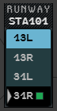
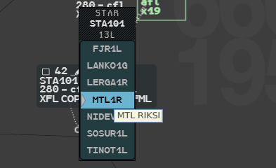
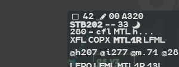
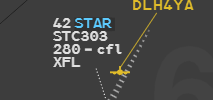

For an arriving flight you can allocate a runway and a STAR. g-atm builds the flight's
route on them, and follows the runway in service at the destination.

## Where the fields are

| Field | Where |
|---|---|
| Runway (`arwy`) | Extended label, line `ADEP ADES STAR arwy`; `rwy` column of the Arrival List |
| STAR | Extended label, same line; selected label, line 3, between the exit point and the destination (only with the Athis Rule, see [Short STARs](#short-stars)) |

Hover the STAR field: a tooltip gives the first five points of the STAR. In the extended
label, hovering the destination or the iFlux gives the STAR name (nothing when the flight
has none). The fields are described in [Label fields](/5g-atm-doc/labels/fields/).

## Change the runway

1. Left click the runway field of the extended label, or the `rwy` cell of the Arrival
   List. The **RUNWAY** menu opens.
2. Left click the runway you want. The runway is updated and the menu closes.

The menu lists the runways of the destination in the order of their designation. The
flight's runway is on a black row, after a triangle. The **green square** follows the
runway in service.

A runway you choose is an allocation: the flight no longer follows a change of runway in
service (see below).

:::note[Runways and runway in service]
g-atm lists every runway threshold the navigation data gives for the airport. The real 4F
takes the runway configuration from OPSUP; g-atm takes it from the wind of the airport's
METAR (one runway in service per airport), read again as the wind changes. On the
simulator, the scenario can impose it.
:::

## Change the STAR

1. Left click the STAR field (selected or extended label). The **STAR** menu opens, its
   row on the field you clicked.
2. Left click the new STAR. The STAR is updated and the menu closes.

The title shows the callsign and the flight's runway. The menu lists the STARs of that
runway in alphabetical order, seven rows at a time, and opens on the STAR in force
(triangle). Hover a row to see its first five points.

### Freeze the STAR

Open the STAR menu and left click the STAR **already in force**. It becomes an
allocation: a later change of runway in service will not replace it.

## When the runway in service changes

When the runway in service of a destination changes, g-atm tries to give a new STAR to the
flights concerned: flights bound for that airport that have a STAR and whose runway you did
not allocate yourself. g-atm checks the runway in service every 20 seconds.

- **It works.** The flight's route is rebuilt on the new runway. The STAR field is shown in
  **REV**, in bold (with the Athis Rule on, it shows even on the base label); right click
  it to acknowledge. The exit
  level and the next sector, recalculated, get their own REV if they change. REV is
  explained in [Seen, Not Seen and REV](/5g-atm-doc/flights/seen-rev/).
- **It fails.** The flight keeps its STAR and the runway of the old configuration, and a
  blue **STAR** mention closes line 0 of the label: the STAR is invalid. Right click the
  mention to acknowledge it.

The reallocation fails when:

- the flight has already started its STAR;
- the flight is on a direct to a point beyond the start of the STAR;
- the STAR was frozen.

A flight whose STAR serves both configurations keeps it, with no REV and no mention.

## Short STARs

Short STARs exist only by local setting: no navigation data has them. g-atm can derive
one for each named point of each STAR after the first: the STAR taken from that point,
named after the point, a `0` and the last letter of the STAR (for example `ALARO0E`). This
is the rule of Paris-Athis.

Turn it on in **Tools → External Applications → Local Settings → Athis Rule (STAR, Short
STARs)**. It is off by default, and your choice is kept from one launch to the next (see
[Local Settings](/5g-atm-doc/reference/local-settings/)).

| Athis Rule | Short STARs | STAR on the label |
|---|---|---|
| On | Listed in the STAR menu with the others | Selected label (line 3), base label when in REV, extended label |
| Off (default) | None | Extended label only |

Allocating a short STAR by hand raises the blue **STAR** mention: right click it to
acknowledge. A short STAR already allocated stays the flight's route if you turn the rule
off afterwards.

---

*4-Flight booklet 3.0: §13.1.c–d (p. 159–163).*
